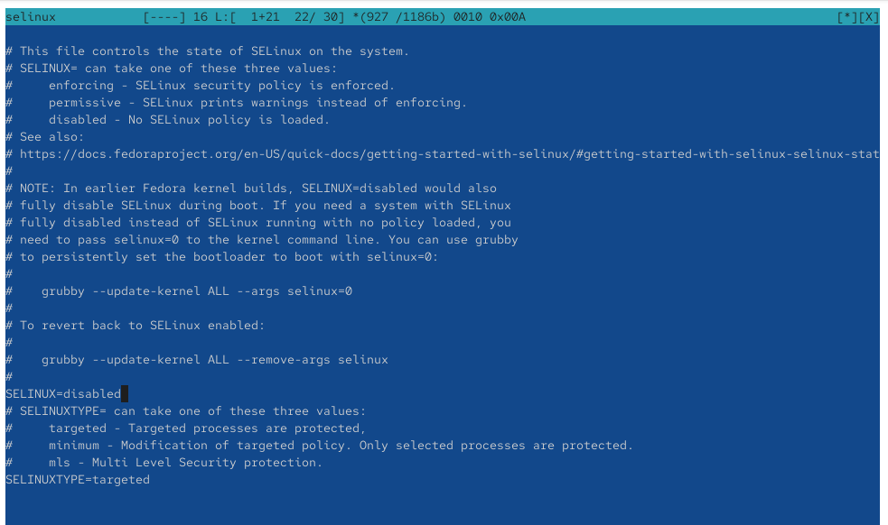
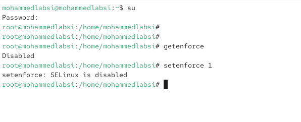
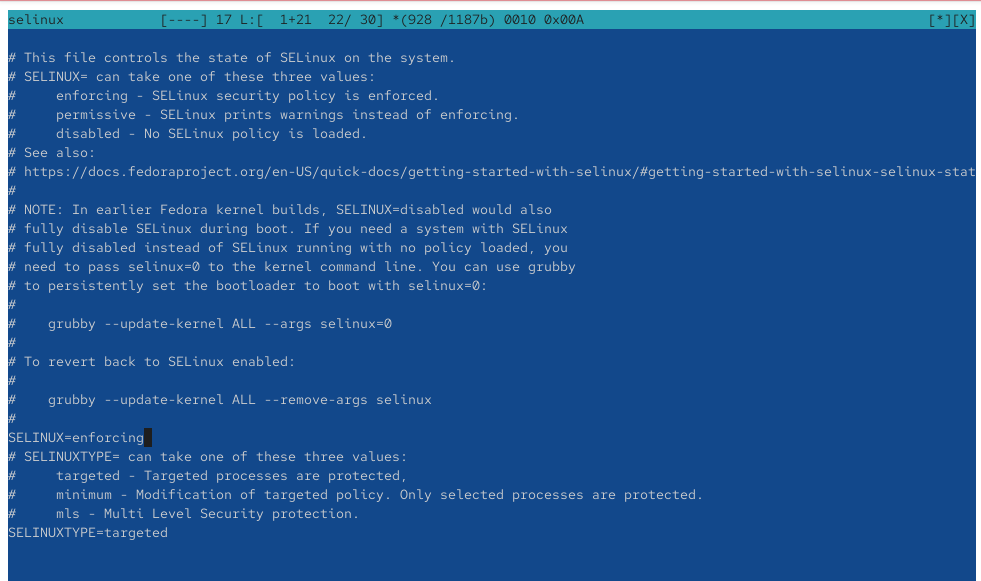
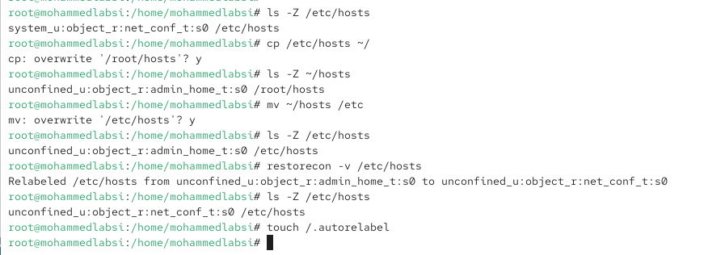
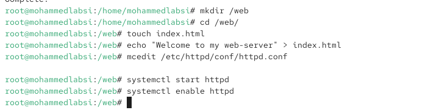
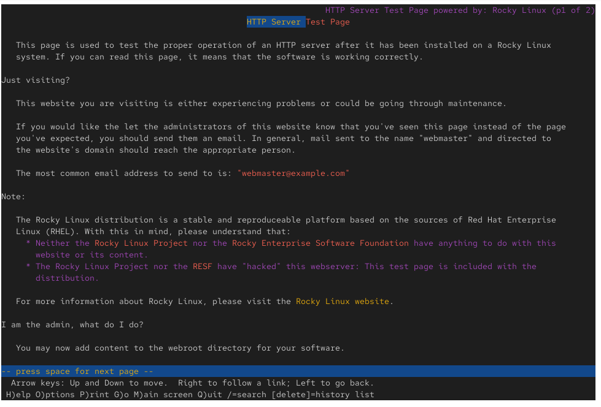
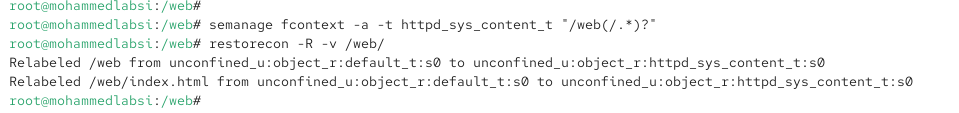
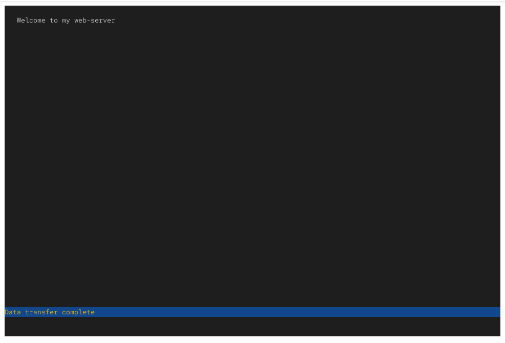
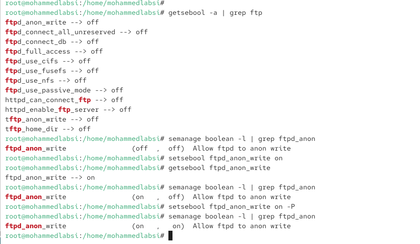

---
## Author
author:
  name: Лабси Мохаммед
  email: 1032245412@rudn.ru
  affiliation:
    - name: Российский университет дружбы народов
      country: Российская Федерация
      postal-code: 117198
      city: Москва
      address: ул. Миклухо-Маклая, д. 6

## Title
title: Лабораторная работа №9
subtitle: Управление SELinux
license: CC BY
date: today
date-format: "YYYY-MM-DD"
---

---
## Author
author:
  name: Лабси Мохаммед
  email: 1032245412@rudn.ru
  affiliation:
    - name: Российский университет дружбы народов
      country: Российская Федерация
      postal-code: 117198
      city: Москва
      address: ул. Миклухо-Маклая, д. 6

## Title
title: Лабораторная работа №9
subtitle: Управление SELinux
license: CC BY
date: today
date-format: "YYYY-MM-DD"
---

# Цели и задачи работы

## Цель лабораторной работы

Получить практические навыки управления системой безопасности SELinux в операционной системе Linux.

Изучить переключение режимов SELinux, восстановление контекстов безопасности файлов, настройку доступа веб-сервера Apache к нестандартным каталогам и управление логическими переключателями SELinux.

# Управление режимами SELinux

## Проверяю состояние SELinux и переключаю режим работы

{ #fig:001 width=70% height=70% }

## Отключаю SELinux в конфигурационном файле

{ #fig:002 width=70% height=70% }

## Проверяю отключение SELinux

{ #fig:003 width=70% height=70% }

## Восстанавливаю режим принудительного исполнения

{ #fig:004 width=70% height=70% }

## Выполняю восстановление меток безопасности при загрузке

{ #fig:005 width=70% height=70% }

## Проверяю состояние SELinux после перезагрузки

{ #fig:006 width=70% height=70% }

# Восстановление контекстов безопасности SELinux

## Изменяю и восстанавливаю контекст файла hosts

{ #fig:007 width=70% height=70% }

## Запускаю автоматическую перемаркировку файловой системы

{ #fig:008 width=70% height=70% }

# Настройка SELinux для веб-сервера Apache

## Изменяю корневой каталог веб-сервера

{ #fig:009 width=70% height=70% }

## Создаю веб-страницу и запускаю службу httpd

{ #fig:010 width=70% height=70% }

## Проверяю доступность веб-страницы

{ #fig:011 width=70% height=70% }

## Настраиваю контекст безопасности каталога web

{ #fig:012 width=70% height=70% }

## Проверяю работу веб-сервера после изменения контекста

{ #fig:013 width=70% height=70% }

# Работа с переключателями SELinux

## Просматриваю и изменяю переключатель ftpd_anon_write

{ #fig:014 width=70% height=70% }

# Выводы по проделанной работе

## Вывод

В ходе лабораторной работы были изучены основные механизмы управления системой безопасности SELinux в операционной системе Linux.

Были освоены переключение режимов `Enforcing`, `Permissive` и `Disabled`, проверка состояния SELinux и восстановление контекстов безопасности файлов с помощью `restorecon`.

Также была выполнена настройка контекста `httpd_sys_content_t` для нестандартного каталога веб-сервера Apache и проверена доступность пользовательской веб-страницы.

Получены практические навыки управления переключателями SELinux с помощью команд `getsebool`, `setsebool` и `semanage`, включая сохранение постоянных настроек безопасности.
