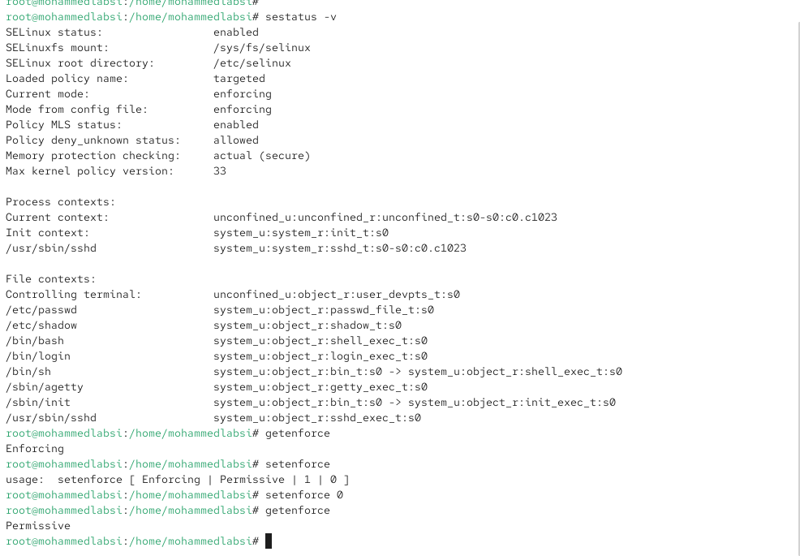
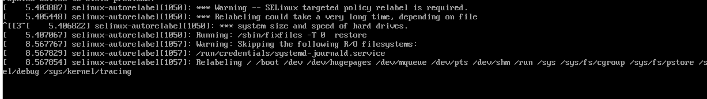
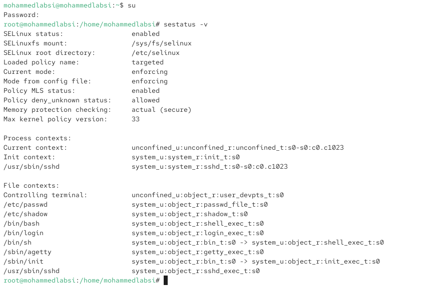
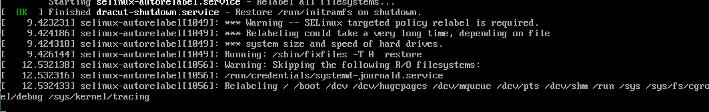
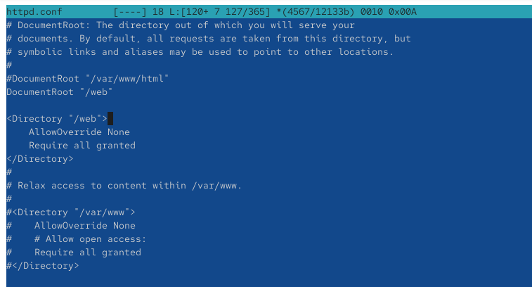

---
## Author
author:
  name: Лабси Мохаммед
  email: 1032245412@rudn.ru
  affiliation:
    - name: Российский университет дружбы народов
      country: Российская Федерация
      postal-code: 117198
      city: Москва
      address: ул. Миклухо-Маклая, д. 6

## Title
title: "Отчёт по лабораторной работе №9"
subtitle: "Управление SELinux"
license: "CC BY"
---

# Цель работы

Получить навыки работы с контекстом безопасности и политиками SELinux.


# Выполнение лабораторной работы

## Управление режимами SELinux

Запускаю терминал и получаю полномочия администратора:

`su -`

Просматриваю текущее состояние SELinux:

`sestatus -v`

В результате отображаются основные параметры системы безопасности:

- `SELinux status: enabled` — SELinux включён.
- `SELinuxfs mount: /sys/fs/selinux` — точка монтирования файловой системы SELinux.
- `SELinux root directory: /etc/selinux` — каталог конфигурационных файлов.
- `Loaded policy name: targeted` — используется целевая политика безопасности.
- `Current mode: enforcing` — текущий режим принудительного исполнения.
- `Mode from config file: enforcing` — режим, заданный в конфигурации.
- `Policy MLS status: enabled` — поддержка многоуровневой безопасности включена.
- `Policy deny_unknown status: allowed` — неизвестные политике разрешения допускаются.
- `Memory protection checking: actual (secure)` — используется безопасный режим проверки защиты памяти.
- `Max kernel policy version: 33` — максимальная поддерживаемая версия политики.

В разделе `Process contexts` отображаются контексты текущего процесса, процесса инициализации и службы SSH. Раздел `File contexts` содержит контексты системных файлов, включая `/etc/passwd`, `/etc/shadow`, `/bin/bash` и `/usr/sbin/sshd`.

Проверяю текущий режим:

`getenforce`

Команда возвращает `Enforcing`. Переключаю SELinux в разрешающий режим:

`setenforce 0`

Повторно выполняю `getenforce` и получаю `Permissive`. В данном режиме нарушения политики регистрируются, но не блокируются (см. рис. [@fig-001]).

{ #fig-001 width=70% }

Открываю конфигурационный файл:

`mcedit /etc/sysconfig/selinux`

Изменяю параметр на `SELINUX=disabled`, сохраняю файл и перезагружаю систему (см. рис. [@fig-002]).

{ #fig-002 width=70% }

После перезагрузки проверяю режим:

`getenforce`

Получаю значение `Disabled`. Попытка включить SELinux командой:

`setenforce 1`

приводит к сообщению `setenforce: SELinux is disabled`. Это означает, что включить отключённый SELinux без изменения конфигурации и перезагрузки невозможно (см. рис. [@fig-003]).

{ #fig-003 width=70% }

Снова открываю файл `/etc/sysconfig/selinux` и устанавливаю:

`SELINUX=enforcing`

Сохраняю изменения и перезагружаю систему (см. рис. [@fig-004]).

{ #fig-004 width=70% }

При загрузке появляется предупреждение `SELinux targeted policy relabel is required`. Система автоматически восстанавливает метки безопасности файлов, поскольку ранее SELinux был отключён (см. рис. [@fig-005]).

{ #fig-005 width=70% }

После завершения загрузки проверяю состояние:

`sestatus -v`

В выводе указаны `SELinux status: enabled`, `Current mode: enforcing` и `Mode from config file: enforcing`. Следовательно, SELinux успешно включён и работает в режиме принудительного исполнения (см. рис. [@fig-006]).

{ #fig-006 width=70% }

## Использование restorecon для восстановления контекста безопасности

Получаю полномочия администратора и проверяю контекст файла `/etc/hosts`:

`ls -Z /etc/hosts`

Файл имеет тип безопасности `net_conf_t`, предназначенный для сетевых конфигурационных файлов.

Копирую файл в домашний каталог:

`cp /etc/hosts ~/`

Проверяю его контекст:

`ls -Z ~/hosts`

Тип изменяется на `admin_home_t`, поскольку файл находится в домашнем каталоге администратора.

Перемещаю файл обратно, подтверждая замену существующего:

`mv ~/hosts /etc`

Повторная проверка `ls -Z /etc/hosts` показывает, что тип `admin_home_t` сохранился.

Восстанавливаю правильный контекст:

`restorecon -v /etc/hosts`

Команда изменяет тип безопасности с `admin_home_t` на `net_conf_t`. Повторная проверка подтверждает восстановление контекста.

Для массового восстановления меток создаю специальный файл:

`touch /.autorelabel`

После этого перезагружаю систему (см. рис. [@fig-007]).

{ #fig-007 width=70% }

Во время загрузки запускается служба `selinux-autorelabel.service`, которая автоматически восстанавливает контексты безопасности файловой системы в соответствии с политикой SELinux (см. рис. [@fig-008]).

{ #fig-008 width=70% }

## Настройка контекста безопасности для нестандартного расположения файлов веб-сервера

Получаю полномочия администратора и устанавливаю необходимые пакеты:

`dnf -y install httpd`

`dnf -y install lynx`

Создаю каталог для файлов веб-сервера и главную страницу:

`mkdir /web`

`cd /web`

`touch index.html`

`echo "Welcome to my web-server" > index.html`

Открываю конфигурацию Apache:

`mcedit /etc/httpd/conf/httpd.conf`

Комментирую стандартную строку `DocumentRoot "/var/www/html"` и добавляю:

`DocumentRoot "/web"`

Также комментирую прежний раздел `<Directory "/var/www">` и добавляю правила доступа:

```apache
<Directory "/web">
    AllowOverride None
    Require all granted
</Directory>
```

Данные настройки позволяют Apache использовать каталог `/web` для размещения содержимого сайта (см. рис. [@fig-009]).

{ #fig-009 width=70% }

Запускаю веб-сервер и включаю его автоматический запуск:

`systemctl start httpd`

`systemctl enable httpd`

В результате служба `httpd` запускается, а её автоматический старт при загрузке системы становится активным (см. рис. [@fig-010]).

{ #fig-010 width=70% }

Проверяю работу веб-сервера через текстовый браузер:

`lynx http://localhost`

Вместо созданной страницы отображается стандартная страница `HTTP Server Test Page` Rocky Linux. Это связано с тем, что SELinux ограничивает доступ Apache к файлам каталога `/web`, имеющим неподходящий контекст безопасности (см. рис. [@fig-011]).

{ #fig-011 width=70% }

Для назначения правильного контекста выполняю:

`semanage fcontext -a -t httpd_sys_content_t "/web(/.*)?"`

Команда добавляет правило, устанавливающее тип `httpd_sys_content_t` для каталога `/web` и его содержимого.

Применяю правило:

`restorecon -R -v /web`

В результате контексты каталога `/web` и файла `index.html` изменяются с `default_t` на `httpd_sys_content_t`, что разрешает Apache читать содержимое сайта (см. рис. [@fig-012]).

{ #fig-012 width=70% }

Повторно открываю веб-страницу:

`lynx http://localhost`

Теперь отображается сообщение `Welcome to my web-server`. Следовательно, контекст безопасности настроен правильно, а веб-сервер успешно предоставляет содержимое нестандартного каталога (см. рис. [@fig-013]).

{ #fig-013 width=70% }

## Работа с переключателями SELinux

Получаю полномочия администратора и просматриваю переключатели, связанные со службой FTP:

`getsebool -a | grep ftp`

В списке нахожу переключатель `ftpd_anon_write`, имеющий значение `off`. Он управляет разрешением анонимной записи для FTP-службы.

Просматриваю подробную информацию:

`semanage boolean -l | grep ftpd_anon`

Первоначально отображается состояние `(off, off)`, означающее, что переключатель отключён как в текущей, так и в постоянной конфигурации.

Включаю его:

`setsebool ftpd_anon_write on`

Проверяю результат:

`getsebool ftpd_anon_write`

Получаю `ftpd_anon_write --> on`.

Повторно выполняю:

`semanage boolean -l | grep ftpd_anon`

Теперь отображается `(on, off)`. Первое значение указывает на текущее состояние, второе — на постоянное. Следовательно, переключатель включён только до перезагрузки.

Для постоянного включения выполняю:

`setsebool -P ftpd_anon_write on`

Проверяю состояние:

`semanage boolean -l | grep ftpd_anon`

В результате получаю `(on, on)`, что подтверждает включение переключателя в текущей и постоянной конфигурациях SELinux (см. рис. [@fig-014]).

{ #fig-014 width=70% }

## Контрольные вопросы

1. **Вы хотите временно поставить SELinux в разрешающем режиме. Какую команду вы используете?**  
   Для временного переключения SELinux в разрешающий режим необходимо выполнить команду:

   `setenforce 0`

   В режиме `Permissive` SELinux регистрирует нарушения политики безопасности, но не блокирует запрещённые действия. Изменение действует до перезагрузки системы. Проверить текущий режим можно командой `getenforce`.

2. **Вам нужен список всех доступных переключателей SELinux. Какую команду вы используете?**  
   Для просмотра всех доступных переключателей SELinux используется команда:

   `getsebool -a`

   Она выводит список логических переключателей и их текущие значения `on` или `off`. Для получения дополнительных описаний переключателей можно использовать команду `semanage boolean -l`.

3. **Каково имя пакета, который требуется установить для получения легко читаемых сообщений журнала SELinux в журнале аудита?**  
   Для получения понятных описаний ошибок и нарушений политики SELinux необходимо установить пакет **setroubleshoot-server**:

   `dnf install setroubleshoot-server`

   Пакет анализирует сообщения аудита SELinux и преобразует их в более понятные описания. Подробную информацию о нарушениях можно получить с помощью утилиты `sealert`. Обработанные сообщения также могут записываться в `/var/log/messages`.

4. **Какие команды вам нужно выполнить, чтобы применить тип контекста httpd_sys_content_t к каталогу /web?**  
   Для назначения типа контекста безопасности `httpd_sys_content_t` каталогу `/web` и его содержимому необходимо выполнить две команды:

   `semanage fcontext -a -t httpd_sys_content_t "/web(/.*)?"`

   `restorecon -R -v /web`

   Первая команда добавляет правило назначения контекста безопасности, а вторая применяет его к существующим файлам и каталогам. Параметр `-R` обеспечивает рекурсивную обработку, а `-v` выводит сведения об изменениях.

5. **Какой файл вам нужно изменить, если вы хотите полностью отключить SELinux?**  
   Для полного отключения SELinux необходимо изменить конфигурационный файл:

   `/etc/sysconfig/selinux`

   В нём следует установить параметр:

   `SELINUX=disabled`

   После сохранения изменений необходимо перезагрузить операционную систему. Также конфигурация доступна через файл `/etc/selinux/config`.

6. **Где SELinux регистрирует все свои сообщения?**  
   Основные сообщения аудита SELinux, включая сведения о запрещённых действиях, записываются в файл:

   `/var/log/audit/audit.log`

   Для просмотра сообщений о нарушениях политики можно использовать команду:

   `ausearch -m AVC`

   Если служба `auditd` не запущена, сообщения об отказах доступа могут записываться в `/var/log/messages`. Также сообщения доступны через системный журнал.

7. **Вы не знаете, какие типы контекстов доступны для службы ftp. Какая команда позволяет получить более конкретную информацию?**  
   Для просмотра типов контекстов безопасности, связанных с FTP, можно выполнить команду:

   `semanage fcontext -l | grep ftp`

   Команда выводит правила назначения контекстов безопасности для файлов и каталогов, связанных с FTP-службой. В результате можно определить доступные типы, например `public_content_t` и `public_content_rw_t`, используемые для общего содержимого.

8. **Ваш сервис работает не так, как ожидалось, и вы хотите узнать, связано ли это с SELinux или чем-то ещё. Какой самый простой способ узнать?**  
   Самый простой способ — временно перевести SELinux в разрешающий режим:

   `setenforce 0`

   После этого необходимо повторить действие, вызывающее ошибку. Если сервис начинает работать корректно, вероятной причиной являются ограничения политики SELinux.

   Для проверки нарушений можно просмотреть журнал:

   `ausearch -m AVC`

   После диагностики следует вернуть SELinux в принудительный режим:

   `setenforce 1`

   Если проблема связана с SELinux, необходимо исправить контексты безопасности или настроить соответствующие разрешения политики, не отключая защиту на постоянной основе.

# Заключение

В ходе лабораторной работы изучил принципы работы и настройки системы безопасности **SELinux** в Linux. Научился управлять режимами **Enforcing**, **Permissive** и **Disabled**, просматривать и восстанавливать контексты безопасности файлов с помощью **restorecon**. Настроил контекст безопасности **httpd_sys_content_t** для нестандартного расположения файлов веб-сервера **Apache** и проверил доступность веб-страницы. Освоил управление переключателями SELinux с помощью **getsebool**, **setsebool** и **semanage**, включая сохранение постоянных настроек. Получил практические навыки настройки политик безопасности, управления доступом к файлам и диагностики ограничений SELinux.

# Список литературы

1. [Red Hat. Getting Started with SELinux — основы работы SELinux, политики безопасности и контексты доступа](https://docs.redhat.com/en/documentation/red_hat_enterprise_linux/9/html/using_selinux/getting-started-with-selinux_using-selinux).

2. [Red Hat. Changing SELinux States and Modes — управление режимами Enforcing, Permissive и Disabled](https://docs.redhat.com/en/documentation/red_hat_enterprise_linux/9/html/using_selinux/changing-selinux-states-and-modes_using-selinux).

3. [Linux Manual Pages. restorecon(8) — восстановление контекстов безопасности файлов и каталогов SELinux](https://man7.org/linux/man-pages/man8/restorecon.8.html).

4. [Linux Manual Pages. semanage-fcontext(8) — настройка и управление контекстами безопасности файловой системы](https://man7.org/linux/man-pages/man8/semanage-fcontext.8.html).

5. [Red Hat. Configuring SELinux for Applications and Services — настройка SELinux для нестандартных каталогов и веб-сервера Apache](https://docs.redhat.com/en/documentation/red_hat_enterprise_linux/9/html/using_selinux/configuring-selinux-for-applications-and-services-with-non-standard-configurations_using-selinux).

6. [Linux Manual Pages. setsebool(8) — управление переключателями SELinux и сохранение постоянных настроек](https://man7.org/linux/man-pages/man8/setsebool.8.html).

7. [Red Hat. Troubleshooting Problems Related to SELinux — диагностика нарушений политики безопасности и анализ сообщений аудита](https://docs.redhat.com/en/documentation/red_hat_enterprise_linux/9/html/using_selinux/troubleshooting-problems-related-to-selinux_using-selinux).