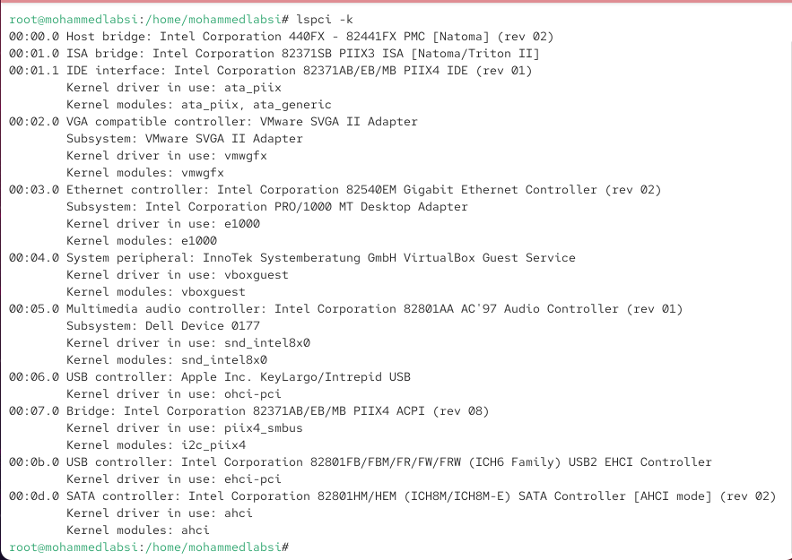
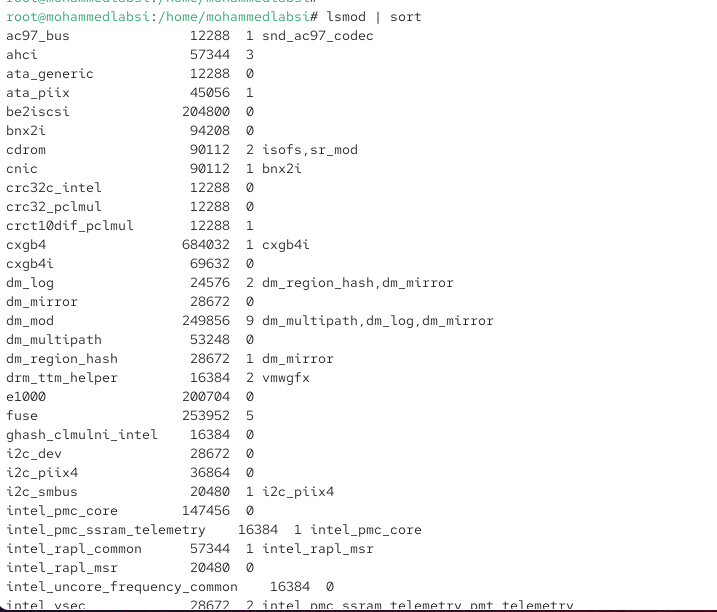
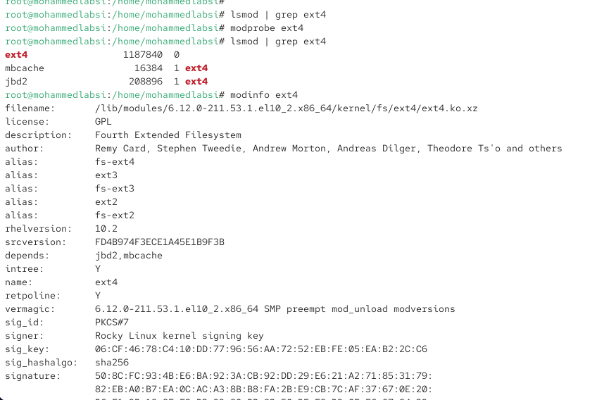
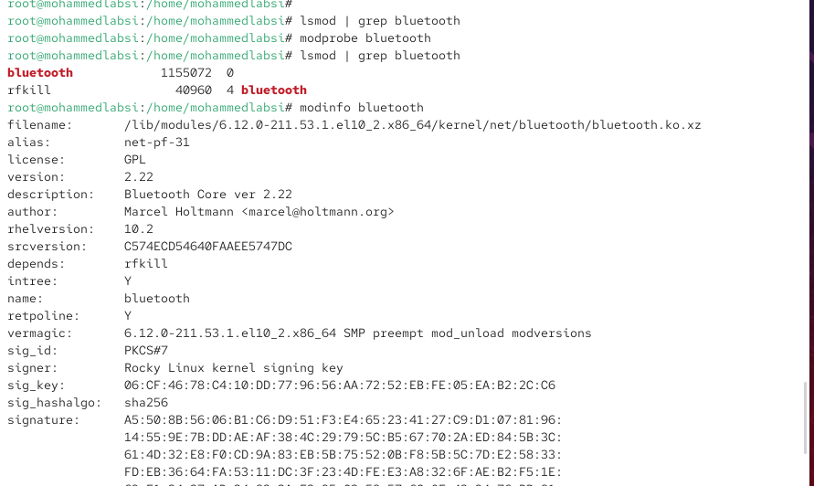
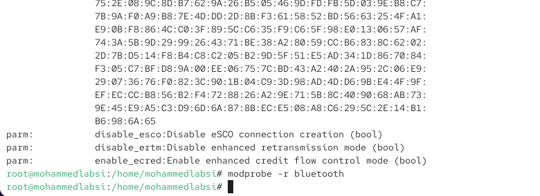
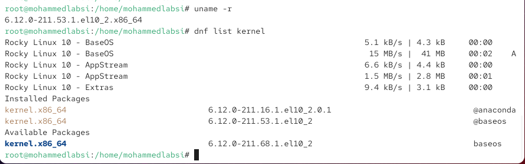
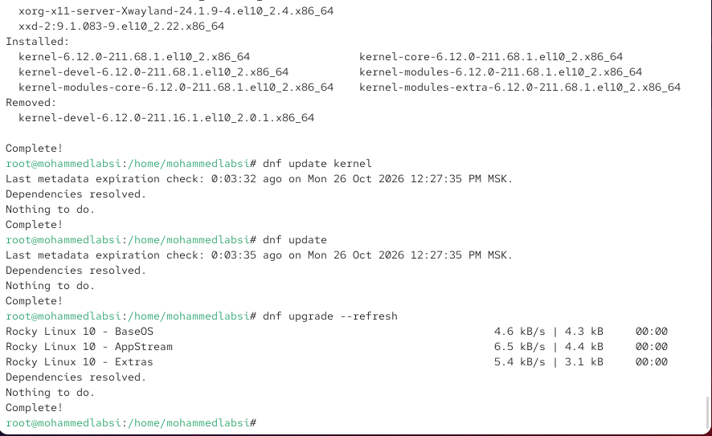
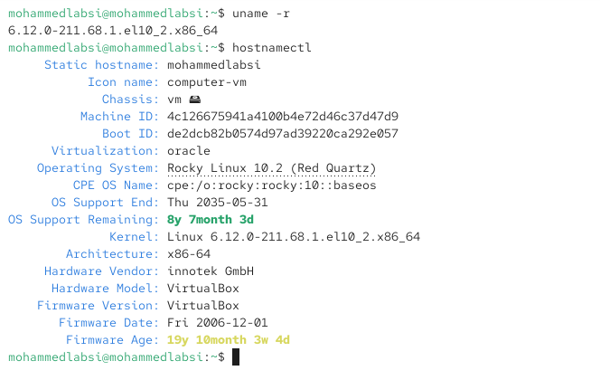

---
## Author
author:
  name: Лабси Мохаммед
  email: 1032245412@rudn.ru
  affiliation:
    - name: Российский университет дружбы народов
      country: Российская Федерация
      postal-code: 117198
      city: Москва
      address: ул. Миклухо-Маклая, д. 6

## Title
title: Лабораторная работа №10
subtitle: Основы работы с модулями ядра операционной системы
license: CC BY
date: today
date-format: "YYYY-MM-DD"
---

# Цели и задачи работы

## Цель лабораторной работы

Получить практические навыки управления модулями ядра операционной системы Linux.

Изучить просмотр информации о модулях ядра, их загрузку и выгрузку, определение зависимостей и параметров модулей.

Освоить обновление ядра операционной системы Rocky Linux и проверку его версии после перезагрузки.

# Управление модулями ядра из командной строки

## Просматриваю устройства PCI и связанные с ними модули ядра

{ #fig:001 width=70% height=70% }

## Просматриваю список загруженных модулей ядра

{ #fig:002 width=70% height=70% }

## Загружаю модуль ext4 и просматриваю информацию о нём

{ #fig:003 width=70% height=70% }

## Выгружаю модуль ext4 и проверяю возможность выгрузки xfs

{ #fig:004 width=70% height=70% }

# Загрузка модулей ядра с параметрами

## Загружаю модуль bluetooth и изучаю его характеристики

{ #fig:005 width=70% height=70% }

## Изучаю параметры модуля bluetooth и выполняю его выгрузку

{ #fig:006 width=70% height=70% }

# Обновление ядра операционной системы

## Проверяю текущую версию ядра и доступные обновления

{ #fig:007 width=70% height=70% }

## Обновляю ядро и пакеты операционной системы

{ #fig:008 width=70% height=70% }

## Проверяю версию ядра после перезагрузки системы

{ #fig:009 width=70% height=70% }

# Выводы по проделанной работе

## Вывод

В ходе лабораторной работы были изучены основные команды управления модулями ядра операционной системы Rocky Linux.

Освоены просмотр загруженных модулей с помощью `lsmod`, загрузка и выгрузка модулей командами `modprobe` и `modprobe -r`, а также получение информации об их характеристиках и параметрах с помощью `modinfo`.

Изучены зависимости модулей `ext4`, `xfs` и `bluetooth`, рассмотрены особенности выгрузки используемых системой модулей и доступные параметры их загрузки.

Выполнено обновление ядра Linux с версии `6.12.0-211.53.1.el10_2.x86_64` до `6.12.0-211.68.1.el10_2.x86_64`. После перезагрузки успешность обновления подтверждена командами `uname -r` и `hostnamectl`.