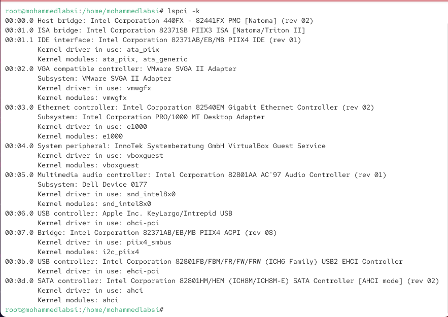
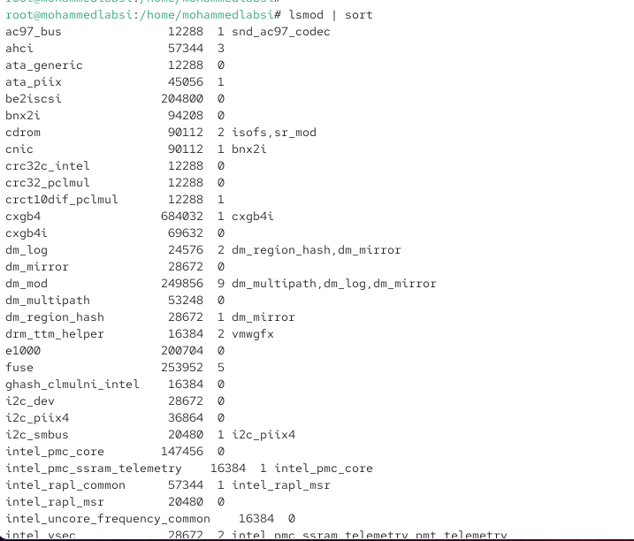
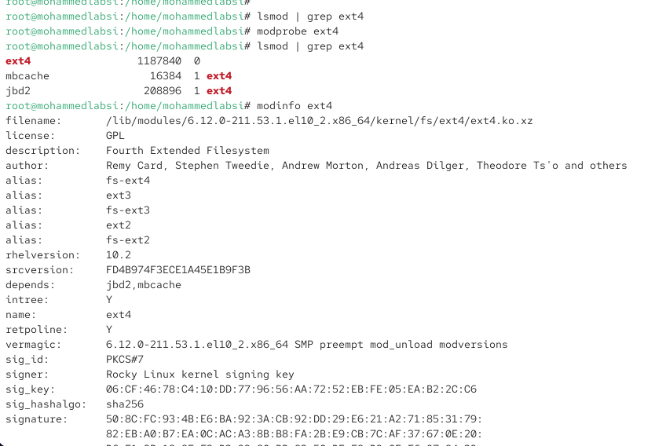
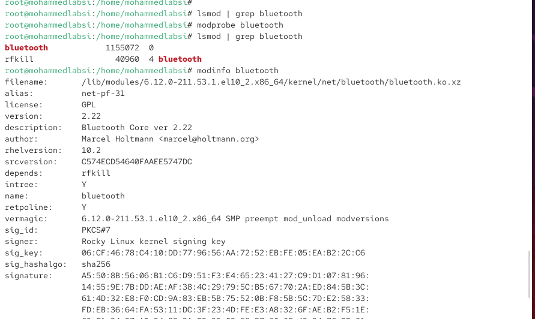
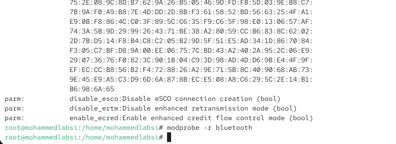
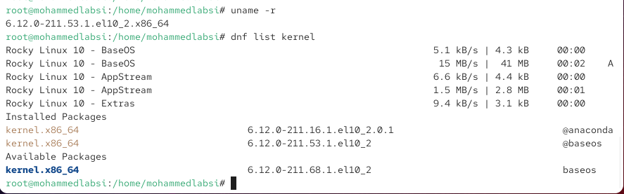
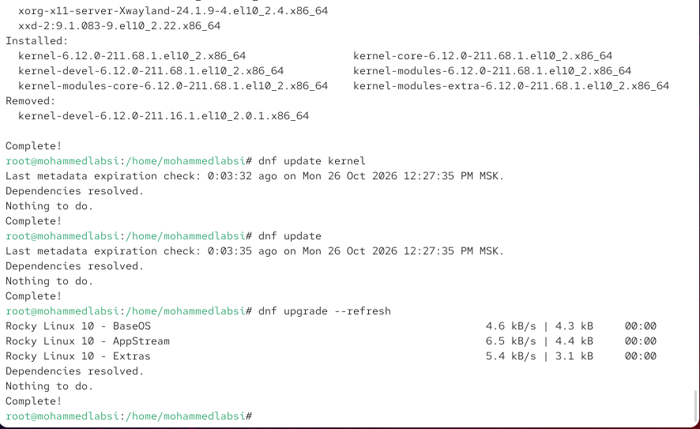
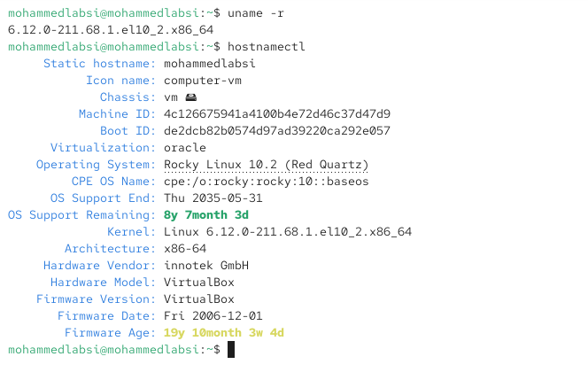

---
## Author
author:
  name: Лабси Мохаммед
  email: 1032245412@rudn.ru
  affiliation:
    - name: Российский университет дружбы народов
      country: Российская Федерация
      postal-code: 117198
      city: Москва
      address: ул. Миклухо-Маклая, д. 6

## Title
title: "Отчёт по лабораторной работе №10"
subtitle: "Основы работы с модулями ядра операционной системы"
license: "CC BY"
---

# Цель работы

Получить навыки работы с утилитами управления модулями ядра операционной системы.

# Выполнение лабораторной работы

## Управление модулями ядра из командной строки

Запускаю терминал и получаю полномочия администратора:

`su -`

Просматриваю список устройств, обнаруженных в системе, и связанных с ними модулей ядра:

`lspci -k`

В результате отображается информация об устройствах, подключённых к шине PCI, и используемых ими драйверах:

- `Host bridge: Intel Corporation 440FX - 82441FX PMC` — системный мост, обеспечивающий взаимодействие компонентов системы.
- `ISA bridge: Intel Corporation 82371SB PIIX3 ISA` — мост для взаимодействия с устройствами шины ISA.
- `IDE interface: Intel Corporation 82371AB/EB/MB PIIX4 IDE` — контроллер IDE, использующий модуль `ata_piix`. Также доступен модуль `ata_generic`.
- `VGA compatible controller: VMware SVGA II Adapter` — графический адаптер, для которого используется драйвер `vmwgfx`.
- `Ethernet controller: Intel Corporation 82540EM Gigabit Ethernet Controller` — сетевой адаптер, работающий с модулем `e1000`.
- `System peripheral: VirtualBox Guest Service` — устройство интеграции виртуальной машины с гипервизором, использующее модуль `vboxguest`.
- `Multimedia audio controller: Intel Corporation 82801AA AC'97 Audio Controller` — звуковой контроллер, использующий модуль `snd_intel8x0`.
- `USB controller: Apple Inc. KeyLargo/Intrepid USB` — контроллер USB, использующий драйвер `ohci-pci`.
- `Bridge: Intel Corporation 82371AB/EB/MB PIIX4 ACPI` — мост ACPI, использующий драйвер `piix4_smbus`.
- `USB controller: Intel Corporation 82801FB/FBM USB2 EHCI Controller` — контроллер USB 2.0, работающий с драйвером `ehci-pci`.
- `SATA controller: Intel Corporation 82801HM/HEM SATA Controller` — контроллер дисковых устройств, использующий драйвер `ahci`.

Строка `Kernel driver in use` показывает драйвер, который в данный момент управляет устройством, а `Kernel modules` содержит список доступных модулей ядра для соответствующего оборудования (см. рис. [@fig-001]).

{ #fig-001 width=70% }

Просматриваю список загруженных модулей ядра, отсортированный по алфавиту:

`lsmod | sort`

Команда `lsmod` выводит информацию о модулях, загруженных в ядро операционной системы, а `sort` сортирует полученные строки.

В выводе отображаются следующие сведения:

- `Module` — название модуля ядра.
- `Size` — размер модуля в байтах.
- `Used by` — количество использований модуля и, при наличии, названия зависимых модулей.

В списке присутствуют модули `ahci`, `ata_piix`, `e1000`, `i2c_piix4`, `dm_mod`, `fuse` и другие. Они обеспечивают работу контроллеров дисков, сетевых устройств, системных интерфейсов и файловых систем.

Например, модуль `e1000` обслуживает сетевой адаптер Intel, `ahci` обеспечивает взаимодействие с SATA-контроллером, а `fuse` позволяет реализовывать файловые системы в пространстве пользователя (см. рис. [@fig-002]).

{ #fig-002 width=70% }

Проверяю, загружен ли модуль файловой системы ext4:

`lsmod | grep ext4`

Команда не возвращает результата, что означает отсутствие модуля `ext4` в списке загруженных модулей.

Загружаю модуль ядра:

`modprobe ext4`

Команда выполняется без сообщений об ошибках. Повторно проверяю наличие модуля:

`lsmod | grep ext4`

Теперь в выводе отображаются следующие модули:

- `ext4` — основной модуль файловой системы ext4, размер 1187840 байт.
- `mbcache` — модуль кэширования метаданных, используемый модулем `ext4`.
- `jbd2` — модуль журналирования, обеспечивающий поддержку журнала файловой системы ext4.

Появление `ext4` в списке подтверждает его успешную загрузку. Вместе с ним загружены необходимые зависимости.

Просматриваю подробную информацию о модуле:

`modinfo ext4`

В результате получаю сведения о модуле:

- `filename` — расположение файла модуля: `/lib/modules/6.12.0-211.53.1.el10_2.x86_64/kernel/fs/ext4/ext4.ko.xz`.
- `license: GPL` — модуль распространяется по лицензии GPL.
- `description: Fourth Extended Filesystem` — модуль реализует файловую систему ext4.
- `author` — разработчики модуля.
- `alias` — альтернативные имена и обозначения поддерживаемых файловых систем, включая `ext2`, `ext3` и `ext4`.
- `rhelversion: 10.2` — версия семейства RHEL, для которой собран модуль.
- `depends: jbd2,mbcache` — зависимости, необходимые для работы модуля.
- `intree: Y` — модуль входит в исходное дерево ядра Linux.
- `name: ext4` — имя модуля.
- `retpoline: Y` — модуль собран с поддержкой механизма защиты Retpoline.
- `vermagic` — информация о совместимости модуля с используемой версией ядра.
- `sig_id: PKCS#7` — формат цифровой подписи модуля.
- `signer: Rocky Linux kernel signing key` — модуль подписан ключом Rocky Linux.
- `sig_hashalgo: sha256` — алгоритм хеширования, используемый при подписывании.

В выводе отсутствуют строки `parm`, следовательно, модуль `ext4` не предоставляет настраиваемых параметров загрузки через `modprobe` (см. рис. [@fig-003]).

{ #fig-003 width=70% }

Пробую выгрузить модуль `ext4`:

`modprobe -r ext4`

Команда выполняется успешно и не выводит сообщений.

Проверяю список загруженных модулей:

`lsmod | grep ext4`

Вывод отсутствует, что подтверждает успешную выгрузку модуля `ext4`.

Далее пытаюсь выгрузить модуль файловой системы XFS:

`modprobe -r xfs`

Система возвращает сообщение об ошибке:

`modprobe: FATAL: Module xfs is in use.`

Это означает, что модуль `xfs` используется операционной системой и не может быть выгружен. Причиной может являться наличие смонтированной файловой системы XFS, с которой продолжается работа.

Таким образом, выгрузка модулей ядра возможна только при отсутствии активного использования, препятствующего их удалению (см. рис. [@fig-004]).

{ #fig-004 width=70% }

## Загрузка модулей ядра с параметрами

В терминале с полномочиями администратора проверяю наличие загруженного модуля Bluetooth:

`lsmod | grep bluetooth`

Команда не возвращает результата, следовательно, модуль `bluetooth` не загружен.

Выполняю загрузку модуля:

`modprobe bluetooth`

После выполнения команды проверяю список модулей, связанных с Bluetooth:

`lsmod | grep bluetooth`

В результате отображаются:

- `bluetooth` — основной модуль подсистемы Bluetooth, размер 1155072 байта.
- `rfkill` — модуль управления блокировкой беспроводных интерфейсов, размер 40960 байт.

Для модуля `bluetooth` значение счётчика использования равно `0`, а для `rfkill` — `4`. В списке использующих `rfkill` модулей присутствует `bluetooth`.

Просматриваю подробную информацию:

`modinfo bluetooth`

Получаю следующие сведения:

- `filename` — путь к файлу модуля `/lib/modules/6.12.0-211.53.1.el10_2.x86_64/kernel/net/bluetooth/bluetooth.ko.xz`.
- `alias: net-pf-31` — псевдоним модуля для соответствующего семейства сетевых протоколов.
- `license: GPL` — лицензия модуля.
- `version: 2.22` — версия реализации Bluetooth Core.
- `description: Bluetooth Core ver 2.22` — описание функционального назначения.
- `author: Marcel Holtmann` — автор модуля.
- `depends: rfkill` — зависимость от подсистемы управления беспроводными интерфейсами.
- `intree: Y` — модуль входит в исходное дерево ядра.
- `name: bluetooth` — имя модуля.
- `retpoline: Y` — поддержка защитного механизма Retpoline.
- `vermagic` — сведения о совместимости с ядром.
- `signer: Rocky Linux kernel signing key` — цифровая подпись модуля.

Информация подтверждает, что модуль `bluetooth` отвечает за базовую функциональность Bluetooth в ядре Linux (см. рис. [@fig-005]).

{ #fig-005 width=70% }

В нижней части вывода `modinfo bluetooth` отображаются параметры, которые можно задавать при загрузке модуля:

- `disable_esco` — отключение создания соединений eSCO (Extended Synchronous Connection-Oriented), используемых при передаче синхронных данных, в том числе аудио.
- `disable_ertm` — отключение улучшенного режима повторной передачи ERTM (Enhanced Retransmission Mode), обеспечивающего контроль доставки данных.
- `enable_ecred` — включение расширенного режима управления потоком на основе кредитов ECRED (Enhanced Credit-Based Flow Control).

Все три параметра имеют тип `bool` и принимают логические значения `0` (выключено) или `1` (включено).

Параметры модуля могут задаваться непосредственно при его загрузке. Например, команда:

`modprobe bluetooth disable_esco=1`

позволяет загрузить модуль с отключённым созданием соединений eSCO. Данная команда приведена как пример синтаксиса передачи параметров.

После изучения параметров выгружаю модуль Bluetooth:

`modprobe -r bluetooth`

Команда завершается без сообщений об ошибках, что свидетельствует об успешной выгрузке модуля (см. рис. [@fig-006]).

{ #fig-006 width=70% }

## Обновление ядра системы

Запускаю терминал и получаю полномочия администратора:

`su -`

Проверяю текущую версию ядра Linux:

`uname -r`

Команда возвращает:

`6.12.0-211.53.1.el10_2.x86_64`

Это означает, что система использует ядро Linux версии `6.12.0`, собранное для Rocky Linux 10.2 под архитектуру `x86_64`.

Просматриваю список установленных и доступных пакетов ядра:

`dnf list kernel`

В результате отображаются установленные версии:

- `6.12.0-211.16.1.el10_2.0.1` — версия ядра, установленная из локального источника установки.
- `6.12.0-211.53.1.el10_2` — установленная версия ядра из репозитория BaseOS.

Также в разделе `Available Packages` отображается доступное обновление:

`kernel.x86_64 6.12.0-211.68.1.el10_2`

Следовательно, в репозитории Rocky Linux доступна более новая сборка ядра, которую можно установить для обновления системы (см. рис. [@fig-007]).

{ #fig-007 width=70% }

Обновляю пакеты системы с принудительным обновлением метаданных репозиториев:

`dnf upgrade --refresh`

Параметр `--refresh` заставляет пакетный менеджер обновить информацию о доступных пакетах перед выполнением операции. Это позволяет использовать актуальные версии программного обеспечения и уменьшает вероятность возникновения конфликтов зависимостей.

В процессе обновления устанавливается новая версия ядра:

`6.12.0-211.68.1.el10_2.x86_64`

В списке установленных компонентов присутствуют:

- `kernel` — основной пакет ядра Linux.
- `kernel-core` — основные исполняемые компоненты ядра.
- `kernel-modules` — стандартные модули ядра.
- `kernel-modules-core` — базовые модули, необходимые для функционирования ядра.
- `kernel-modules-extra` — дополнительные модули для поддержки оборудования и функций.
- `kernel-devel` — файлы, необходимые для разработки и сборки модулей ядра.

Также отображается удаление старого пакета `kernel-devel` версии `6.12.0-211.16.1.el10_2.0.1`.

После завершения обновления выполняю команду:

`dnf update kernel`

Пакетный менеджер сообщает:

`Dependencies resolved.`

`Nothing to do.`

`Complete!`

Это означает, что обновление пакета ядра уже выполнено и дополнительные действия не требуются.

Далее проверяю обновления остальных системных пакетов:

`dnf update`

Команда также возвращает:

`Nothing to do.`

Повторно обновляю метаданные репозиториев и проверяю состояние пакетов:

`dnf upgrade --refresh`

В результате появляется сообщение `Nothing to do.`, подтверждающее отсутствие дополнительных доступных обновлений на момент проверки (см. рис. [@fig-008]).

{ #fig-008 width=70% }

После установки обновлений перезагружаю операционную систему для загрузки нового ядра.

После перезагрузки открываю терминал и проверяю версию активного ядра:

`uname -r`

Получаю результат:

`6.12.0-211.68.1.el10_2.x86_64`

По сравнению с первоначальной версией `6.12.0-211.53.1.el10_2.x86_64` сборка ядра изменилась на `6.12.0-211.68.1.el10_2.x86_64`. Это подтверждает успешную установку обновления и запуск системы с новым ядром.

Дополнительно просматриваю сведения об операционной системе:

`hostnamectl`

В результате отображается следующая информация:

- `Static hostname: mohammedlabsi` — имя компьютера.
- `Icon name: computer-vm` — система определена как виртуальная машина.
- `Chassis: vm` — тип используемого оборудования.
- `Virtualization: oracle` — используется технология виртуализации Oracle.
- `Operating System: Rocky Linux 10.2 (Red Quartz)` — название и версия операционной системы.
- `CPE OS Name: cpe:/o:rocky:rocky:10::baseos` — идентификатор операционной системы.
- `OS Support End: Thu 2035-05-31` — дата окончания поддержки операционной системы.
- `Kernel: Linux 6.12.0-211.68.1.el10_2.x86_64` — версия загруженного ядра.
- `Architecture: x86-64` — архитектура процессора.
- `Hardware Vendor: innotek GmbH` — производитель виртуального оборудования.
- `Hardware Model: VirtualBox` — используемая платформа виртуализации.
- `Firmware Version: VirtualBox` — информация о виртуальной прошивке.

Значение поля `Kernel` совпадает с результатом команды `uname -r`. Следовательно, операционная система успешно загружена с обновлённым ядром Linux (см. рис. [@fig-009]).

{ #fig-009 width=70% }

## Контрольные вопросы

1. **Какая команда показывает текущую версию ядра, которая используется на вашей системе?**  
   Для просмотра текущей версии ядра операционной системы используется команда:

   `uname -r`

   Она выводит версию ядра, которое в данный момент загружено и используется системой. Например, после обновления Rocky Linux команда возвращает:

   `6.12.0-211.68.1.el10_2.x86_64`

   Здесь `6.12.0` — версия ядра Linux, `211.68.1.el10_2` — номер сборки для Rocky Linux, а `x86_64` — архитектура процессора.

2. **Как можно посмотреть более подробную информацию о текущей версии ядра операционной системы?**  
   Для получения подробной информации о ядре используется команда:

   `uname -a`

   Она выводит название операционной системы, имя компьютера, версию и сборку ядра, архитектуру процессора и другие системные сведения.

   Дополнительно можно использовать команду:

   `hostnamectl`

   Она отображает информацию об операционной системе, включая версию ядра, архитектуру процессора, тип оборудования и среду виртуализации.

3. **Какая команда показывает список загруженных модулей ядра?**  
   Для просмотра списка модулей, загруженных в ядро операционной системы, используется команда:

   `lsmod`

   Она выводит таблицу, содержащую название каждого модуля (`Module`), его размер (`Size`) и количество использований (`Used by`).

   Для сортировки списка модулей по алфавиту можно выполнить:

   `lsmod | sort`

   Для поиска определённого модуля применяется команда с фильтрацией, например:

   `lsmod | grep ext4`

4. **Какая команда позволяет вам определять параметры модуля ядра?**  
   Для просмотра информации о модуле ядра используется команда:

   `modinfo <имя_модуля>`

   Например, для получения сведений о модуле Bluetooth необходимо выполнить:

   `modinfo bluetooth`

   Команда отображает расположение файла модуля, его описание, версию, лицензию, зависимости, цифровую подпись и поддерживаемые параметры.

   При загрузке модуля значения параметров можно задавать командой `modprobe`. Например:

   `modprobe bluetooth disable_esco=1`

   В данном случае параметр `disable_esco` получает значение `1`, отключающее создание соединений eSCO.

5. **Как выгрузить модуль ядра?**  
   Для выгрузки модуля ядра используется команда:

   `modprobe -r <имя_модуля>`

   Например, для выгрузки модуля файловой системы ext4 необходимо выполнить:

   `modprobe -r ext4`

   Команда удаляет модуль из памяти ядра, если он не используется другими компонентами системы.

   Проверить результат можно командой:

   `lsmod | grep ext4`

   Если команда не возвращает результата, модуль отсутствует в списке загруженных.

6. **Что вы можете сделать, если получите сообщение об ошибке при попытке выгрузить модуль ядра?**  
   Если при попытке выгрузки модуля появляется сообщение `Module is in use`, это означает, что модуль используется операционной системой или другими модулями ядра.

   Для определения зависимостей и количества использований необходимо выполнить:

   `lsmod | grep <имя_модуля>`

   Также можно просмотреть подробную информацию:

   `modinfo <имя_модуля>`

   Если модуль используется приложениями, службами или смонтированными файловыми системами, необходимо сначала завершить соответствующие процессы, остановить службы или размонтировать файловые системы, если это безопасно.

   После освобождения модуля можно повторить команду:

   `modprobe -r <имя_модуля>`

   Например, модуль `xfs` нельзя выгрузить, пока он используется для обслуживания смонтированной файловой системы. Принудительная выгрузка используемых модулей не рекомендуется, поскольку может привести к нестабильной работе системы.

7. **Как определить, какие параметры модуля ядра поддерживаются?**  
   Для просмотра поддерживаемых параметров модуля используется команда:

   `modinfo -p <имя_модуля>`

   Например:

   `modinfo -p bluetooth`

   Она выводит список доступных параметров и их описания.

   Для модуля `bluetooth` доступны следующие параметры:

   - `disable_esco` — отключение создания соединений eSCO.
   - `disable_ertm` — отключение улучшенного режима повторной передачи ERTM.
   - `enable_ecred` — включение расширенного режима управления потоком ECRED.

   Эти параметры имеют логический тип `bool` и могут принимать значения `0` или `1`.

   Указать значение параметра можно при загрузке модуля:

   `modprobe bluetooth disable_ertm=1`

   Если команда `modinfo -p` не выводит параметров, модуль не предоставляет настраиваемых параметров загрузки.

8. **Как установить новую версию ядра?**  
   Для установки новой версии ядра в Rocky Linux необходимо получить полномочия администратора:

   `su -`

   Сначала проверяю текущую версию ядра:

   `uname -r`

   Затем просматриваю установленные и доступные версии пакета ядра:

   `dnf list kernel`

   Обновляю метаданные репозиториев и установленные пакеты:

   `dnf upgrade --refresh`

   Для обновления ядра используется команда:

   `dnf update kernel`

   После этого обновляю остальные пакеты операционной системы:

   `dnf update`

   Повторно проверяю наличие обновлений:

   `dnf upgrade --refresh`

   После завершения установки перезагружаю систему:

   `reboot`

   При загрузке выбираю новое ядро, если оно не было выбрано автоматически.

   Проверяю версию активного ядра:

   `uname -r`

   Дополнительно просматриваю сведения о системе:

   `hostnamectl`

   Если после перезагрузки отображается новая версия ядра, значит обновление выполнено успешно. В ходе лабораторной работы ядро Rocky Linux было обновлено с версии `6.12.0-211.53.1.el10_2.x86_64` до `6.12.0-211.68.1.el10_2.x86_64`.

# Заключение

В ходе лабораторной работы изучены основные команды управления модулями ядра Linux. Выполнены просмотр, загрузка и выгрузка модулей, исследованы их зависимости и параметры. Также проведено обновление ядра операционной системы Rocky Linux и проверена его версия после перезагрузки. Получены практические навыки работы с модулями ядра и обновления системных компонентов.

# Список литературы

1. [Red Hat. Managing Kernel Modules — управление модулями ядра Linux, просмотр зависимостей, загрузка и выгрузка модулей](https://docs.redhat.com/en/documentation/red_hat_enterprise_linux/10/html/managing_monitoring_and_updating_the_kernel/managing-kernel-modules).

2. [Red Hat. Managing, Monitoring, and Updating the Kernel — управление ядром Linux, установка новых версий и обновление ядра в RHEL 10](https://docs.redhat.com/en/documentation/red_hat_enterprise_linux/10/html/managing_monitoring_and_updating_the_kernel/index).

3. [Linux Manual Pages. lsmod(8) — просмотр списка загруженных модулей ядра и информации об их использовании](https://man7.org/linux/man-pages/man8/lsmod.8.html).

4. [Linux Manual Pages. modprobe(8) — загрузка и выгрузка модулей ядра, управление зависимостями и передача параметров загрузки](https://man7.org/linux/man-pages/man8/modprobe.8.html).

5. [Linux Manual Pages. modinfo(8) — получение подробной информации о модулях ядра, их характеристиках, зависимостях и поддерживаемых параметрах](https://man7.org/linux/man-pages/man8/modinfo.8.html).