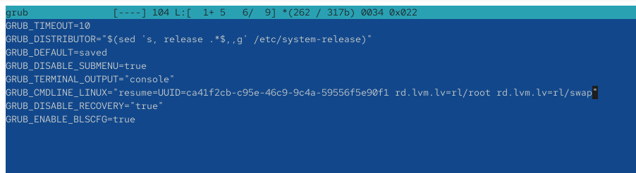
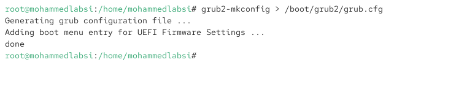
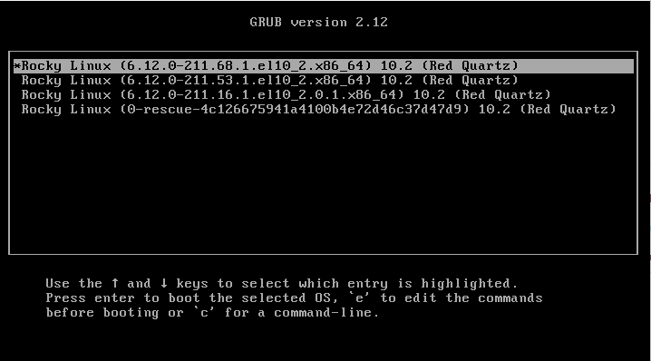
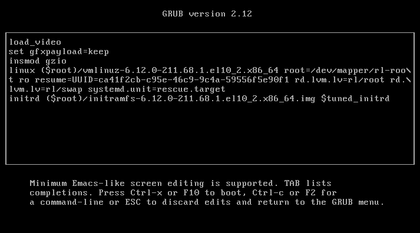
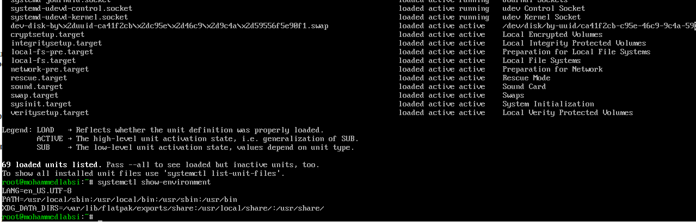
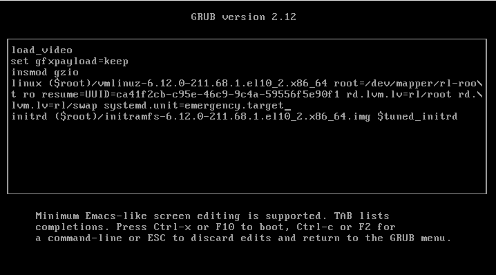
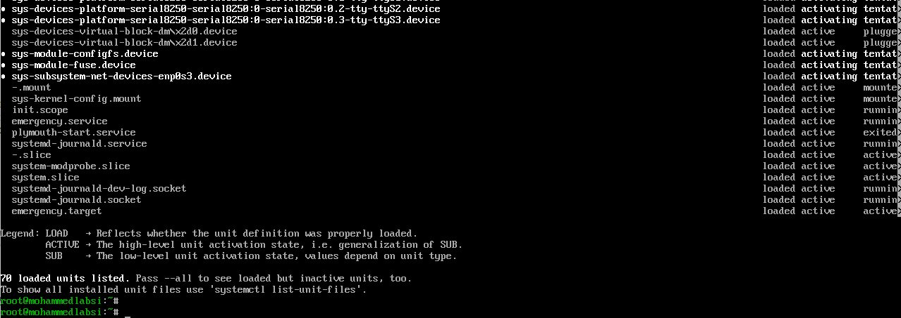
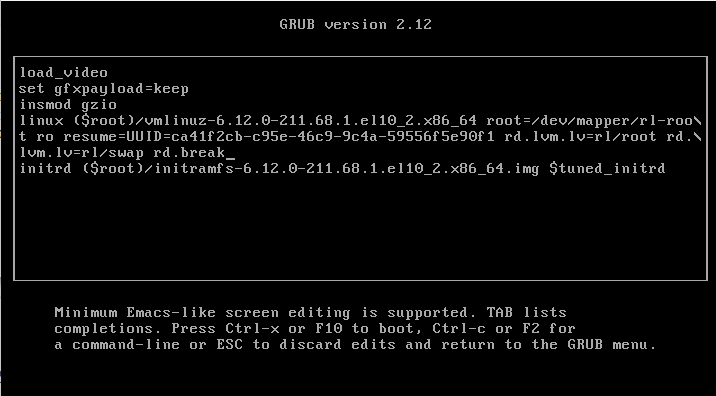
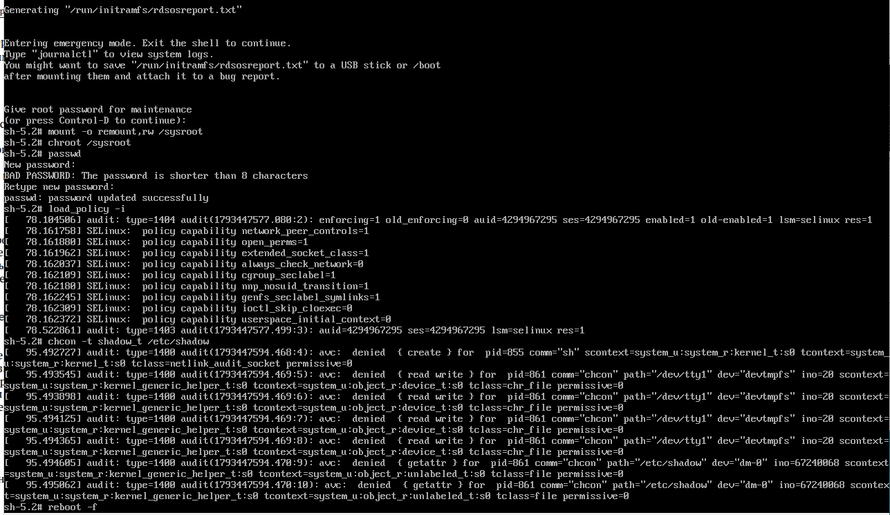

---
## Author
author:
  name: Лабси Мохаммед
  email: 1032245412@rudn.ru
  affiliation:
    - name: Российский университет дружбы народов
      country: Российская Федерация
      postal-code: 117198
      city: Москва
      address: ул. Миклухо-Маклая, д. 6

## Title
title: Лабораторная работа №11
subtitle: Управление загрузкой системы
license: CC BY
date: today
date-format: "YYYY-MM-DD"
---

# Цели и задачи работы

## Цель лабораторной работы

Получить практические навыки настройки загрузчика GRUB2 и управления процессом загрузки операционной системы Rocky Linux.

Изучить изменение параметров конфигурации GRUB2, обновление конфигурационного файла и редактирование параметров запуска ядра.

Освоить загрузку системы в режимах восстановления `rescue.target` и `emergency.target`, а также процедуру сброса пароля администратора `root`.

# Модификация параметров GRUB2

## Изменяю параметры конфигурации загрузчика

{ #fig:001 width=70% height=70% }

## Обновляю конфигурационный файл GRUB2

{ #fig:002 width=70% height=70% }

## Проверяю отображение меню загрузчика после перезагрузки

{ #fig:003 width=70% height=70% }

# Устранение неполадок при работе с GRUB2

## Настраиваю загрузку в режиме восстановления rescue.target

{ #fig:004 width=70% height=70% }

## Просматриваю системные модули и переменные окружения

{ #fig:005 width=70% height=70% }

## Настраиваю загрузку в аварийном режиме emergency.target

{ #fig:006 width=70% height=70% }

## Проверяю системные компоненты аварийного режима

{ #fig:007 width=70% height=70% }

# Сброс пароля администратора root

## Настраиваю прерывание загрузки с помощью rd.break

{ #fig:008 width=70% height=70% }

## Изменяю пароль root и проверяю настройки SELinux

{ #fig:009 width=70% height=70% }

## Проверяю возможность входа после перезагрузки

{ #fig:010 width=70% height=70% }

# Выводы по проделанной работе

## Вывод

В ходе лабораторной работы изучены основные возможности настройки загрузчика GRUB2 в операционной системе Rocky Linux.

Освоены режимы восстановления `rescue.target` и `emergency.target`, изучены загруженные системные компоненты и переменные окружения.

Выполнена попытка сброса пароля администратора с использованием `rd.break`, `chroot` и `passwd`.

При настройке SELinux возникли ошибки доступа к `/etc/shadow`. После перезагрузки вход в систему стал невозможен для всех пользователей, включая `root`, что свидетельствует о нарушении работы механизма авторизации.
