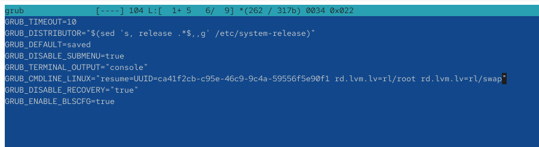
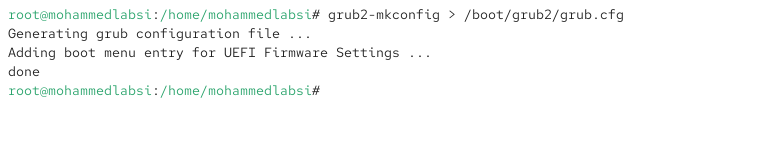
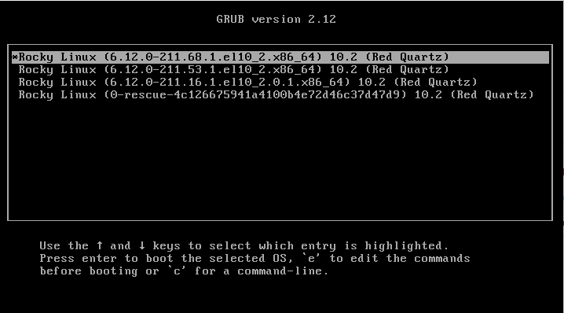
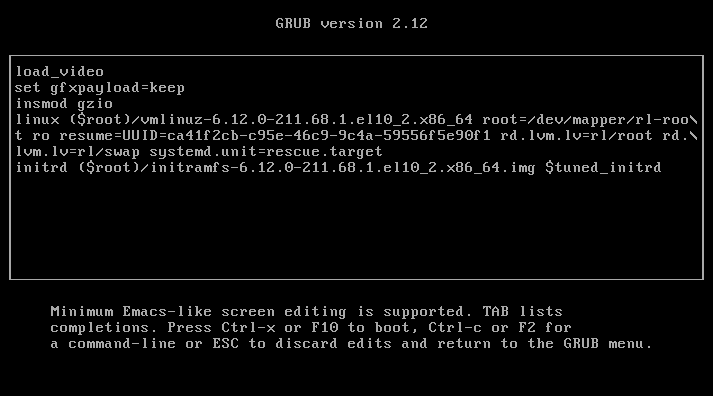
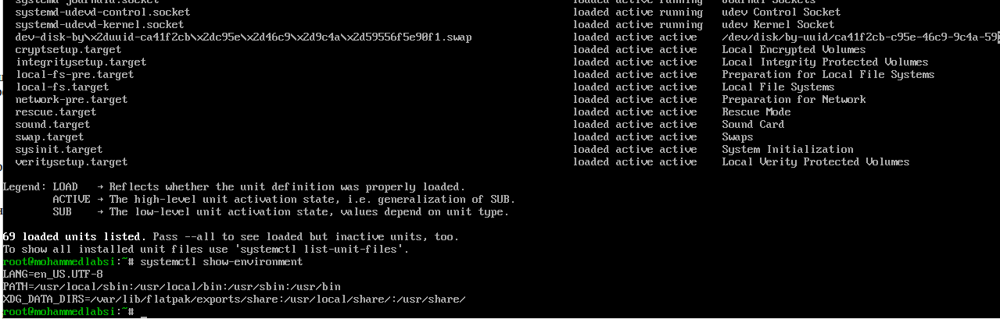
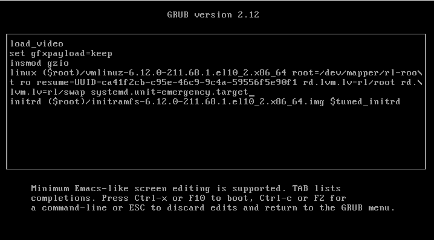
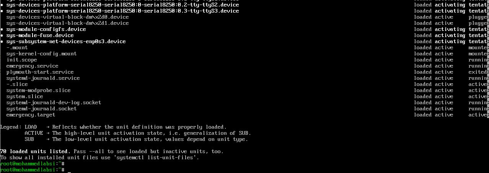
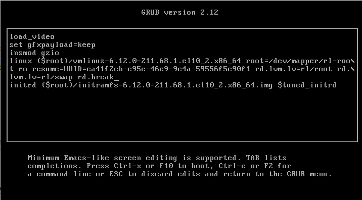
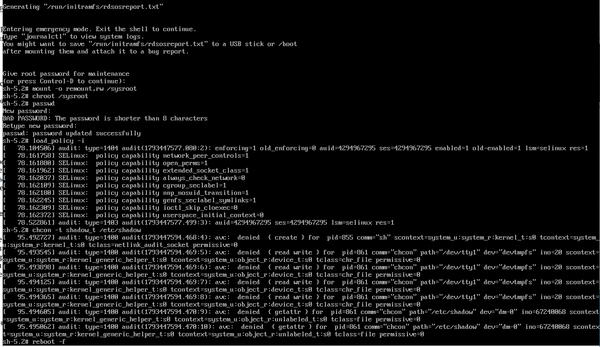

---
## Author
author:
  name: Лабси Мохаммед
  email: 1032245412@rudn.ru
  affiliation:
    - name: Российский университет дружбы народов
      country: Российская Федерация
      postal-code: 117198
      city: Москва
      address: ул. Миклухо-Маклая, д. 6

## Title
title: "Отчёт по лабораторной работе №11"
subtitle: "Управление загрузкой системы"
license: "CC BY"
---

# Цель работы

Получить навыки работы с загрузчиком системы GRUB2.

# Выполнение лабораторной работы

## Модификация параметров GRUB2

Запускаю терминал и получаю полномочия администратора:

`su -`

Открываю файл `/etc/default/grub` и устанавливаю время отображения меню загрузки:

`GRUB_TIMEOUT=10`

Проверяю остальные параметры конфигурации. Параметр `GRUB_CMDLINE_LINUX` определяет аргументы запуска ядра, а `GRUB_DEFAULT` задаёт запись загрузки по умолчанию (см. рис. [@fig-001]).

{ #fig-001 width=70% }

Сохраняю изменения и обновляю конфигурацию загрузчика:

`grub2-mkconfig > /boot/grub2/grub.cfg`

Команда формирует новый конфигурационный файл GRUB2. В результате появляется сообщение `done`, подтверждающее успешное завершение операции (см. рис. [@fig-002]).

{ #fig-002 width=70% }

Перезагружаю систему и проверяю отображение меню GRUB2. В меню доступны несколько версий ядра Rocky Linux и запись для восстановления системы. Меню загрузчика отображается корректно (см. рис. [@fig-003]).

{ #fig-003 width=70% }

## Устранение неполадок при работе с GRUB2

Перезагружаю систему, выбираю текущее ядро в меню GRUB и нажимаю `e` для редактирования параметров загрузки.

В конец строки загрузки ядра добавляю:

`systemd.unit=rescue.target`

Нажимаю `Ctrl + x` для продолжения загрузки. Данный параметр запускает систему в режиме восстановления с минимальным набором необходимых служб (см. рис. [@fig-004]).

{ #fig-004 width=70% }

После входа в систему просматриваю загруженные системные модули:

`systemctl list-units`

Затем проверяю переменные окружения:

`systemctl show-environment`

В результате отображаются 69 загруженных модулей управления `systemd`, а также переменные `LANG`, `PATH` и `XDG_DATA_DIRS` (см. рис. [@fig-005]).

{ #fig-005 width=70% }

Перезагружаю систему:

`systemctl reboot`

Повторно открываю редактор GRUB и добавляю параметр:

`systemd.unit=emergency.target`

Нажимаю `Ctrl + x`. Система запускается в аварийном режиме, предназначенном для устранения критических неполадок (см. рис. [@fig-006]).

{ #fig-006 width=70% }

После загрузки выполняю:

`systemctl list-units`

В списке присутствуют `emergency.service`, `emergency.target`, `systemd-journald.service` и другие компоненты. Отображается 70 загруженных модулей управления `systemd`, часть которых не находится в активном состоянии (см. рис. [@fig-007]).

{ #fig-007 width=70% }

Завершаю проверку перезагрузкой:

`systemctl reboot`

## Сброс пароля root

Для сброса пароля администратора перезагружаю систему, выбираю текущее ядро и нажимаю `e`.

В конец строки загрузки добавляю:

`rd.break`

Нажимаю `Ctrl + x`. Параметр прерывает процесс загрузки на этапе `initramfs` и позволяет перейти к восстановлению системы (см. рис. [@fig-008]).

{ #fig-008 width=70% }

Перемонтирую корневую файловую систему в режиме чтения и записи:

`mount -o remount,rw /sysroot`

Перехожу в корневой каталог установленной системы:

`chroot /sysroot`

Изменяю пароль администратора:

`passwd`

Несмотря на предупреждение о недостаточной длине пароля, появляется сообщение `password updated successfully`.

Для восстановления контекста безопасности SELinux выполняю:

`load_policy -i`

`chcon -t shadow_t /etc/shadow`

Однако при изменении контекста файла `/etc/shadow` появляются ошибки SELinux `avc: denied`, свидетельствующие об отказе в доступе.

Перезагружаю систему:

`reboot -f`

Выполнение команд сопровождается ошибками настройки SELinux (см. рис. [@fig-009]).

{ #fig-009 width=70% }

После перезагрузки система отображает графический экран авторизации, однако войти в неё не удаётся.

Проверяю вход под обычными пользователями и администратором `root`. Авторизация не проходит ни под одной учётной записью (см. рис. [@fig-010]).

{ #fig-010 width=70% }

**В результате выполнения команд из раздела сброса пароля нарушилась работа механизма авторизации. Система загружается до экрана входа, но авторизоваться невозможно ни одному пользователю, включая root.**

Предположительно, проблема связана с некорректным контекстом SELinux файла `/etc/shadow`, поскольку при выполнении `chcon` возникали ошибки доступа. Точная причина требует дополнительной диагностики.

## Контрольные вопросы

1. **Какой файл конфигурации следует изменить для применения общих изменений в GRUB2?**  
   Для изменения общих параметров загрузчика GRUB2 используется файл:

   `/etc/default/grub`

   В нём задаются основные настройки загрузчика, включая время отображения меню (`GRUB_TIMEOUT`), запись загрузки по умолчанию (`GRUB_DEFAULT`) и параметры запуска ядра (`GRUB_CMDLINE_LINUX`).

2. **Как называется конфигурационный файл GRUB2, в котором вы применяете изменения для GRUB2?**  
   Основным конфигурационным файлом загрузчика GRUB2 является:

   `/boot/grub2/grub.cfg`

   Этот файл содержит настройки меню загрузки, записи операционных систем и параметры запуска ядра. Он формируется автоматически на основании `/etc/default/grub` и файлов из каталога `/etc/grub.d/`. Редактировать его вручную не рекомендуется.

3. **После внесения изменений в конфигурацию GRUB2, какую команду вы должны выполнить, чтобы изменения сохранились и воспринялись при загрузке системы?**  
   Для применения изменений необходимо выполнить команду:

   `grub2-mkconfig -o /boot/grub2/grub.cfg`

   Она создаёт обновлённый конфигурационный файл GRUB2 с учётом внесённых настроек.

   Также можно использовать команду:

   `grub2-mkconfig > /boot/grub2/grub.cfg`

   После обновления конфигурации необходимо перезагрузить систему, чтобы проверить применение новых параметров загрузчика.

# Заключение

В ходе лабораторной работы изменяю параметры GRUB2, обновляю конфигурацию загрузчика и проверяю режимы восстановления `rescue.target` и `emergency.target`.

Также выполняю сброс пароля root через параметр `rd.break`. Однако после выполнения команд возникают ошибки SELinux, а последующая перезагрузка приводит к невозможности входа в систему под любой учётной записью.

В результате навыки настройки GRUB2 и использования аварийных режимов изучены, но процедура сброса пароля завершается нарушением работоспособности авторизации операционной системы.

# Список литературы

1. [GNU GRUB Manual. Simple Configuration — настройка загрузчика GRUB2, изменение параметров файла /etc/default/grub и управление меню загрузки](https://www.gnu.org/software/grub/manual/grub/html_node/Simple-configuration.html).

2. [Red Hat. Configuring Kernel Command-Line Parameters — настройка параметров загрузки ядра Linux, редактирование меню GRUB2 и обновление конфигурации в RHEL 10](https://docs.redhat.com/en/documentation/red_hat_enterprise_linux/10/html/managing_monitoring_and_updating_the_kernel/configuring-kernel-command-line-parameters).

3. [Linux Manual Pages. systemd.special(7) — описание системных целей rescue.target и emergency.target, использование режимов восстановления и аварийной загрузки](https://man7.org/linux/man-pages/man7/systemd.special.7.html).

4. [Red Hat. Managing Users and Groups — управление учётными записями Linux, изменение и восстановление пароля root с использованием GRUB2 и параметра rd.break](https://docs.redhat.com/en/documentation/red_hat_enterprise_linux/9/html/configuring_basic_system_settings/managing-users-and-groups_configuring-basic-system-settings).

5. [Red Hat. Troubleshooting Problems Related to SELinux — диагностика ошибок SELinux, анализ отказов в доступе, восстановление контекстов безопасности файлов и устранение неполадок](https://docs.redhat.com/en/documentation/red_hat_enterprise_linux/10/html/using_selinux/troubleshooting-problems-related-to-selinux).
