---
## Author
author:
  name: Лабси Мохаммед
  email: 1032245412@rudn.ru
  affiliation:
    - name: Российский университет дружбы народов
      country: Российская Федерация
      postal-code: 117198
      city: Москва
      address: ул. Миклухо-Маклая, д. 6

## Title
title: Лабораторная работа №12
subtitle: Настройки сети в Linux
license: CC BY
date: today
date-format: "YYYY-MM-DD"
---

# Цели и задачи работы

## Цель лабораторной работы

Получить практические навыки настройки и диагностики сетевых подключений в операционной системе Rocky Linux.

Изучить использование утилиты `ip` для просмотра сетевых интерфейсов, IP-адресов, таблицы маршрутизации и статистики передачи пакетов.

Освоить управление сетевыми соединениями с помощью `nmcli`, создание динамических и статических подключений, изменение IP-адресов, DNS-серверов и шлюза по умолчанию.

Изучить просмотр и редактирование сетевых параметров с помощью `nmtui` и графического интерфейса операционной системы.

# Проверка конфигурации сети

## Просматриваю сетевые интерфейсы и статистику передачи пакетов

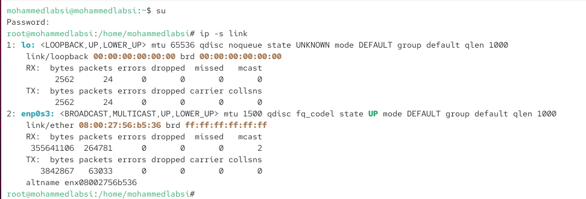{ #fig:001 width=70% height=70% }

## Проверяю таблицу маршрутизации и IP-адреса

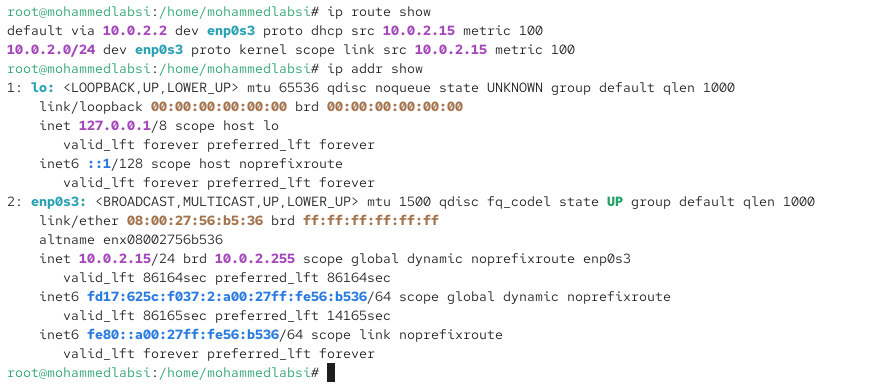{ #fig:002 width=70% height=70% }

## Проверяю доступность Интернета

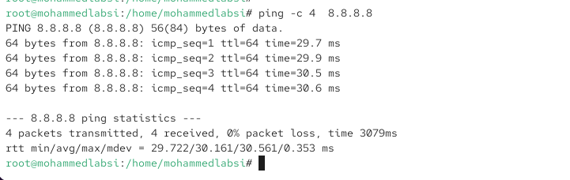{ #fig:003 width=70% height=70% }

## Добавляю дополнительный IPv4-адрес сетевому интерфейсу

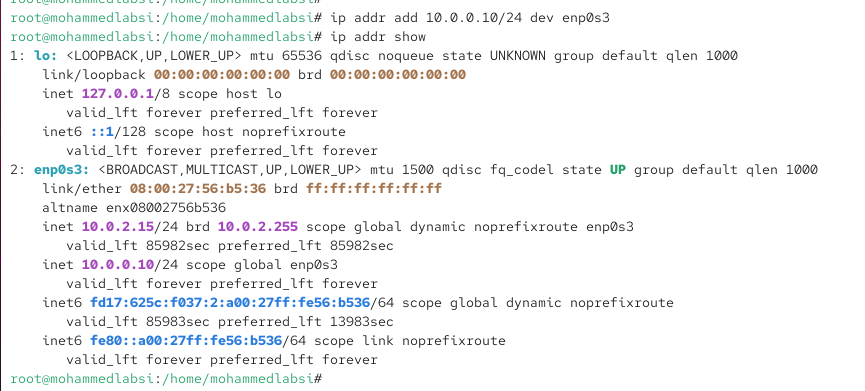{ #fig:004 width=70% height=70% }

## Сравниваю информацию о сетевых интерфейсах

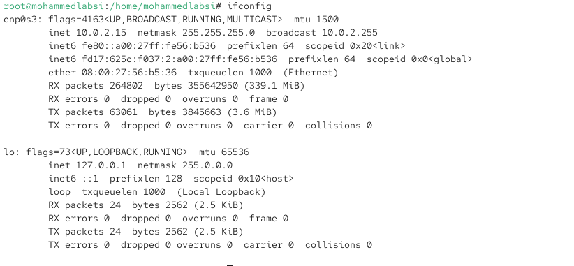{ #fig:005 width=70% height=70% }

## Просматриваю прослушиваемые TCP- и UDP-порты

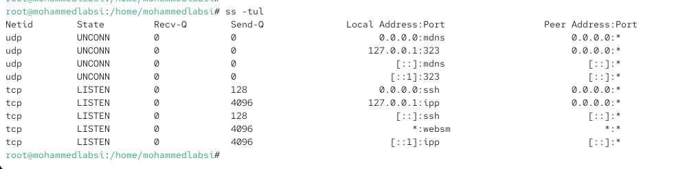{ #fig:006 width=70% height=70% }

# Управление сетевыми подключениями с помощью nmcli

## Создаю сетевые соединения dhcp и static

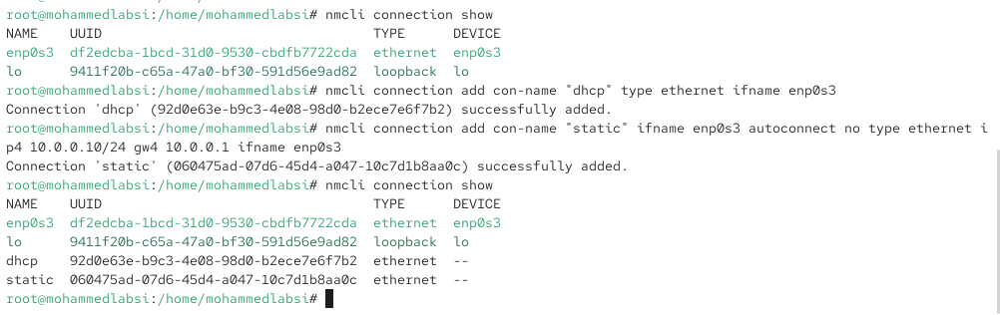{ #fig:007 width=70% height=70% }

## Активирую статическое сетевое соединение

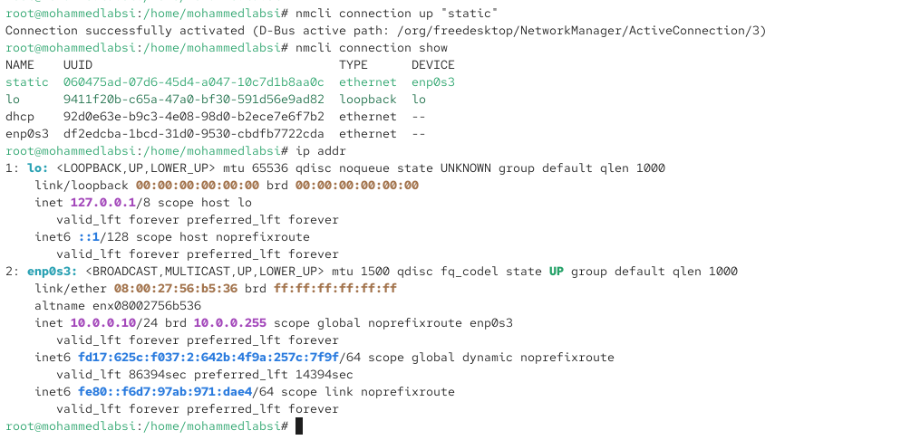{ #fig:008 width=70% height=70% }

## Переключаюсь на соединение с динамической конфигурацией

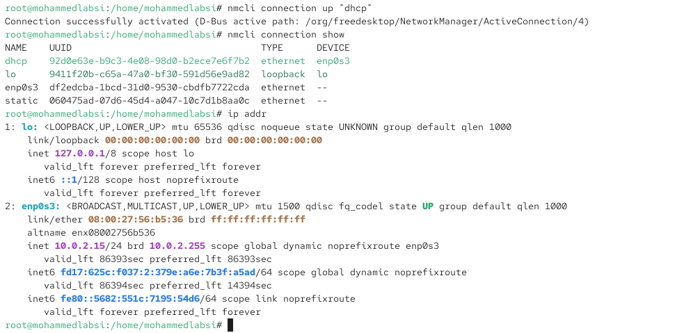{ #fig:009 width=70% height=70% }

# Изменение параметров сетевого соединения

## Изменяю IP-адреса и DNS-серверы статического соединения

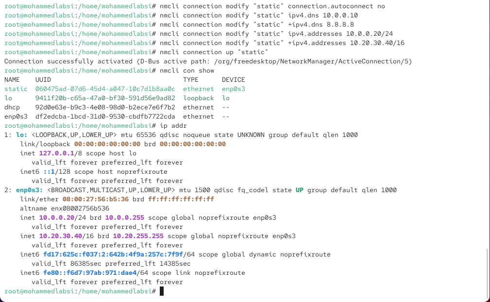{ #fig:010 width=70% height=70% }

# Настройка сетевых соединений с помощью nmtui

## Просматриваю параметры статического соединения

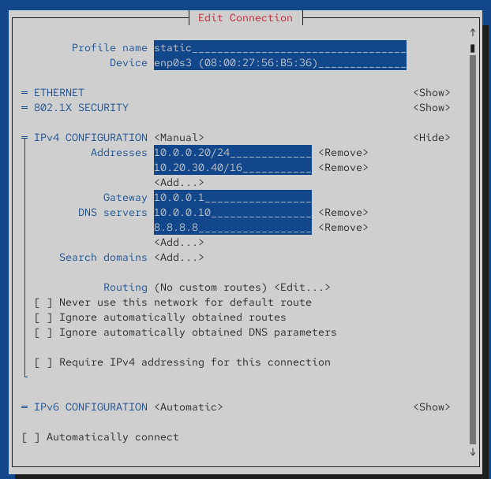{ #fig:011 width=70% height=70% }

## Проверяю параметры динамического соединения dhcp

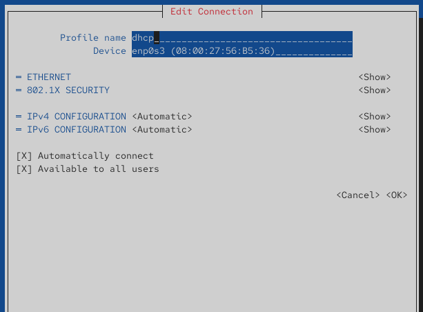{ #fig:012 width=70% height=70% }

## Проверяю первоначальное сетевое соединение enp0s3

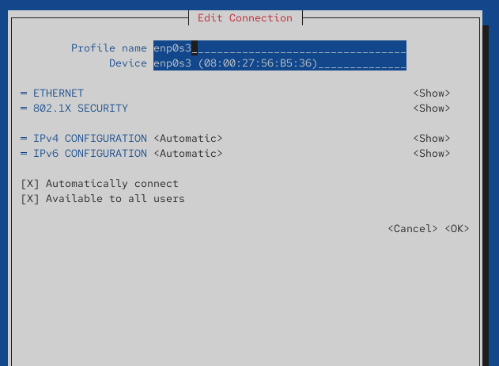{ #fig:013 width=70% height=70% }

# Просмотр настроек сети в графическом интерфейсе

## Проверяю параметры статического соединения

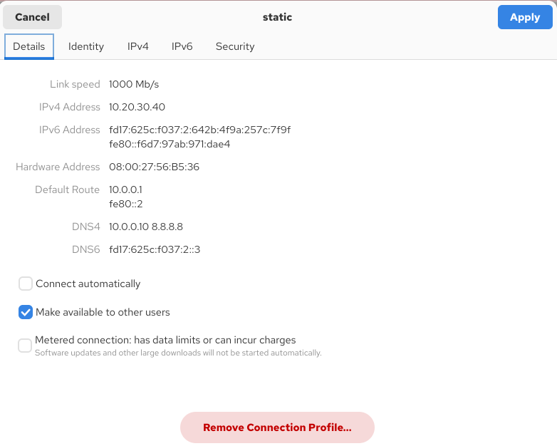{ #fig:014 width=70% height=70% }

## Просматриваю параметры соединения dhcp

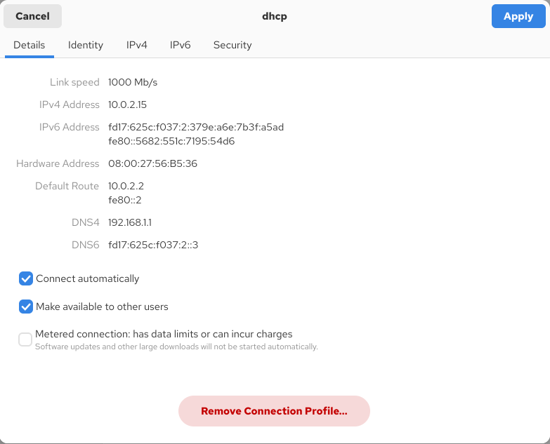{ #fig:015 width=70% height=70% }

## Проверяю первоначальные настройки сетевого адаптера

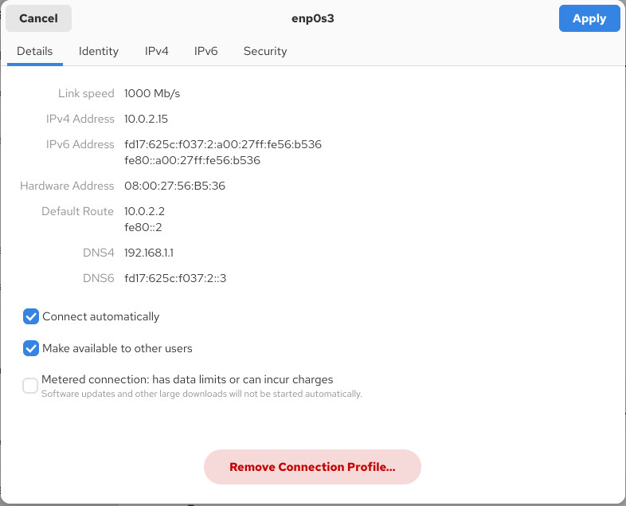{ #fig:016 width=70% height=70% }

# Выводы по проделанной работе

## Вывод

В ходе лабораторной работы изучены основные возможности настройки и диагностики сети в операционной системе Rocky Linux.

С помощью утилиты `ip` получена информация о сетевых интерфейсах, IP-адресах, маршрутах и статистике передачи пакетов. Проверена доступность сети с помощью `ping`, добавлен дополнительный IPv4-адрес и выполнено сравнение команд `ip` и `ifconfig`.

С помощью утилиты `ss` изучены прослушиваемые TCP- и UDP-порты.

Освоено управление сетевыми подключениями с помощью `nmcli`. Созданы соединения `dhcp` и `static`, выполнено переключение между ними, изменены IP-адреса, DNS-серверы и параметры автоматического подключения.
