---
## Author
author:
  name: Лабси Мохаммед
  email: 1032245412@rudn.ru
  affiliation:
    - name: Российский университет дружбы народов
      country: Российская Федерация
      postal-code: 117198
      city: Москва
      address: ул. Миклухо-Маклая, д. 6

## Title
title: "Отчёт по лабораторной работе №12"
subtitle: "Настройки сети в Linux"
license: "CC BY"
---

# Цель работы

Получить навыки настройки сетевых параметров системы.

# Выполнение лабораторной работы

## Проверка конфигурации сети с помощью утилиты ip

Запускаю терминал и получаю полномочия администратора:

`su`

Для просмотра информации о сетевых интерфейсах и статистики передачи пакетов выполняю команду:

`ip -s link`

В результате отображается информация о двух сетевых интерфейсах: `lo` и `enp0s3`.

Интерфейс `lo` является локальным интерфейсом обратной петли, используемым для взаимодействия процессов внутри системы.

Интерфейс `enp0s3` представляет собой сетевой адаптер Ethernet. Он находится в состоянии `UP`, что указывает на его активность. Значение `mtu 1500` определяет максимальный размер передаваемого пакета без фрагментации, а `08:00:27:56:b5:36` является MAC-адресом адаптера.

В статистике интерфейса `enp0s3` отображается 264781 принятый пакет (`RX`) и 63033 отправленных пакета (`TX`). Количество ошибок (`errors`) и отброшенных пакетов (`dropped`) равно нулю, что указывает на отсутствие зарегистрированных ошибок передачи и приёма в представленной статистике (см. рис. [@fig-001]).

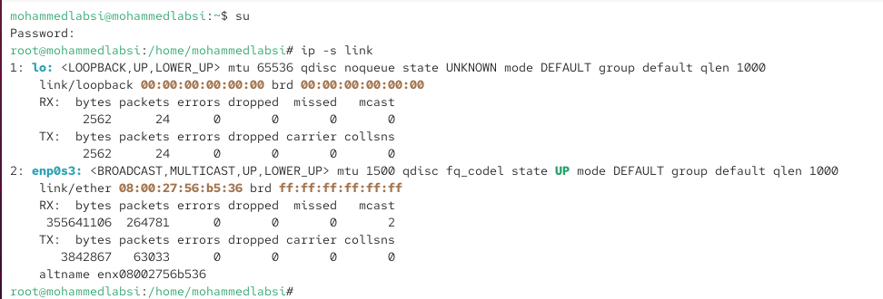{ #fig-001 width=70% }

Для просмотра текущей таблицы маршрутизации выполняю команду:

`ip route show`

В результате отображаются два маршрута:

- `default via 10.0.2.2 dev enp0s3` — маршрут по умолчанию, согласно которому пакеты, предназначенные для внешних сетей, направляются через шлюз `10.0.2.2` по интерфейсу `enp0s3`.
- `10.0.2.0/24 dev enp0s3` — маршрут к локальной сети `10.0.2.0/24`, непосредственно подключённой к сетевому интерфейсу.

Параметр `src 10.0.2.15` указывает исходный IPv4-адрес, используемый при передаче пакетов. Параметр `proto dhcp` означает, что маршрут получен через DHCP, а `metric 100` задаёт метрику маршрута.

Для просмотра назначенных сетевым интерфейсам IP-адресов выполняю команду:

`ip addr show`

В результате определяю, что сетевой адаптер имеет обозначение `enp0s3`, а его IPv4-адрес — `10.0.2.15/24`. Маска подсети соответствует значению `255.255.255.0`, широковещательный адрес — `10.0.2.255`.

Также интерфейсу назначены глобальный IPv6-адрес и локальный IPv6-адрес, начинающийся с `fe80::`. Интерфейс `lo` использует IPv4-адрес `127.0.0.1/8` и IPv6-адрес `::1/128` (см. рис. [@fig-002]).

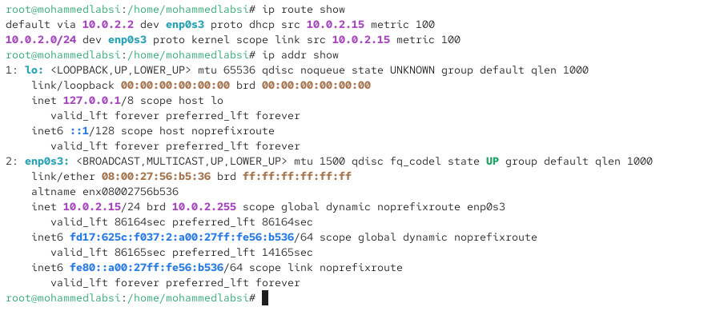{ #fig-002 width=70% }

Для проверки сетевого подключения отправляю четыре ICMP-запроса на IP-адрес публичного DNS-сервера Google:

`ping -c 4 8.8.8.8`

В результате все четыре отправленных пакета успешно доставляются и принимаются обратно. Потери пакетов составляют `0%`.

Минимальное время ответа составляет `29.722 ms`, среднее — `30.161 ms`, максимальное — `30.361 ms`.

Полученные результаты подтверждают доступность удалённого узла `8.8.8.8` и работоспособность сетевого подключения по IPv4 (см. рис. [@fig-003]).

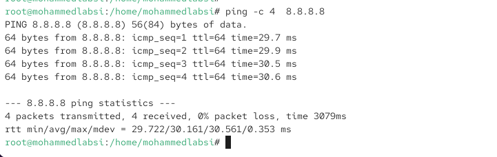{ #fig-003 width=70% }

Добавляю дополнительный IPv4-адрес `10.0.0.10/24` к сетевому интерфейсу `enp0s3`:

`ip addr add 10.0.0.10/24 dev enp0s3`

Проверяю результат выполнения команды:

`ip addr show`

В выводе команды для интерфейса `enp0s3` отображаются два IPv4-адреса: первоначальный `10.0.2.15/24` и дополнительный `10.0.0.10/24`.

Первоначальный адрес обозначен как `dynamic`, поскольку получен автоматически. Дополнительный адрес добавлен вручную и имеет область действия `global`.

Это подтверждает возможность назначения нескольких IP-адресов одному сетевому интерфейсу с помощью утилиты `ip` (см. рис. [@fig-004]).

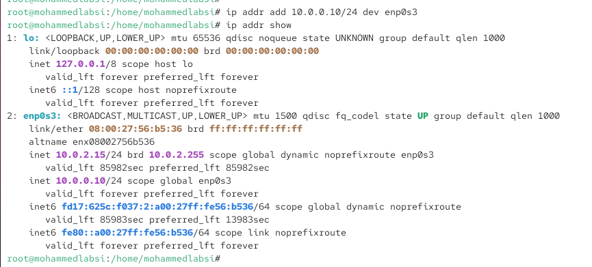{ #fig-004 width=70% }

Для сравнения информации о сетевых интерфейсах использую команду:

`ifconfig`

В результате отображаются сведения об интерфейсах `enp0s3` и `lo`.

Для интерфейса `enp0s3` выводятся IPv4-адрес `10.0.2.15`, маска сети `255.255.255.0`, широковещательный адрес `10.0.2.255`, MAC-адрес, значение MTU и статистика переданных и принятых пакетов.

В отличие от команды `ip addr show`, представленный вывод `ifconfig` не показывает ранее добавленный дополнительный IPv4-адрес `10.0.0.10/24`.

Команда `ip` предоставляет более подробные сведения о состоянии интерфейсов, назначенных адресах и параметрах сети. Утилита `ifconfig` позволяет просматривать основные характеристики интерфейсов, однако относится к устаревшему набору сетевых инструментов (см. рис. [@fig-005]).

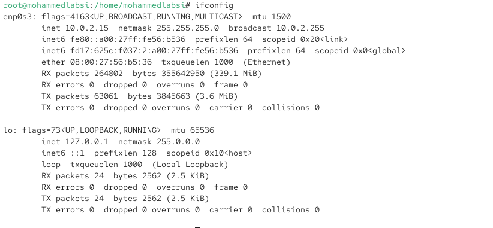{ #fig-005 width=70% }

Для просмотра прослушиваемых системой портов TCP и UDP выполняю команду:

`ss -tul`

Параметр `-t` отвечает за отображение TCP-сокетов, `-u` — UDP-сокетов, а `-l` ограничивает вывод прослушиваемыми сокетами.

В результате получаю список сетевых служб и соответствующих портов.

Среди UDP-сокетов отображаются службы `mdns` и порт `323`. Среди TCP-сокетов присутствуют службы `ssh`, `ipp` и `websm`.

Состояние `LISTEN` у TCP-сокетов означает ожидание входящих соединений. Для UDP-сокетов отображается состояние `UNCONN`, характерное для сокетов без установленного соединения.

Адрес `0.0.0.0` означает привязку ко всем локальным IPv4-адресам, а `127.0.0.1` указывает на доступность службы только через локальный интерфейс IPv4. Аналогичные обозначения используются для IPv6.

Полученная информация позволяет определить сетевые службы, ожидающие входящие подключения или UDP-пакеты (см. рис. [@fig-006]).

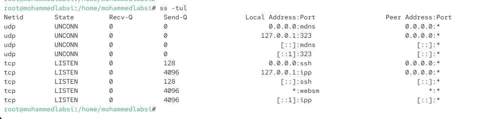{ #fig-006 width=70% }

## Управление сетевыми подключениями с помощью nmcli

Для управления сетевыми подключениями использую утилиту `nmcli`, представляющую собой интерфейс командной строки для NetworkManager.

Просматриваю список существующих сетевых соединений:

`nmcli connection show`

В результате отображаются соединение `enp0s3`, связанное с сетевым адаптером Ethernet, и соединение `lo`, соответствующее интерфейсу обратной петли.

Создаю новое Ethernet-соединение с именем `dhcp` для интерфейса `enp0s3`:

`nmcli connection add con-name "dhcp" type ethernet ifname enp0s3`

Команда создаёт профиль подключения, использующий автоматическое получение сетевых параметров.

Затем создаю статическое Ethernet-соединение с именем `static`, IPv4-адресом `10.0.0.10/24` и шлюзом `10.0.0.1`:

`nmcli connection add con-name "static" ifname enp0s3 autoconnect no type ethernet ip4 10.0.0.10/24 gw4 10.0.0.1`

Параметр `autoconnect no` запрещает автоматическую активацию статического соединения.

После создания профилей повторно выполняю:

`nmcli connection show`

В списке появляются четыре соединения: `enp0s3`, `lo`, `dhcp` и `static`. Новые соединения созданы успешно, но пока не активированы, поэтому в столбце `DEVICE` для них отображается `--` (см. рис. [@fig-007]).

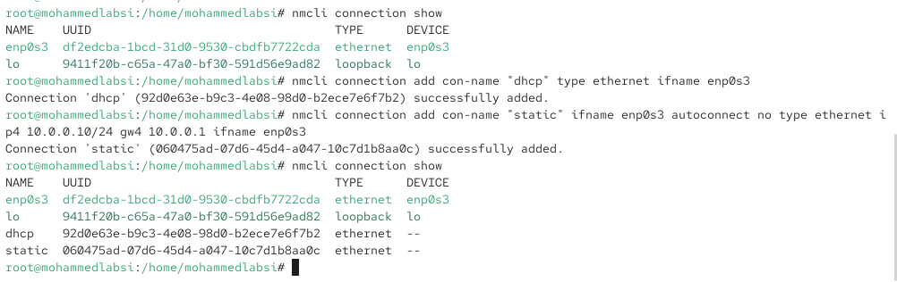{ #fig-007 width=70% }

Активирую статическое сетевое соединение:

`nmcli connection up "static"`

В терминале появляется сообщение `Connection successfully activated`, подтверждающее успешное переключение.

Проверяю состояние соединений:

`nmcli connection show`

В результате соединение `static` становится активным и связывается с интерфейсом `enp0s3`. Ранее использовавшееся соединение `enp0s3` перестаёт быть активным.

Для проверки назначенного адреса выполняю:

`ip addr`

В выводе команды для интерфейса `enp0s3` отображается статический IPv4-адрес `10.0.0.10/24`. Первоначальный динамический адрес `10.0.2.15/24` отсутствует.

Это подтверждает успешное переключение на соединение со статической IPv4-конфигурацией (см. рис. [@fig-008]).

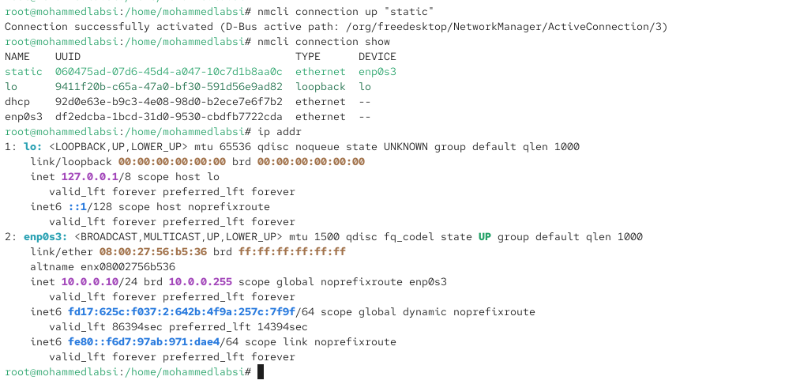{ #fig-008 width=70% }

Возвращаюсь к соединению с автоматическим получением сетевых параметров:

`nmcli connection up "dhcp"`

Команда завершается сообщением об успешной активации соединения.

Проверяю результат:

`nmcli connection show`

Теперь активным соединением для интерфейса `enp0s3` является `dhcp`, а статический профиль отображается как неактивный.

Дополнительно проверяю IP-адрес:

`ip addr`

В результате интерфейсу `enp0s3` снова назначается динамический IPv4-адрес `10.0.2.15/24`.

Полученный результат подтверждает успешное переключение между статическим и динамическим способами настройки сети (см. рис. [@fig-009]).

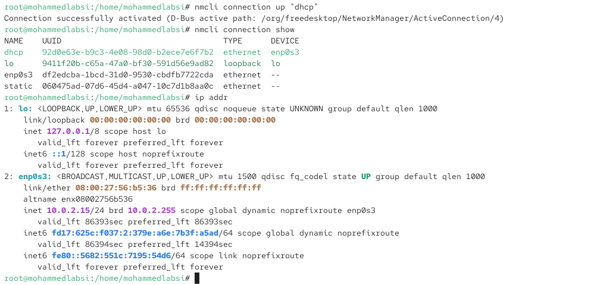{ #fig-009 width=70% }

## Изменение параметров соединения с помощью nmcli

Для изменения параметров ранее созданного соединения `static` использую команду `nmcli connection modify`.

Сначала отключаю автоматическую активацию статического соединения:

`nmcli connection modify "static" connection.autoconnect no`

Добавляю первый DNS-сервер с адресом `10.0.0.10`:

`nmcli connection modify "static" ipv4.dns 10.0.0.10`

Затем добавляю второй DNS-сервер с адресом `8.8.8.8`:

`nmcli connection modify "static" +ipv4.dns 8.8.8.8`

Знак `+` перед параметром `ipv4.dns` позволяет добавить новый адрес к существующему списку DNS-серверов без замены ранее указанного значения.

Изменяю основной IPv4-адрес статического соединения:

`nmcli connection modify "static" ipv4.addresses 10.0.0.20/24`

После этого добавляю второй IPv4-адрес:

`nmcli connection modify "static" +ipv4.addresses 10.20.30.40/16`

В данном случае знак `+` позволяет сохранить первый адрес и дополнить список новым значением.

Для применения изменённых параметров активирую соединение:

`nmcli connection up "static"`

Проверяю состояние сетевых соединений:

`nmcli con show`

В результате профиль `static` становится активным для интерфейса `enp0s3`.

Для проверки назначенных адресов выполняю:

`ip addr`

В выводе команды отображаются два IPv4-адреса интерфейса `enp0s3`: `10.0.0.20/24` и `10.20.30.40/16`.

Успешная активация и наличие обоих адресов подтверждают применение изменённых параметров соединения (см. рис. [@fig-010]).

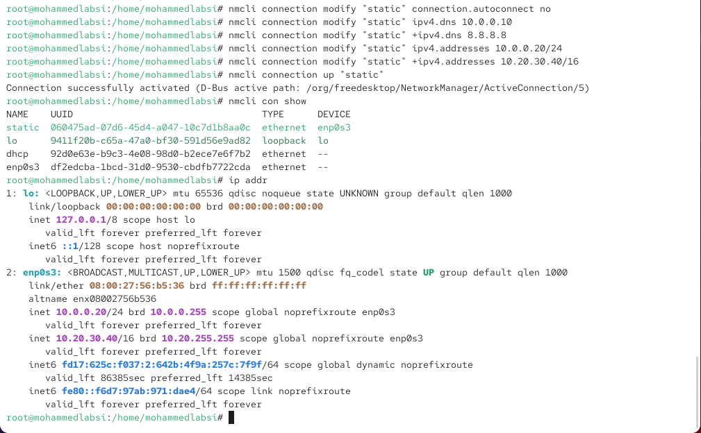{ #fig-010 width=70% }

Для просмотра сетевых параметров в текстовом интерфейсе NetworkManager запускаю утилиту:

`nmtui`

Перехожу к редактированию сетевых соединений и открываю профиль `static`.

В настройках соединения указан сетевой интерфейс `enp0s3` с MAC-адресом `08:00:27:56:b5:36`.

Для IPv4 выбран режим `Manual`, предусматривающий ручное назначение сетевых параметров.

В списке адресов отображаются `10.0.0.20/24` и `10.20.30.40/16`. В качестве основного шлюза указан адрес `10.0.0.1`, а в качестве DNS-серверов — `10.0.0.10` и `8.8.8.8`.

Для IPv6 установлен режим `Automatic`. Автоматическое подключение статического профиля отключено.

Настройки соответствуют параметрам, ранее заданным с помощью `nmcli` (см. рис. [@fig-011]).

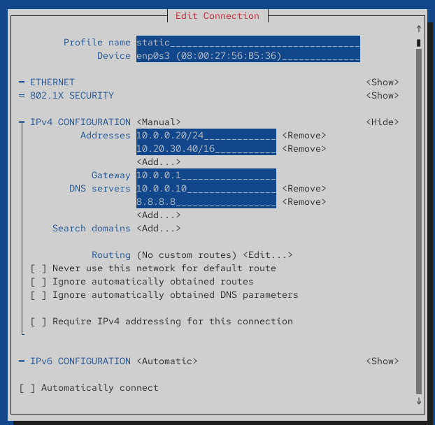{ #fig-011 width=70% }

Далее в утилите `nmtui` открываю параметры соединения `dhcp`.

В настройках указан интерфейс `enp0s3`. Для IPv4 и IPv6 установлены автоматические способы конфигурирования.

Параметр `Automatically connect` включён, что разрешает автоматическое подключение данного профиля. Также включён параметр `Available to all users`, позволяющий использовать соединение всем пользователям системы.

Настройки подтверждают, что профиль `dhcp` предназначен для автоматического получения сетевых параметров (см. рис. [@fig-012]).

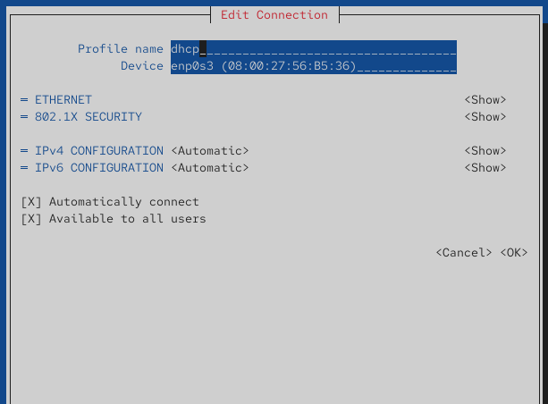{ #fig-012 width=70% }

После этого открываю первоначальное сетевое соединение `enp0s3`.

Проверяю настройки интерфейса и способы конфигурирования IP-адресов.

Для IPv4 и IPv6 выбран режим `Automatic`. Также включены параметры автоматического подключения и доступности соединения всем пользователям.

Следовательно, первоначальный профиль `enp0s3`, как и созданный профиль `dhcp`, использует автоматическую настройку сетевых адресов (см. рис. [@fig-013]).

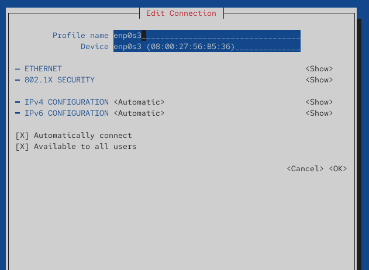{ #fig-013 width=70% }

Для просмотра параметров сети в графическом интерфейсе операционной системы открываю настройки сетевых подключений.

Выбираю соединение `static` и перехожу на вкладку `Details`.

В графическом интерфейсе отображаются скорость соединения `1000 Mb/s`, IPv4-адрес `10.20.30.40`, IPv6-адреса и аппаратный адрес сетевого адаптера.

В качестве маршрута по умолчанию указан шлюз `10.0.0.1`. В списке DNS-серверов IPv4 присутствуют адреса `10.0.0.10` и `8.8.8.8`.

Параметр `Connect automatically` отключён, что соответствует настройке `connection.autoconnect no`.

Графический интерфейс подтверждает сохранение настроенных сетевых параметров статического соединения (см. рис. [@fig-014]).

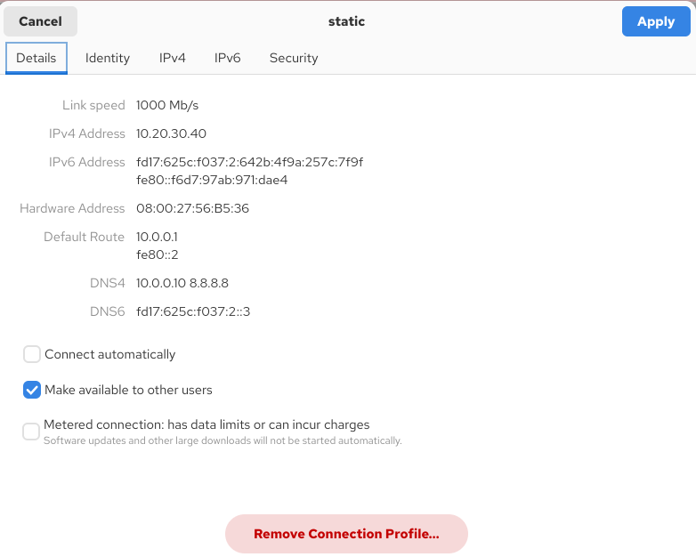{ #fig-014 width=70% }

Затем открываю свойства соединения `dhcp`.

Во вкладке `Details` отображается IPv4-адрес `10.0.2.15`, полученный автоматически.

В качестве основного шлюза указан `10.0.2.2`, а в качестве DNS-сервера IPv4 — `192.168.1.1`.

Скорость соединения составляет `1000 Mb/s`, аппаратный адрес сетевого интерфейса — `08:00:27:56:b5:36`.

Параметры `Connect automatically` и `Make available to other users` включены.

Полученная информация соответствует конфигурации соединения с автоматическим назначением сетевых параметров (см. рис. [@fig-015]).

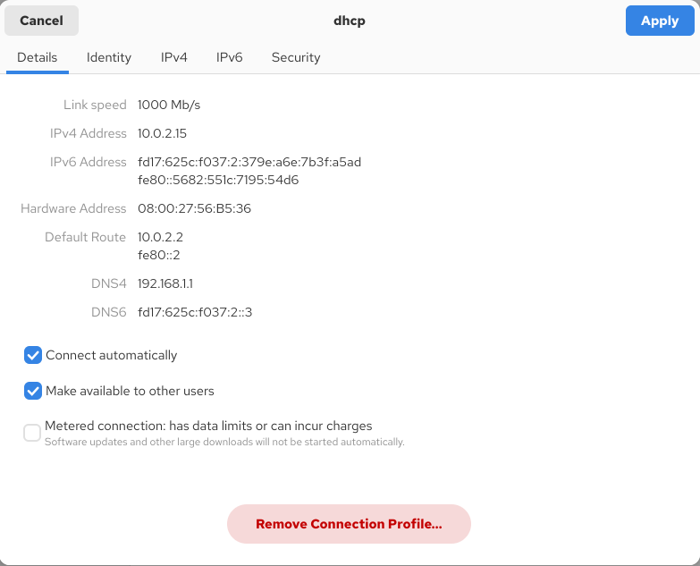{ #fig-015 width=70% }

В завершение просматриваю параметры первоначального сетевого соединения `enp0s3` в графическом интерфейсе.

В его свойствах отображаются IPv4-адрес `10.0.2.15`, маршрут по умолчанию через `10.0.2.2` и DNS-сервер `192.168.1.1`.

Скорость соединения составляет `1000 Mb/s`. Автоматическое подключение разрешено, а профиль доступен всем пользователям системы.

Для возврата к первоначальному сетевому соединению используется команда:

`nmcli connection up "enp0s3"`

На заключительном скриншоте представлены параметры исходного профиля `enp0s3`, однако выполнение команды его повторной активации отдельно не отображается (см. рис. [@fig-016]).

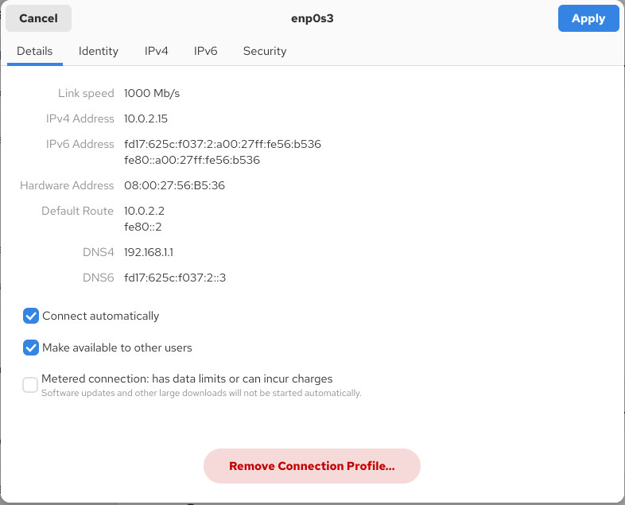{ #fig-016 width=70% }

## Контрольные вопросы

1. **Какая команда отображает только статус соединения, но не IP-адрес?**  
   Для просмотра состояния сетевых устройств без отображения их IP-адресов используется команда:

   `nmcli device status`

   Команда выводит список сетевых устройств, их тип, текущее состояние (`connected`, `disconnected`, `unavailable`) и имя используемого соединения.

   Также для краткого просмотра состояния сетевых соединений можно использовать команду:

   `nmcli general status`

   Она отображает общее состояние NetworkManager, включая состояние сетевого подключения.

2. **Какая служба управляет сетью в ОС типа RHEL?**  
   В операционных системах семейства RHEL (Red Hat Enterprise Linux), включая Rocky Linux, управление сетевыми подключениями выполняет служба:

   `NetworkManager`

   Она отвечает за настройку сетевых интерфейсов, назначение IP-адресов, управление маршрутами, DNS-серверами и автоматическое подключение к сетям.

   Для управления сетевыми соединениями используются утилиты `nmcli` (командная строка) и `nmtui` (текстовый интерфейс).

3. **Какой файл содержит имя узла (устройства) в ОС типа RHEL?**  
   Имя узла операционной системы хранится в файле:

   `/etc/hostname`

   Этот файл содержит статическое имя компьютера, которое используется для идентификации устройства в системе и сети.

   Для просмотра текущего имени узла можно использовать команду:

   `hostnamectl`

   Также имя узла можно вывести командой `hostname`.

4. **Какая команда позволяет вам задать имя узла (устройства)?**  
   Для изменения имени узла используется команда:

   `hostnamectl set-hostname <имя_узла>`

   Например, для установки имени `server1` необходимо выполнить:

   `hostnamectl set-hostname server1`

   Команда изменяет статическое имя узла, которое сохраняется в файле `/etc/hostname`.

   Проверить результат можно командой:

   `hostnamectl status`

5. **Какой конфигурационный файл можно изменить для включения разрешения имён для конкретного IP-адреса?**  
   Для сопоставления IP-адресов с именами узлов используется файл:

   `/etc/hosts`

   В этом файле можно вручную указать соответствие между IP-адресом и доменным именем устройства.

   Например:

   `192.168.1.10 server1.local server1`

   После добавления записи система сможет преобразовывать имя `server1.local` в IP-адрес `192.168.1.10` без обращения к DNS-серверу, если настройки разрешения имён предусматривают использование файла `/etc/hosts`.

6. **Какая команда показывает текущую конфигурацию маршрутизации?**  
   Для просмотра текущей таблицы маршрутизации используется команда:

   `ip route show`

   Команда отображает маршруты, используемые системой для передачи IP-пакетов.

   Например:

   `default via 10.0.2.2 dev enp0s3`

   Эта запись означает, что маршрут по умолчанию проходит через шлюз `10.0.2.2` с использованием сетевого интерфейса `enp0s3`.

   Также может использоваться сокращённая команда:

   `ip route`

7. **Как проверить текущий статус службы NetworkManager?**  
   Для проверки текущего состояния службы NetworkManager используется команда:

   `systemctl status NetworkManager`

   Команда выводит информацию о состоянии службы, времени её запуска, идентификаторе процесса и последних сообщениях журнала.

   Если служба работает корректно, в выводе отображается состояние:

   `Active: active (running)`

   Для краткой проверки активности службы можно использовать команду:

   `systemctl is-active NetworkManager`

   Если служба запущена, команда возвращает значение `active`.

8. **Какая команда позволяет вам изменить текущий IP-адрес и шлюз по умолчанию для вашего сетевого соединения?**  
   Для изменения IP-адреса и шлюза по умолчанию сетевого соединения используется команда `nmcli connection modify`.

   Например, для установки статического IPv4-адреса `10.0.0.20/24` и шлюза `10.0.0.1` для соединения `static` выполняю:

   `nmcli connection modify "static" ipv4.addresses 10.0.0.20/24 ipv4.gateway 10.0.0.1 ipv4.method manual`

   Параметр `ipv4.addresses` задаёт IPv4-адрес и маску подсети, `ipv4.gateway` определяет шлюз по умолчанию, а `ipv4.method manual` включает ручную настройку IPv4.

   Для применения изменений повторно активирую соединение:

   `nmcli connection up "static"`

   Проверить назначенный IP-адрес можно командой:

   `ip addr show`

   Для проверки маршрута по умолчанию используется команда:

   `ip route show`

# Заключение

В ходе лабораторной работы изучаю возможности утилиты `ip`, просматриваю информацию о сетевых интерфейсах, таблице маршрутизации и назначенных IP-адресах. Проверяю доступность сети с помощью `ping`, добавляю дополнительный IPv4-адрес, сравниваю вывод команд `ip` и `ifconfig`, а также просматриваю прослушиваемые TCP- и UDP-порты с помощью `ss`.

Также использую утилиту `nmcli` для создания и управления сетевыми соединениями `dhcp` и `static`. Выполняю переключение между динамической и статической конфигурациями, изменяю IP-адреса, шлюз по умолчанию, DNS-серверы и параметры автоматического подключения. Проверяю настройки соединений через `nmtui` и графический интерфейс операционной системы.

В результате осваиваю основные навыки диагностики сети, настройки сетевых интерфейсов и управления сетевыми подключениями в Rocky Linux с помощью инструментов NetworkManager.

# Список литературы

1. [Linux Manual Pages. ip(8) — использование утилиты ip для просмотра и настройки сетевых интерфейсов, управления IP-адресами и получения статистики сетевых подключений](https://man7.org/linux/man-pages/man8/ip.8.html).

2. [Linux Manual Pages. ip-route(8) — просмотр таблицы маршрутизации Linux, управление сетевыми маршрутами и настройка шлюза по умолчанию](https://man7.org/linux/man-pages/man8/ip-route.8.html).

3. [Red Hat. Configuring an Ethernet Connection — настройка сетевых интерфейсов в RHEL 9, создание подключений с динамическими и статическими IPv4-адресами, управление DNS и шлюзами](https://docs.redhat.com/en/documentation/red_hat_enterprise_linux/9/html/configuring_and_managing_networking/configuring-an-ethernet-connection_configuring-and-managing-networking).

4. [NetworkManager. nmcli Reference Manual — управление сетевыми соединениями через командную строку, создание и изменение профилей подключений, переключение между соединениями и настройка автоматического подключения](https://networkmanager.pages.freedesktop.org/NetworkManager/NetworkManager/nmcli.html).

5. [NetworkManager. nmtui Reference Manual — использование текстового интерфейса NetworkManager для просмотра, редактирования и активации сетевых подключений](https://networkmanager.pages.freedesktop.org/NetworkManager/NetworkManager/nmtui.html).

6. [Linux Manual Pages. ss(8) — диагностика сетевых соединений, просмотр прослушиваемых TCP- и UDP-портов, анализ состояния сокетов и статистики сетевых служб](https://man7.org/linux/man-pages/man8/ss.8.html).