---
## Author
author:
  name: Лабси Мохаммед
  email: 1032245412@rudn.ru
  affiliation:
    - name: Российский университет дружбы народов
      country: Российская Федерация
      postal-code: 117198
      city: Москва
      address: ул. Миклухо-Маклая, д. 6

## Title
title: Лабораторная работа №13
subtitle: Фильтр пакетов
license: CC BY
date: today
date-format: "YYYY-MM-DD"
---

# Цели и задачи работы

## Цель лабораторной работы

Получить практические навыки настройки и управления межсетевым экраном firewalld в операционной системе Rocky Linux.

Изучить использование утилиты `firewall-cmd` для просмотра зон брандмауэра, управления разрешёнными службами и сетевыми портами.

Изучить различия между временной и постоянной конфигурациями брандмауэра, научиться сохранять и применять изменения.

Настроить доступ к сетевым службам `telnet`, `imap`, `pop3` и `smtp`.

# Управление брандмауэром с помощью firewall-cmd

## Определяю текущую зону и доступные службы

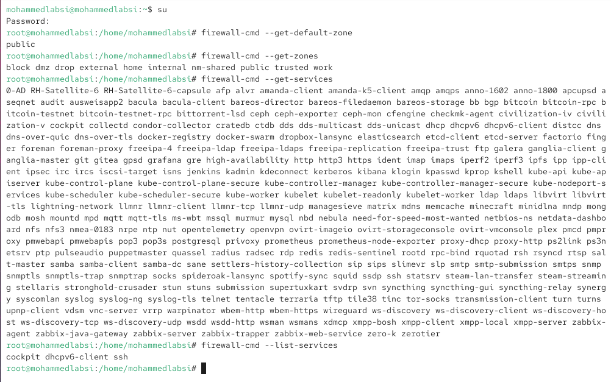{ #fig:001 width=70% height=70% }

## Просматриваю подробную конфигурацию брандмауэра

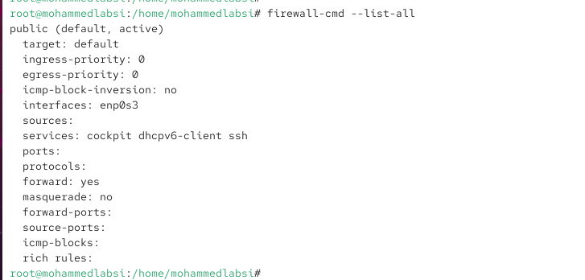{ #fig:002 width=70% height=70% }

## Сравниваю конфигурацию текущей зоны и зоны public

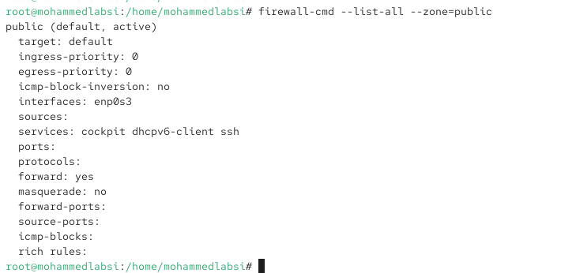{ #fig:003 width=70% height=70% }

## Добавляю службу VNC-сервера

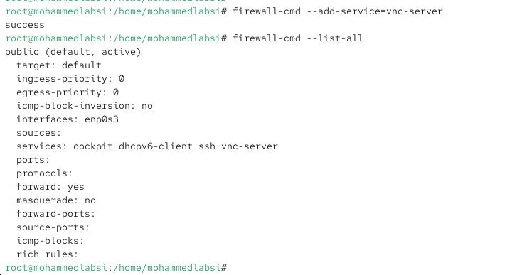{ #fig:004 width=70% height=70% }

## Проверяю сохранение настроек после перезапуска firewalld

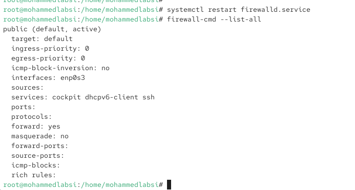{ #fig:005 width=70% height=70% }

## Добавляю VNC-сервер в постоянную конфигурацию

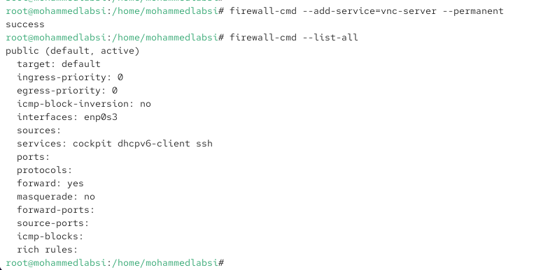{ #fig:006 width=70% height=70% }

## Применяю постоянную конфигурацию брандмауэра

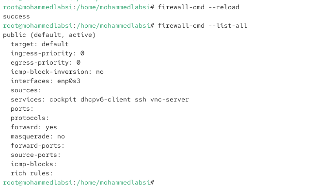{ #fig:007 width=70% height=70% }

## Добавляю порт 2022 протокола TCP

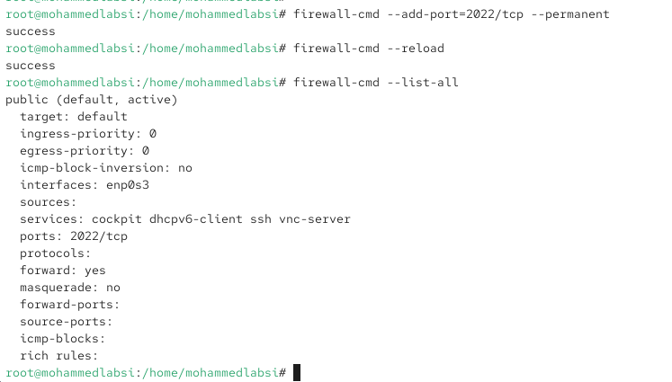{ #fig:008 width=70% height=70% }

# Управление брандмауэром с помощью firewall-config

## Добавляю сетевые службы через графический интерфейс

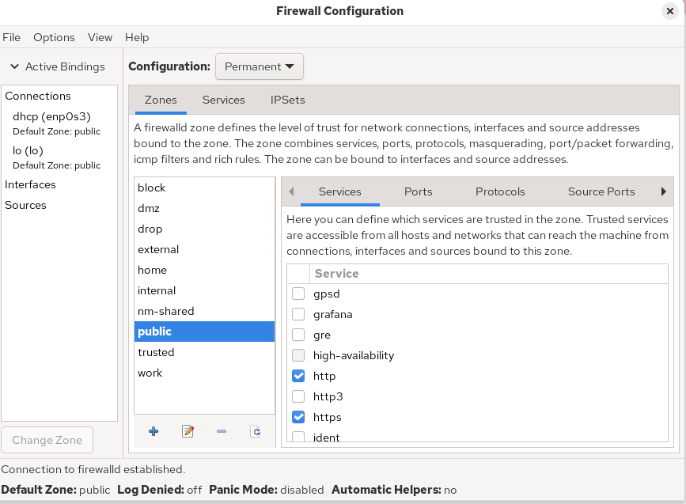{ #fig:009 width=70% height=70% }

## Добавляю порт 2022 протокола UDP

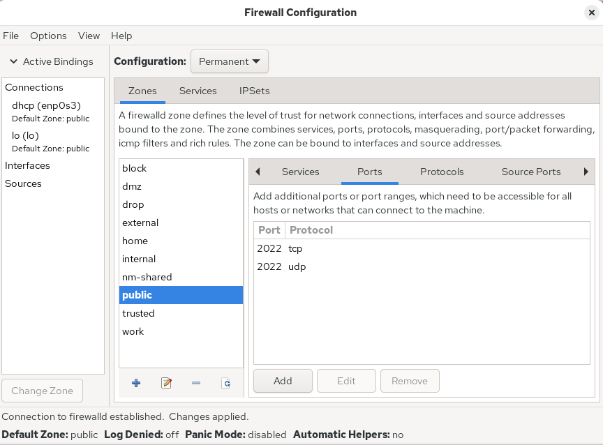{ #fig:010 width=70% height=70% }

## Проверяю конфигурацию после изменений в firewall-config

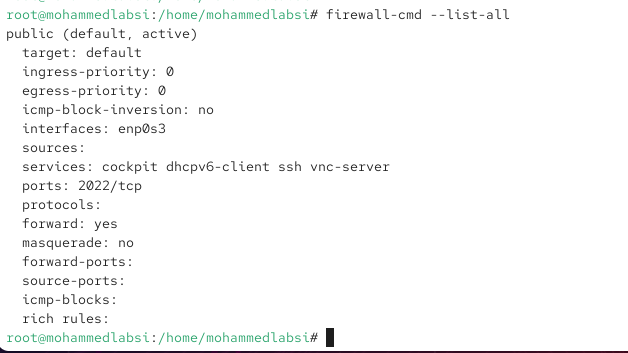{ #fig:011 width=70% height=70% }

## Применяю изменения, внесённые через firewall-config

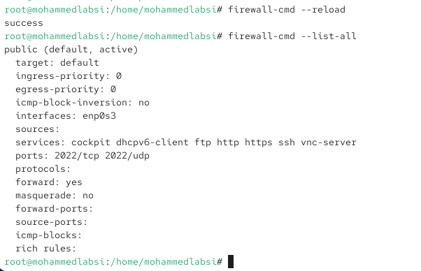{ #fig:012 width=70% height=70% }

# Выполнение самостоятельной работы

## Добавляю почтовые службы через firewall-config

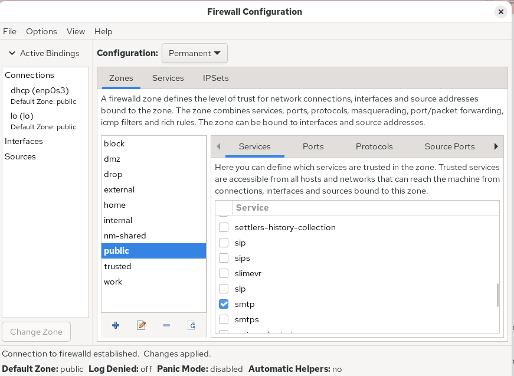{ #fig:013 width=70% height=70% }

## Добавляю службу Telnet и проверяю итоговую конфигурацию

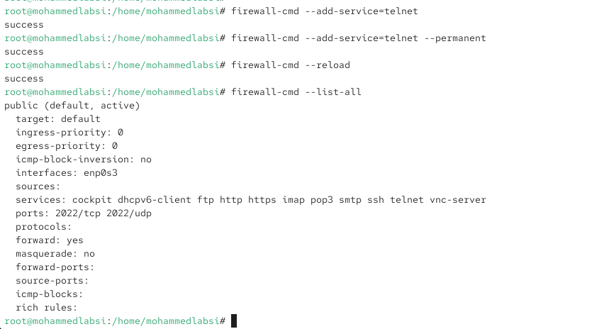{ #fig:014 width=70% height=70% }

# Выводы по проделанной работе

## Вывод

В ходе лабораторной работы изучены основные возможности настройки и управления межсетевым экраном firewalld в операционной системе Rocky Linux.

С помощью утилиты `firewall-cmd` определены доступные зоны, просмотрена текущая конфигурация брандмауэра и список разрешённых служб. Добавлена служба `vnc-server` и настроен порт `2022/tcp`.

Изучены различия между временной и постоянной конфигурациями брандмауэра. Проверено сохранение правил после перезапуска firewalld и применение изменений командой `firewall-cmd --reload`.

В рамках самостоятельной работы настроен доступ к службам `telnet`, `imap`, `pop3` и `smtp`. Проверено наличие всех добавленных служб в действующей конфигурации.
