---
## Author
author:
  name: Лабси Мохаммед
  email: 1032245412@rudn.ru
  affiliation:
    - name: Российский университет дружбы народов
      country: Российская Федерация
      postal-code: 117198
      city: Москва
      address: ул. Миклухо-Маклая, д. 6

## Title
title: "Отчёт по лабораторной работе №13"
subtitle: "Фильтр пакетов"
license: "CC BY"
---

# Цель работы

Получить навыки настройки пакетного фильтра в Linux.

# Выполнение лабораторной работы

## Управление брандмауэром с помощью firewall-cmd

Запускаю терминал и получаю полномочия администратора:

`su`

Для определения текущей зоны брандмауэра по умолчанию выполняю команду:

`firewall-cmd --get-default-zone`

В результате получаю значение `public`. Это означает, что по умолчанию используется публичная зона, предназначенная для сетевых подключений с ограниченным уровнем доверия.

Для просмотра всех доступных зон брандмауэра выполняю команду:

`firewall-cmd --get-zones`

В результате отображается список зон: `block`, `dmz`, `drop`, `external`, `home`, `internal`, `nm-shared`, `public`, `trusted`, `work`.

Каждая зона определяет собственный набор правил обработки сетевого трафика. Например, зона `public` предназначена для публичных сетей, `home` — для домашних сетей, `trusted` — для доверенных подключений, а `drop` используется для отбрасывания входящих пакетов без отправки ответа.

Для просмотра всех служб, которые поддерживаются установленной конфигурацией firewalld, выполняю команду:

`firewall-cmd --get-services`

В результате получаю список доступных служб, среди которых присутствуют `http`, `https`, `ftp`, `ssh`, `telnet`, `vnc-server`, `imap`, `pop3`, `smtp` и другие. Каждая служба представляет собой заранее определённый набор сетевых портов и протоколов.

Для определения служб, разрешённых в текущей зоне, выполняю команду:

`firewall-cmd --list-services`

В результате отображаются службы `cockpit`, `dhcpv6-client` и `ssh`. Следовательно, в исходной конфигурации брандмауэр разрешает входящие подключения для перечисленных служб (см. рис. [@fig-001]).

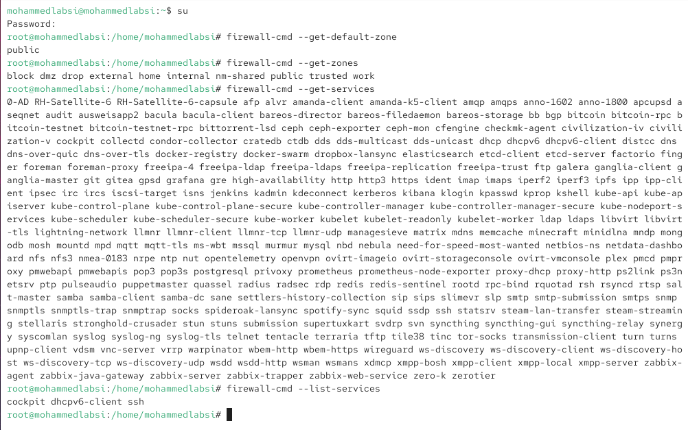{ #fig-001 width=70% }

Для получения подробной информации о текущей зоне выполняю команду:

`firewall-cmd --list-all`

В результате отображается конфигурация зоны `public`, которая является зоной по умолчанию и находится в активном состоянии.

В выводе команды определяю следующие параметры:

- `public (default, active)` — активная зона, используемая по умолчанию.
- `target: default` — стандартное поведение брандмауэра при обработке трафика.
- `interfaces: enp0s3` — сетевой интерфейс, связанный с данной зоной.
- `services: cockpit dhcpv6-client ssh` — список разрешённых служб.
- `ports:` — список отдельно разрешённых портов, который в исходной конфигурации пуст.
- `forward: yes` — включённая настройка пересылки пакетов внутри зоны.
- `masquerade: no` — маскарадинг отключён.

Также значения `ingress-priority: 0` и `egress-priority: 0` определяют приоритеты обработки входящего и исходящего трафика. Параметр `icmp-block-inversion: no` указывает, что инверсия правил блокировки ICMP не используется (см. рис. [@fig-002]).

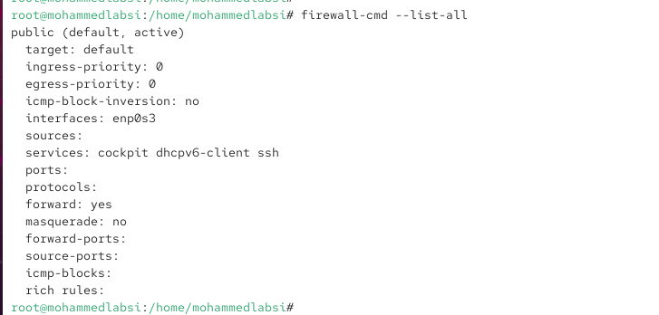{ #fig-002 width=70% }

Для просмотра конфигурации непосредственно зоны `public` выполняю команду:

`firewall-cmd --list-all --zone=public`

Сравниваю результат с выводом предыдущей команды `firewall-cmd --list-all`.

Обе команды отображают одинаковую конфигурацию, поскольку зона `public` является текущей зоной по умолчанию. В обоих случаях используются интерфейс `enp0s3` и службы `cockpit`, `dhcpv6-client`, `ssh`.

Отличие команд заключается в том, что `firewall-cmd --list-all` отображает параметры зоны по умолчанию, а команда с параметром `--zone=public` позволяет явно указать зону, конфигурацию которой необходимо просмотреть (см. рис. [@fig-003]).

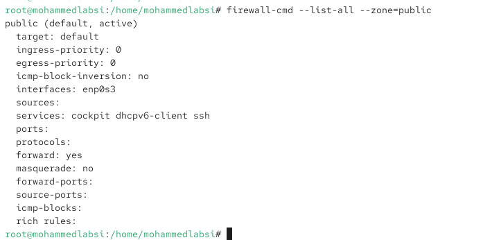{ #fig-003 width=70% }

Для добавления службы VNC-сервера в текущую конфигурацию брандмауэра выполняю команду:

`firewall-cmd --add-service=vnc-server`

В результате отображается сообщение `success`, подтверждающее успешное выполнение команды.

Данная команда разрешает входящие подключения к службе `vnc-server`, которая используется для удалённого доступа к графическому рабочему столу компьютера.

Для проверки внесённых изменений выполняю команду:

`firewall-cmd --list-all`

В результате в строке `services` появляется служба `vnc-server`. Теперь список разрешённых служб содержит `cockpit`, `dhcpv6-client`, `ssh` и `vnc-server`.

Следовательно, VNC-сервер успешно добавлен в действующую конфигурацию брандмауэра. Однако изменение является временным, поскольку команда была выполнена без параметра `--permanent` (см. рис. [@fig-004]).

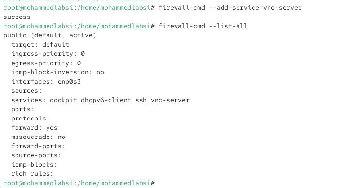{ #fig-004 width=70% }

Для проверки сохранения настроек после перезапуска службы firewalld выполняю команду:

`systemctl restart firewalld.service`

После перезапуска повторно просматриваю конфигурацию:

`firewall-cmd --list-all`

В результате обнаруживаю, что служба `vnc-server` отсутствует в списке разрешённых служб. В строке `services` снова отображаются только `cockpit`, `dhcpv6-client` и `ssh`.

Это происходит потому, что firewalld использует два вида конфигурации: временную конфигурацию времени выполнения (`runtime`) и постоянную конфигурацию (`permanent`).

При добавлении службы без параметра `--permanent` изменения применяются только к конфигурации времени выполнения. После перезапуска firewalld временные настройки сбрасываются, а конфигурация загружается из постоянных настроек, сохранённых на диске (см. рис. [@fig-005]).

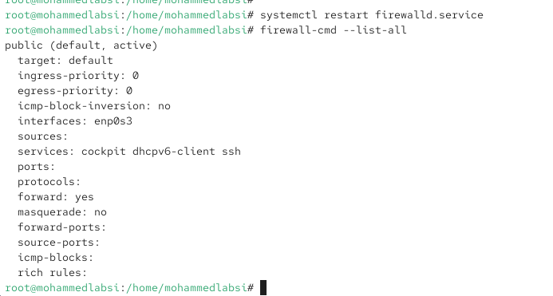{ #fig-005 width=70% }

Для постоянного добавления VNC-сервера выполняю команду:

`firewall-cmd --add-service=vnc-server --permanent`

В результате получаю сообщение `success`, подтверждающее сохранение изменений в постоянной конфигурации.

Для проверки действующей конфигурации выполняю команду:

`firewall-cmd --list-all`

В результате служба `vnc-server` по-прежнему отсутствует в строке `services`.

Это связано с тем, что параметр `--permanent` изменяет конфигурацию, хранящуюся на диске, но не обновляет автоматически действующие правила брандмауэра. Для применения постоянных настроек требуется перезагрузить конфигурацию firewalld (см. рис. [@fig-006]).

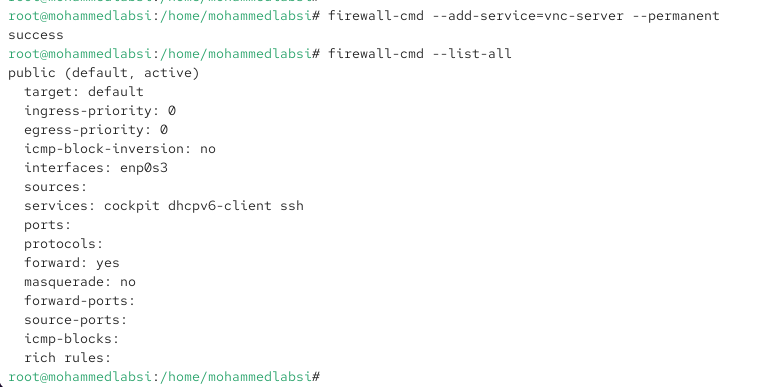{ #fig-006 width=70% }

Для применения сохранённых изменений выполняю команду:

`firewall-cmd --reload`

В результате появляется сообщение `success`, указывающее на успешную перезагрузку конфигурации.

После этого проверяю список разрешённых служб:

`firewall-cmd --list-all`

Теперь в строке `services` отображаются `cockpit`, `dhcpv6-client`, `ssh`, `vnc-server`.

Следовательно, постоянная конфигурация была успешно загружена и служба VNC-сервера стала доступна в действующей конфигурации брандмауэра. Поскольку изменение сохранено с параметром `--permanent`, оно не будет потеряно при последующих перезапусках службы firewalld (см. рис. [@fig-007]).

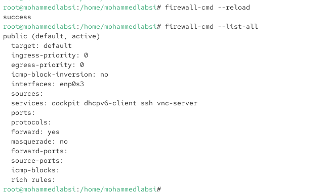{ #fig-007 width=70% }

Для добавления порта `2022` протокола TCP в постоянную конфигурацию брандмауэра выполняю команду:

`firewall-cmd --add-port=2022/tcp --permanent`

Команда завершается сообщением `success`, подтверждающим успешное добавление правила.

Для применения сохранённой конфигурации выполняю команду:

`firewall-cmd --reload`

После получения сообщения `success` просматриваю действующие настройки:

`firewall-cmd --list-all`

В результате в строке `ports` появляется значение `2022/tcp`.

Это означает, что брандмауэр разрешает входящие TCP-соединения на порт `2022` в зоне `public`. При этом наличие разрешающего правила брандмауэра не означает, что на данном порту обязательно запущена служба.

Поскольку порт добавлен в постоянную конфигурацию, соответствующее правило будет сохраняться после перезапуска службы firewalld и перезагрузки операционной системы (см. рис. [@fig-008]).

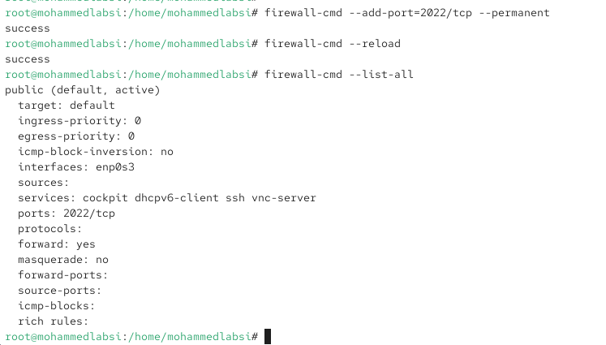{ #fig-008 width=70% }

## Управление брандмауэром с помощью firewall-config

Для настройки брандмауэра через графический интерфейс запускаю утилиту:

`firewall-config`

В результате открывается окно `Firewall Configuration`, позволяющее изменять зоны, разрешённые службы, порты и другие параметры межсетевого экрана.

В верхней части окна в раскрывающемся списке `Configuration` выбираю значение `Permanent`. Это позволяет сохранять вносимые изменения в постоянную конфигурацию брандмауэра.

В разделе `Zones` выбираю зону `public`, после чего открываю вкладку `Services`.

В списке служб нахожу и отмечаю `http` и `https`. Служба `ssh` уже присутствовала в исходной конфигурации зоны `public`, поэтому дополнительное включение для неё не требуется.

Служба `http` используется для передачи веб-страниц по протоколу HTTP через TCP-порт `80`, а `https` — для защищённой передачи данных через TCP-порт `443`. Служба `ssh` обеспечивает защищённое удалённое подключение к системе, обычно через TCP-порт `22`.

Также добавляю службу `ftp`, предназначенную для передачи файлов по сети. Для управляющего соединения FTP обычно используется TCP-порт `21`.

Выбранные службы сохраняются в постоянной конфигурации зоны `public` (см. рис. [@fig-009]).

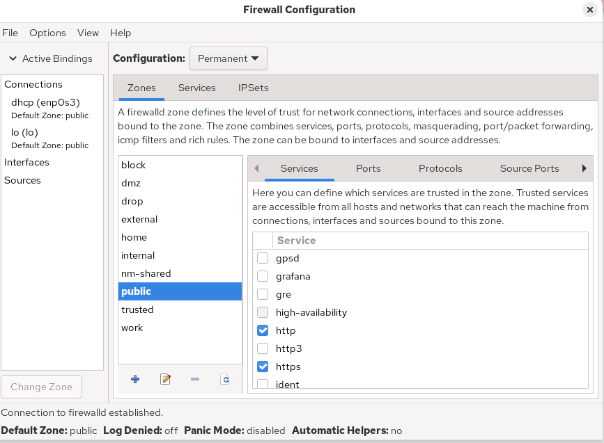{ #fig-009 width=70% }

Для добавления нового сетевого порта в графическом интерфейсе перехожу на вкладку `Ports` выбранной зоны `public`.

Нажимаю кнопку `Add` и указываю параметры нового правила:

- Номер порта — `2022`.
- Протокол — `udp`.

После подтверждения добавления в списке портов отображаются две записи: `2022/tcp` и `2022/udp`.

Первая запись соответствует порту, ранее добавленному через командную строку, а вторая представляет собой новое правило для протокола UDP.

Протокол UDP обеспечивает передачу датаграмм без предварительного установления соединения. Добавленное правило разрешает входящий UDP-трафик, предназначенный для порта `2022`.

Поскольку в параметре `Configuration` выбрано значение `Permanent`, добавленный порт сохраняется в постоянной конфигурации брандмауэра (см. рис. [@fig-010]).

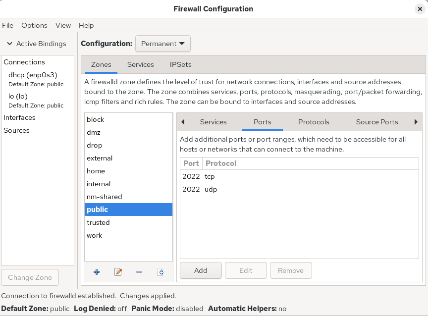{ #fig-010 width=70% }

После завершения настройки закрываю графическую утилиту `firewall-config`.

Возвращаюсь в терминал и выполняю команду:

`firewall-cmd --list-all`

В результате отображается текущая конфигурация зоны `public`.

В строке `services` присутствуют службы `cockpit`, `dhcpv6-client`, `ssh` и `vnc-server`, а в строке `ports` указан только порт `2022/tcp`.

При этом добавленные в графическом интерфейсе службы `http`, `https`, `ftp` и порт `2022/udp` пока отсутствуют в действующей конфигурации.

Причина заключается в том, что в утилите `firewall-config` был выбран режим `Permanent`. Внесённые изменения записаны в постоянную конфигурацию, но ещё не применены к настройкам времени выполнения (см. рис. [@fig-011]).

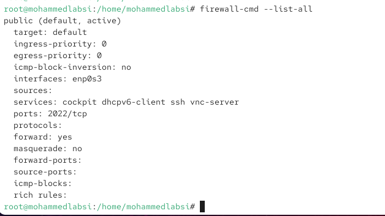{ #fig-011 width=70% }

Для применения изменений, внесённых через графический интерфейс, выполняю команду:

`firewall-cmd --reload`

В результате получаю сообщение `success`.

Повторно просматриваю конфигурацию брандмауэра:

`firewall-cmd --list-all`

Теперь в строке `services` отображаются следующие службы: `cockpit`, `dhcpv6-client`, `ftp`, `http`, `https`, `ssh`, `vnc-server`.

В строке `ports` присутствуют значения `2022/tcp` и `2022/udp`.

Это подтверждает, что изменения, внесённые с помощью `firewall-config`, успешно применены.

В результате в зоне `public` разрешены подключения к веб-серверу по протоколам HTTP и HTTPS, к FTP-серверу, SSH-серверу и VNC-серверу. Также разрешён входящий трафик через порт `2022` по протоколам TCP и UDP.

Все внесённые изменения сохранены в постоянной конфигурации firewalld (см. рис. [@fig-012]).

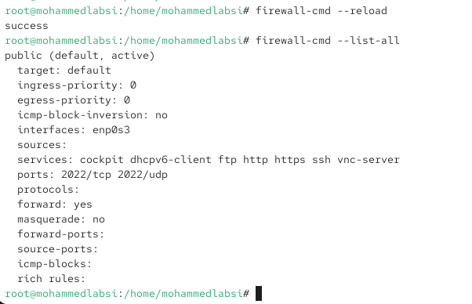{ #fig-012 width=70% }

## Выполнение самостоятельной работы

В рамках самостоятельной работы необходимо настроить брандмауэр для разрешения подключений к службам `telnet`, `imap`, `pop3` и `smtp`.

Согласно заданию службу `telnet` добавляю через командную строку, а службы `imap`, `pop3` и `smtp` — с помощью графического интерфейса `firewall-config`.

Для настройки почтовых служб открываю графическую утилиту:

`firewall-config`

В раскрывающемся списке `Configuration` выбираю режим `Permanent`, чтобы внесённые изменения сохранялись после перезагрузки системы.

В разделе `Zones` выбираю зону `public` и перехожу на вкладку `Services`.

В списке доступных служб нахожу и отмечаю следующие службы:

- `imap` — протокол доступа к сообщениям электронной почты, позволяющий работать с письмами, хранящимися на почтовом сервере. Обычно использует TCP-порт `143`.
- `pop3` — протокол получения электронной почты с почтового сервера. Обычно использует TCP-порт `110`.
- `smtp` — протокол передачи электронной почты между почтовыми серверами. Обычно использует TCP-порт `25`.

На вкладке `Services` отмечаю соответствующие пункты. На скриншоте отображается включённая служба `smtp`.

Поскольку выбран режим `Permanent`, настройки сохраняются в постоянной конфигурации брандмауэра. После применения конфигурации указанные службы будут разрешены в зоне `public` (см. рис. [@fig-013]).

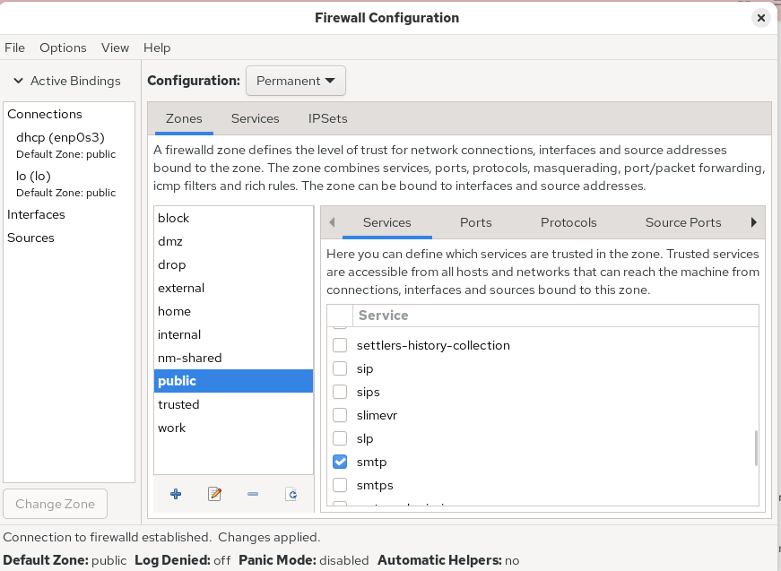{ #fig-013 width=70% }

Для настройки службы Telnet возвращаюсь в терминал с полномочиями администратора.

Добавляю службу `telnet` в действующую конфигурацию брандмауэра:

`firewall-cmd --add-service=telnet`

В результате получаю сообщение `success`.

Служба `telnet` используется для удалённого текстового подключения к компьютеру. По умолчанию она использует TCP-порт `23`. В отличие от SSH, протокол Telnet не обеспечивает шифрование передаваемых данных, поэтому его применение допустимо преимущественно в учебных или изолированных сетях.

Чтобы сохранить разрешение службы после перезапуска firewalld и перезагрузки операционной системы, выполняю команду:

`firewall-cmd --add-service=telnet --permanent`

В результате снова отображается сообщение `success`, подтверждающее сохранение настройки.

Для применения постоянной конфигурации выполняю команду:

`firewall-cmd --reload`

После успешной перезагрузки конфигурации проверяю список разрешённых служб и портов:

`firewall-cmd --list-all`

В результате отображается активная зона `public`, связанная с интерфейсом `enp0s3`.

В строке `services` присутствуют:

- `cockpit` — служба веб-интерфейса управления системой.
- `dhcpv6-client` — служба DHCPv6-клиента.
- `ftp` — служба передачи файлов.
- `http` — служба передачи веб-страниц.
- `https` — служба защищённой передачи веб-страниц.
- `imap` — служба доступа к электронной почте.
- `pop3` — служба получения электронной почты.
- `smtp` — служба отправки и передачи электронной почты.
- `ssh` — служба защищённого удалённого доступа.
- `telnet` — служба удалённого терминального доступа.
- `vnc-server` — служба удалённого графического доступа.

В строке `ports` отображаются значения `2022/tcp` и `2022/udp`, добавленные в ходе предыдущих этапов лабораторной работы.

Наличие служб `imap`, `pop3`, `smtp` и `telnet` в действующей конфигурации подтверждает, что все необходимые правила успешно применены.

Постоянство конфигурации обеспечивается использованием параметра `--permanent` при добавлении службы `telnet` и режима `Permanent` в графическом интерфейсе для почтовых служб.

После выполнения команды `firewall-cmd --reload` постоянная конфигурация загружается в действующие настройки брандмауэра. Следовательно, созданные правила сохраняются на диске и будут использоваться после перезапуска firewalld и последующей загрузки системы (см. рис. [@fig-014]).

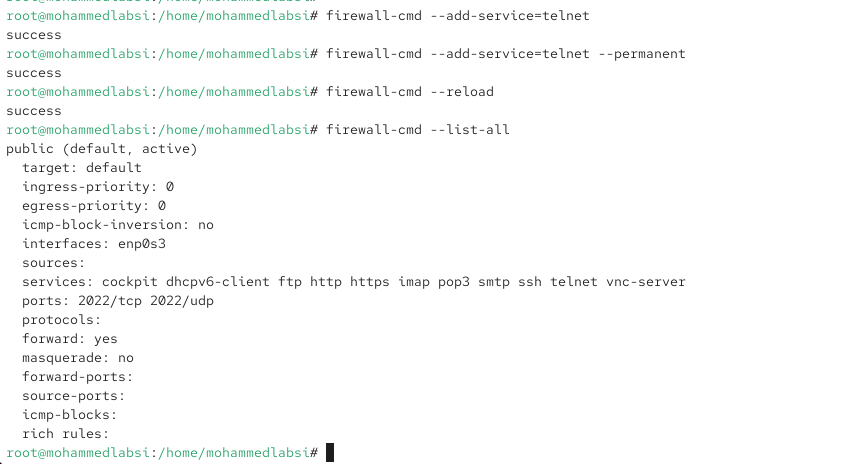{ #fig-014 width=70% }

## Контрольные вопросы

1. **Какая служба должна быть запущена перед началом работы с менеджером конфигурации брандмауэра firewall-config?**

   Перед началом работы с графическим менеджером конфигурации брандмауэра `firewall-config` должна быть запущена служба:

   `firewalld`

   Данная служба отвечает за управление правилами межсетевого экрана, обработку сетевого трафика и настройку зон безопасности.

   Для проверки состояния службы используется команда:

   `systemctl status firewalld`

   Если служба не запущена, её можно запустить командой:

   `systemctl start firewalld`

   Для автоматического запуска службы при загрузке операционной системы используется команда:

   `systemctl enable firewalld`

2. **Какая команда позволяет добавить UDP-порт 2355 в конфигурацию брандмауэра в зоне по умолчанию?**

   Для добавления UDP-порта `2355` в текущую конфигурацию зоны по умолчанию используется команда:

   `firewall-cmd --add-port=2355/udp`

   Параметр `--add-port` указывает номер разрешаемого порта и используемый транспортный протокол. В данном случае разрешается входящий трафик через порт `2355` по протоколу UDP.

   Поскольку зона явно не указана, правило применяется к зоне по умолчанию.

   Для постоянного сохранения настройки используется команда:

   `firewall-cmd --add-port=2355/udp --permanent`

   После этого необходимо применить изменения:

   `firewall-cmd --reload`

   Для проверки добавленного порта используется команда:

   `firewall-cmd --list-ports`

3. **Какая команда позволяет показать всю конфигурацию брандмауэра во всех зонах?**

   Для просмотра полной конфигурации брандмауэра во всех доступных зонах используется команда:

   `firewall-cmd --list-all-zones`

   Команда отображает параметры каждой зоны, включая связанные сетевые интерфейсы, разрешённые службы, открытые порты, правила перенаправления и другие настройки.

   В отличие от команды `firewall-cmd --list-all`, которая показывает конфигурацию только зоны по умолчанию, параметр `--list-all-zones` позволяет получить сведения обо всех зонах брандмауэра.

   Для просмотра постоянной конфигурации всех зон используется команда:

   `firewall-cmd --permanent --list-all-zones`

4. **Какая команда позволяет удалить службу vnc-server из текущей конфигурации брандмауэра?**

   Для удаления службы `vnc-server` из действующей конфигурации брандмауэра используется команда:

   `firewall-cmd --remove-service=vnc-server`

   Параметр `--remove-service` удаляет указанную службу из списка разрешённых служб зоны по умолчанию.

   Изменение применяется немедленно, но действует только до перезапуска службы firewalld или перезагрузки её конфигурации.

   Для удаления службы из постоянной конфигурации используется команда:

   `firewall-cmd --remove-service=vnc-server --permanent`

   После этого необходимо выполнить:

   `firewall-cmd --reload`

   Проверить отсутствие службы можно командой:

   `firewall-cmd --list-services`

5. **Какая команда firewall-cmd позволяет активировать новую конфигурацию, добавленную опцией --permanent?**

   Для применения изменений, сохранённых с параметром `--permanent`, используется команда:

   `firewall-cmd --reload`

   Данная команда перезагружает правила межсетевого экрана и загружает сохранённую постоянную конфигурацию в конфигурацию времени выполнения.

   Параметр `--permanent` записывает изменения на диск, но не активирует их немедленно. После выполнения команды `--reload` новые правила начинают действовать.

   При этом временные изменения, которые не были сохранены в постоянной конфигурации, обычно сбрасываются.

6. **Какой параметр firewall-cmd позволяет проверить, что новая конфигурация была добавлена в текущую зону и теперь активна?**

   Для проверки действующей конфигурации текущей зоны используется параметр:

   `--list-all`

   Полная команда имеет вид:

   `firewall-cmd --list-all`

   Она отображает сведения об активной конфигурации зоны по умолчанию, включая разрешённые службы, открытые порты, сетевые интерфейсы и дополнительные правила.

   Если новая служба или порт присутствует в соответствующем разделе вывода, это подтверждает, что правило добавлено в действующую конфигурацию брандмауэра.

   Для проверки конкретной службы также можно использовать параметр `--query-service`, например:

   `firewall-cmd --query-service=vnc-server`

   Если служба разрешена в зоне по умолчанию, команда выводит `yes`, в противном случае — `no`.

7. **Какая команда позволяет добавить интерфейс eno1 в зону public?**

   Для добавления сетевого интерфейса `eno1` в зону `public` используется команда:

   `firewall-cmd --zone=public --add-interface=eno1`

   Параметр `--zone=public` определяет зону, к которой необходимо привязать интерфейс, а параметр `--add-interface=eno1` указывает имя сетевого интерфейса.

   После успешного выполнения команды к сетевому трафику интерфейса `eno1` применяются правила зоны `public`.

   Для проверки принадлежности интерфейса к зоне используется команда:

   `firewall-cmd --get-zone-of-interface=eno1`

   В результате должно отображаться значение `public`.

   Если интерфейс уже привязан к другой зоне, для изменения его принадлежности используется команда:

   `firewall-cmd --zone=public --change-interface=eno1`

8. **Если добавить новый интерфейс в конфигурацию брандмауэра, пока не указана зона, в какую зону он будет добавлен?**

   Если при добавлении нового сетевого интерфейса зона не указана, он будет добавлен в зону, установленную по умолчанию.

   Для определения текущей зоны по умолчанию используется команда:

   `firewall-cmd --get-default-zone`

   В рассматриваемой конфигурации результатом выполнения команды является значение:

   `public`

   Следовательно, при отсутствии явно указанной зоны новый интерфейс будет относиться к зоне `public`.

   Например, команда:

   `firewall-cmd --add-interface=eno1`

   добавит интерфейс `eno1` в зону по умолчанию.

   Для изменения зоны по умолчанию используется команда:

   `firewall-cmd --set-default-zone=home`

   После выполнения данной команды зоной по умолчанию станет `home`, и для интерфейсов, которым не назначена отдельная зона, будут использоваться её правила.

# Заключение

В ходе лабораторной работы изучил управление межсетевым экраном firewalld с помощью командной утилиты `firewall-cmd` и графического интерфейса `firewall-config`. Определил доступные зоны, просмотрел текущую конфигурацию брандмауэра и список разрешённых служб. Добавил службы `vnc-server`, `http`, `https`, `ftp`, а также порты `2022/tcp` и `2022/udp`. В рамках самостоятельной работы настроил доступ к службам `telnet`, `imap`, `pop3` и `smtp`. Проверил применение изменений и сохранение постоянной конфигурации после перезагрузки firewalld.

# Список литературы

1. [Firewalld. firewall-cmd Manual Page — руководство по использованию командной утилиты firewall-cmd для управления зонами брандмауэра, настройки служб, добавления и удаления сетевых портов](https://firewalld.org/documentation/man-pages/firewall-cmd).

2. [Firewalld. firewall-config Documentation — использование графического интерфейса firewall-config для настройки межсетевого экрана, управления службами, портами и постоянными правилами](https://firewalld.org/documentation/utilities/firewall-config.html).

3. [Red Hat. Using and Configuring firewalld — настройка межсетевого экрана в RHEL 9, управление сетевым трафиком, разрешение служб, настройка портов TCP и UDP и работа с зонами безопасности](https://docs.redhat.com/en/documentation/red_hat_enterprise_linux/9/html/configuring_firewalls_and_packet_filters/using-and-configuring-firewalld_firewall-packet-filters).

4. [Firewalld. Runtime versus Permanent — особенности временной и постоянной конфигураций брандмауэра, сохранение правил, применение параметра --permanent и перезагрузка конфигурации](https://firewalld.org/documentation/configuration/runtime-versus-permanent.html).

5. [Firewalld. Predefined Zones — описание стандартных зон межсетевого экрана, включая public, home, internal, trusted, dmz и drop, а также особенности управления доступом к сетевым службам](https://firewalld.org/documentation/zone/predefined-zones.html).
