---
## Author
author:
  name: Лабси Мохаммед
  email: 1032245412@rudn.ru
  affiliation:
    - name: Российский университет дружбы народов
      country: Российская Федерация
      postal-code: 117198
      city: Москва
      address: ул. Миклухо-Маклая, д. 6

## Title
title: Лабораторная работа №14
subtitle: Партиции, файловые системы, монтирование
license: CC BY
date: today
date-format: "YYYY-MM-DD"
---

# Цели и задачи работы

## Цель лабораторной работы

Получить практические навыки управления дисковыми разделами и файловыми системами в операционной системе Linux.

Изучить использование утилит `fdisk` и `gdisk` для создания разделов с таблицами MBR и GPT.

Освоить создание файловых систем XFS и EXT4, настройку разделов подкачки Linux swap.

Изучить ручное и автоматическое монтирование файловых систем с помощью команд `mount`, `umount` и конфигурационного файла `/etc/fstab`.

# Создание виртуальных носителей

## Проверяю подключённые виртуальные диски

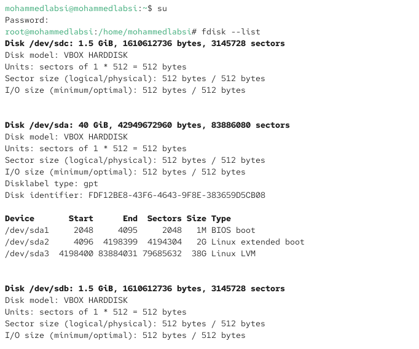{ #fig:001 width=70% height=70% }

# Создание разделов MBR с помощью fdisk

## Запускаю fdisk и изучаю доступные команды

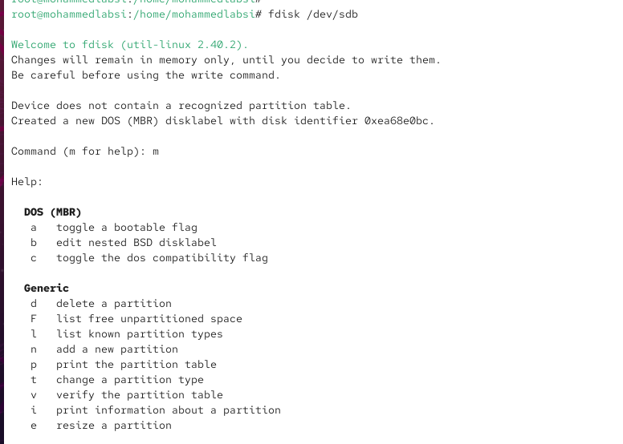{ #fig:002 width=70% height=70% }

## Создаю основной раздел MBR

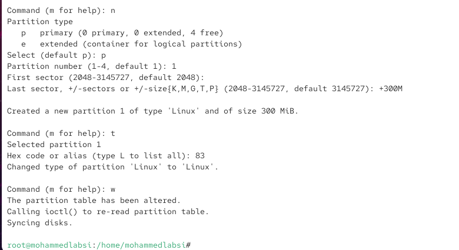{ #fig:003 width=70% height=70% }

## Проверяю созданный раздел

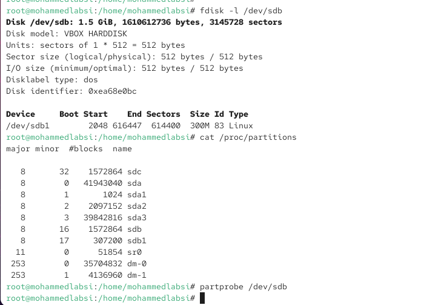{ #fig:004 width=70% height=70% }

# Создание логических разделов

## Создаю расширенный и логический разделы

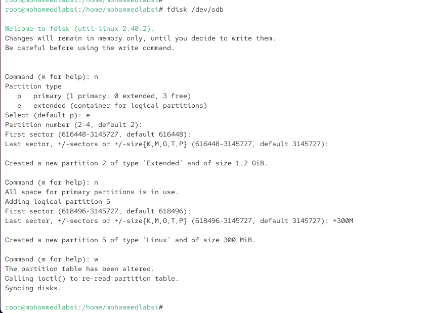{ #fig:005 width=70% height=70% }

## Проверяю расширенный и логический разделы

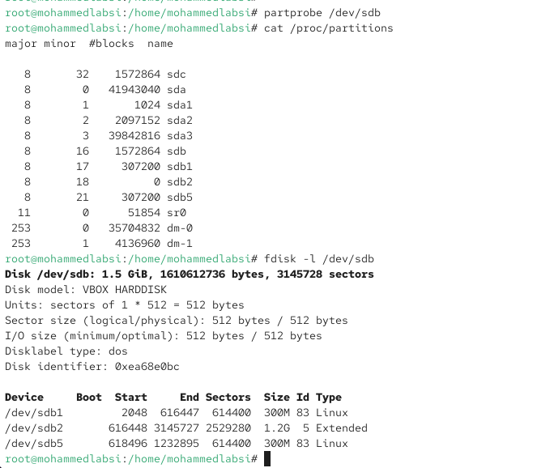{ #fig:006 width=70% height=70% }

# Создание раздела подкачки

## Создаю логический раздел Linux swap

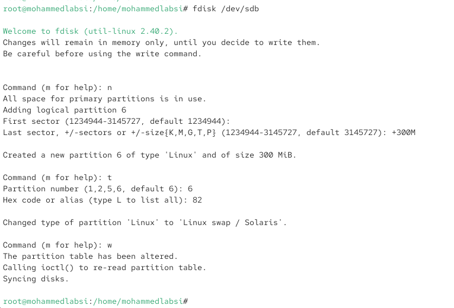{ #fig:007 width=70% height=70% }

## Проверяю раздел подкачки

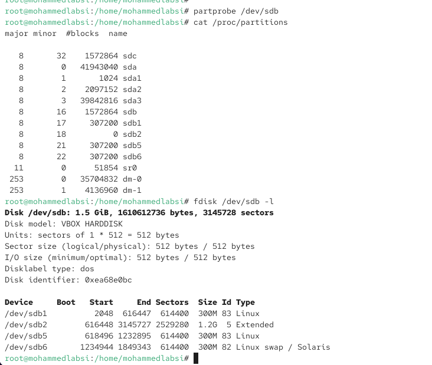{ #fig:008 width=70% height=70% }

## Инициализирую и активирую пространство подкачки

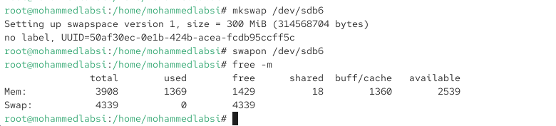{ #fig:009 width=70% height=70% }

# Создание разделов GPT с помощью gdisk

## Проверяю второй дополнительный диск

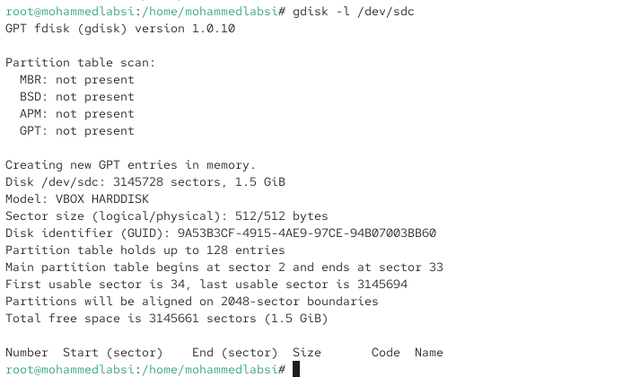{ #fig:010 width=70% height=70% }

## Создаю раздел GPT

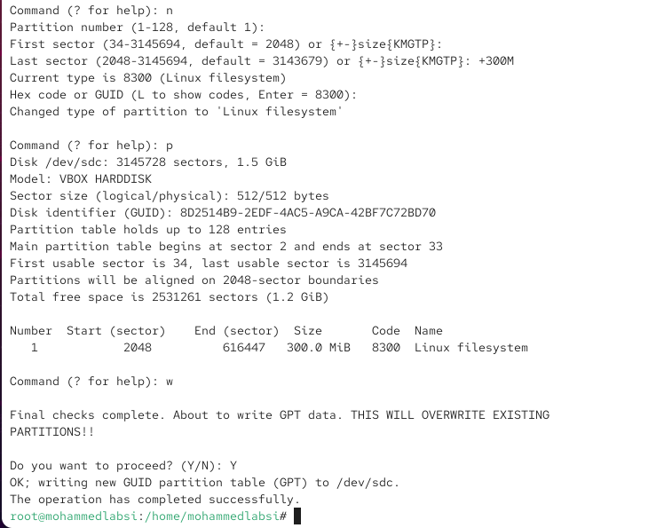{ #fig:011 width=70% height=70% }

## Обновляю таблицу разделов GPT

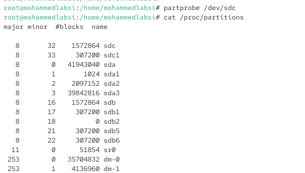{ #fig:012 width=70% height=70% }

## Проверяю созданную таблицу GPT

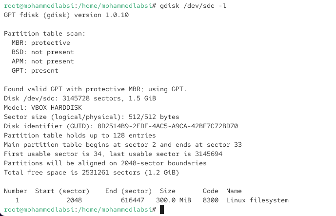{ #fig:013 width=70% height=70% }

# Форматирование файловых систем

## Создаю файловую систему XFS

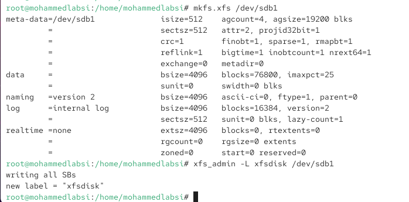{ #fig:014 width=70% height=70% }

## Создаю файловую систему EXT4

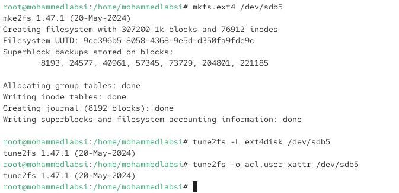{ #fig:015 width=70% height=70% }

# Ручное монтирование файловых систем

## Монтирую файловую систему EXT4

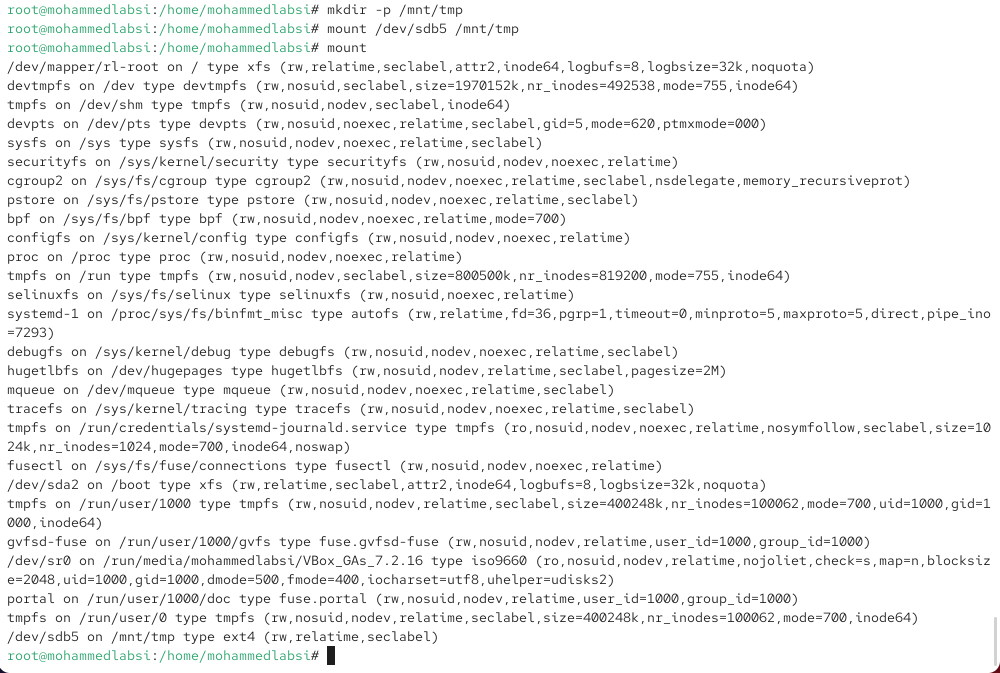{ #fig:016 width=70% height=70% }

## Отмонтирую файловую систему EXT4

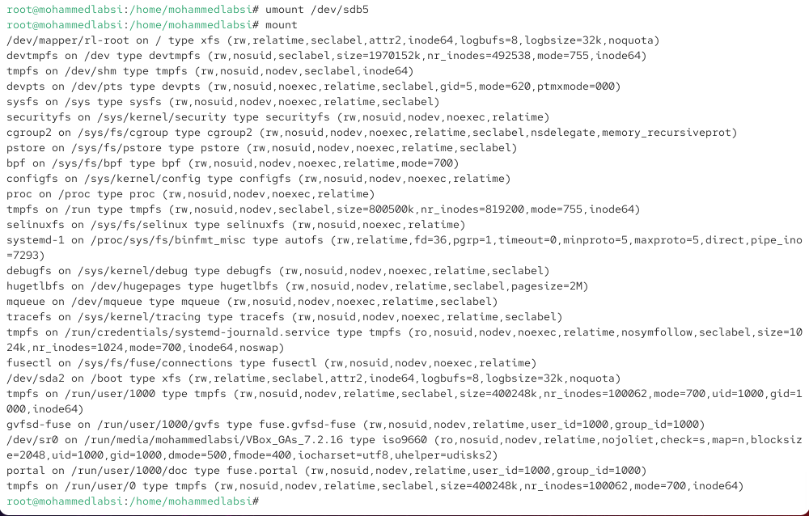{ #fig:017 width=70% height=70% }

# Автоматическое монтирование через /etc/fstab

## Определяю UUID файловой системы XFS

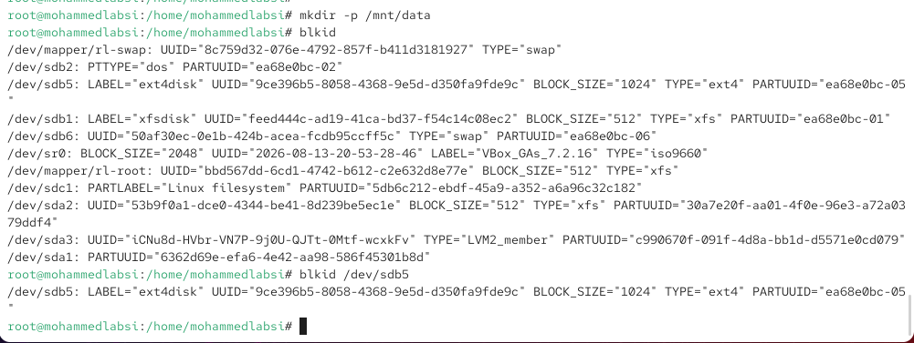{ #fig:018 width=70% height=70% }

## Настраиваю автоматическое монтирование XFS

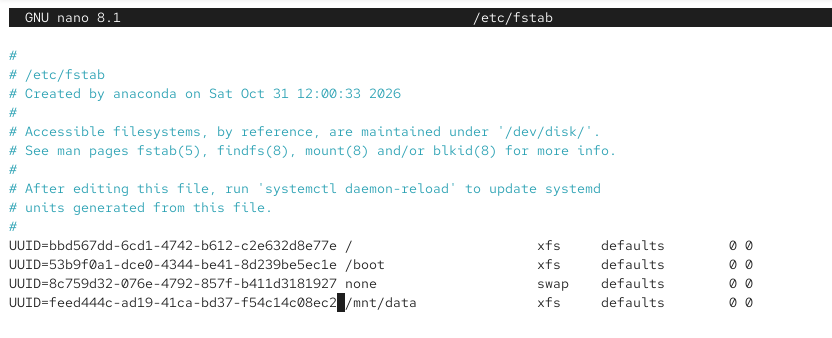{ #fig:019 width=70% height=70% }

## Проверяю автоматическое монтирование

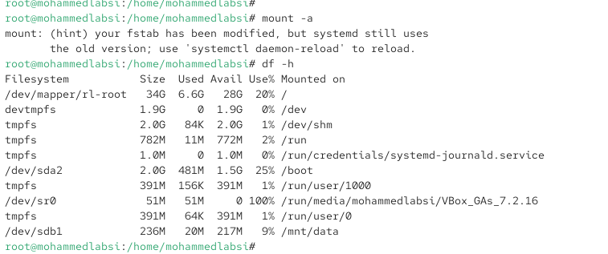{ #fig:020 width=70% height=70% }

# Выполнение самостоятельной работы

## Создаю дополнительные разделы GPT

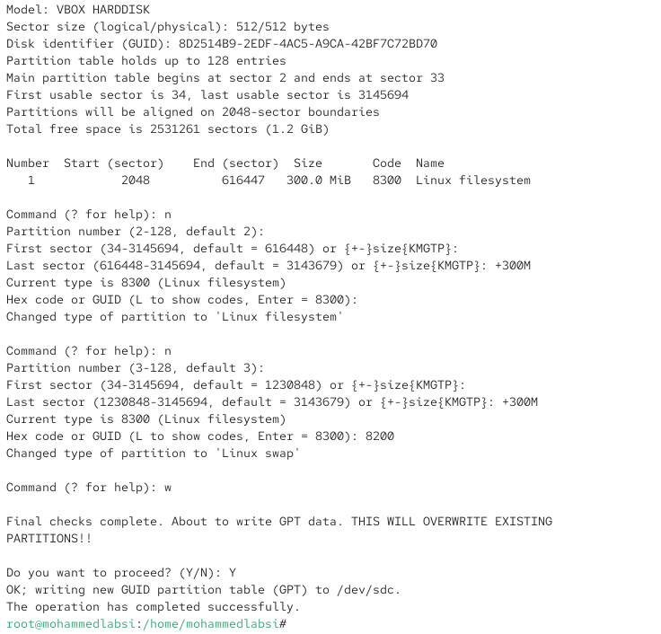{ #fig:021 width=70% height=70% }

## Форматирую EXT4 и создаю пространство подкачки

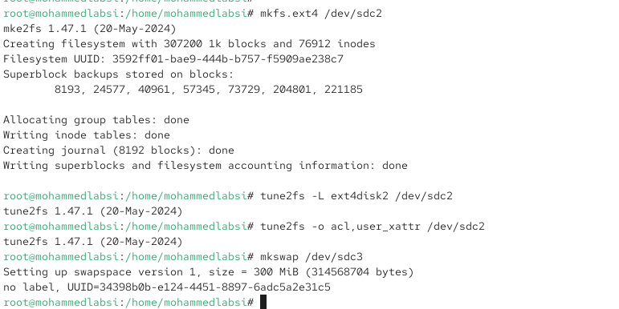{ #fig:022 width=70% height=70% }

## Настраиваю автоматическое подключение разделов

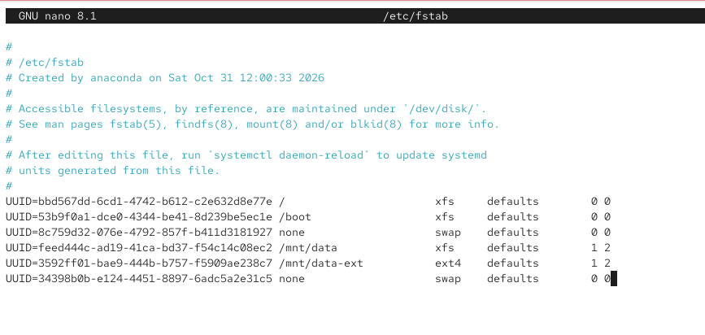{ #fig:023 width=70% height=70% }

## Проверяю результат после повторного входа в систему

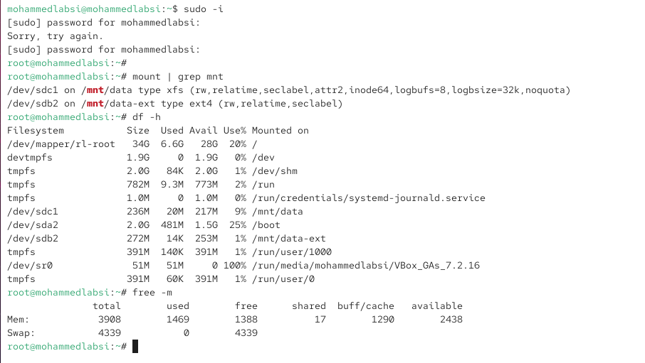{ #fig:024 width=70% height=70% }

# Выводы по проделанной работе

## Вывод

С помощью утилиты `fdisk` созданы основные, расширенный и логические разделы MBR. Утилита `gdisk` использована для создания разделов с таблицей GPT.

Выполнено форматирование разделов в файловые системы XFS и EXT4, настроено и активировано пространство подкачки Linux swap.

Освоены операции ручного монтирования и отмонтирования файловых систем командами `mount` и `umount`.

В рамках самостоятельной работы созданы дополнительные разделы GPT и настроено автоматическое подключение файловых систем и пространства подкачки через `/etc/fstab`.
