---
## Author
author:
  name: Лабси Мохаммед
  email: 1032245412@rudn.ru
  affiliation:
    - name: Российский университет дружбы народов
      country: Российская Федерация
      postal-code: 117198
      city: Москва
      address: ул. Миклухо-Маклая, д. 6

## Title
title: "Отчёт по лабораторной работе №14"
subtitle: "Партиции, файловые системы, монтирование"
license: "CC BY"
---

# Цель работы

Получить навыки создания разделов на диске и файловых систем. Получить навыки монтирования файловых систем.

# Выполнение лабораторной работы

## Создание виртуальных носителей

Добавляю к виртуальной машине два дополнительных диска с помощью VirtualBox.

Запускаю терминал, получаю полномочия администратора:

`su`

Для просмотра подключённых дисков выполняю команду:

`fdisk --list`

В результате отображаются системный диск `/dev/sda` размером 40 GiB и два дополнительных диска `/dev/sdb` и `/dev/sdc` размером 1,5 GiB каждый. Оба дополнительных диска определяются системой и доступны для разметки (см. рис. [@fig-001]).

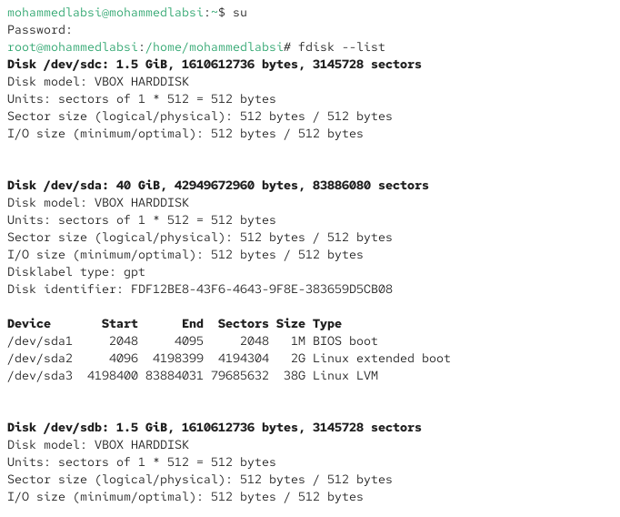{ #fig-001 width=70% }

## Создание разделов MBR с помощью fdisk

Для разметки первого дополнительного диска запускаю:

`fdisk /dev/sdb`

Утилита создаёт новую таблицу разделов DOS (MBR) в памяти. Для просмотра доступных команд ввожу `m`.

В справке отображаются основные команды: `n` — создание раздела, `p` — просмотр таблицы, `t` — изменение типа, `w` — сохранение изменений, `q` — выход без сохранения (см. рис. [@fig-002]).

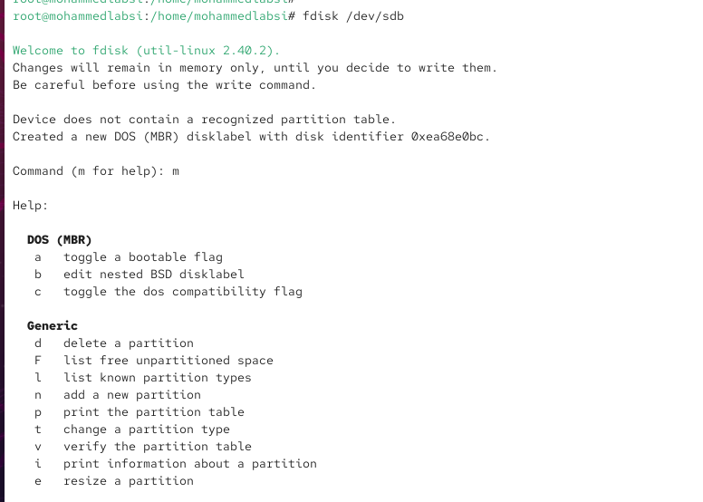{ #fig-002 width=70% }

Для создания основного раздела ввожу `n`, выбираю тип `p` и принимаю номер раздела `1`.

Начальный сектор оставляю по умолчанию, а размер задаю командой:

`+300M`

Для установки типа раздела использую `t` и код `83`, соответствующий Linux. Затем сохраняю изменения командой `w`.

В результате создаётся основной раздел `/dev/sdb1` размером 300 MiB (см. рис. [@fig-003]).

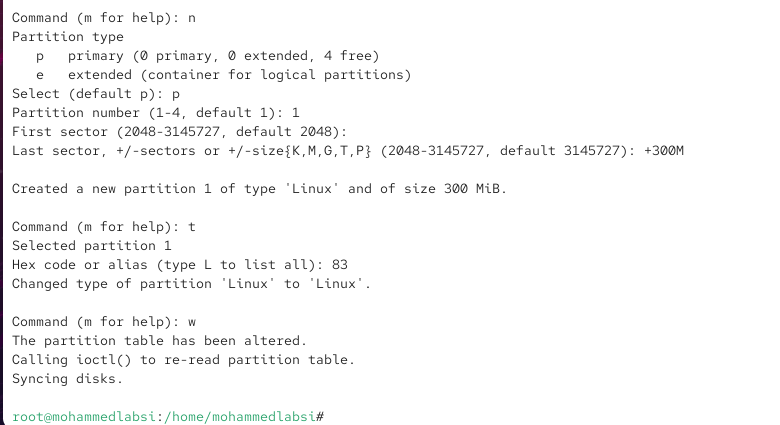{ #fig-003 width=70% }

Для проверки таблицы разделов выполняю:

`fdisk -l /dev/sdb`

Затем просматриваю информацию ядра:

`cat /proc/partitions`

Первая команда отображает подробную разметку диска, включая типы и границы разделов, а вторая — список блочных устройств и их размеры.

Для обновления таблицы разделов ядра выполняю:

`partprobe /dev/sdb`

В результате созданный раздел `/dev/sdb1` успешно определяется системой (см. рис. [@fig-004]).

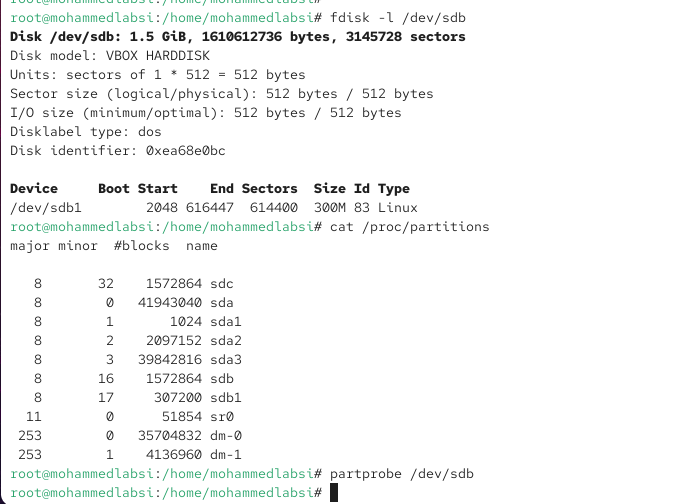{ #fig-004 width=70% }

## Создание логических разделов

Повторно запускаю:

`fdisk /dev/sdb`

Ввожу `n` и выбираю тип `e` для создания расширенного раздела. Принимаю номер `2` и значения секторов по умолчанию, выделяя оставшееся пространство диска.

Затем снова ввожу `n` для создания логического раздела `/dev/sdb5` и задаю размер:

`+300M`

Сохраняю изменения командой `w`.

В результате создаются расширенный раздел `/dev/sdb2` и логический раздел `/dev/sdb5` размером 300 MiB (см. рис. [@fig-005]).

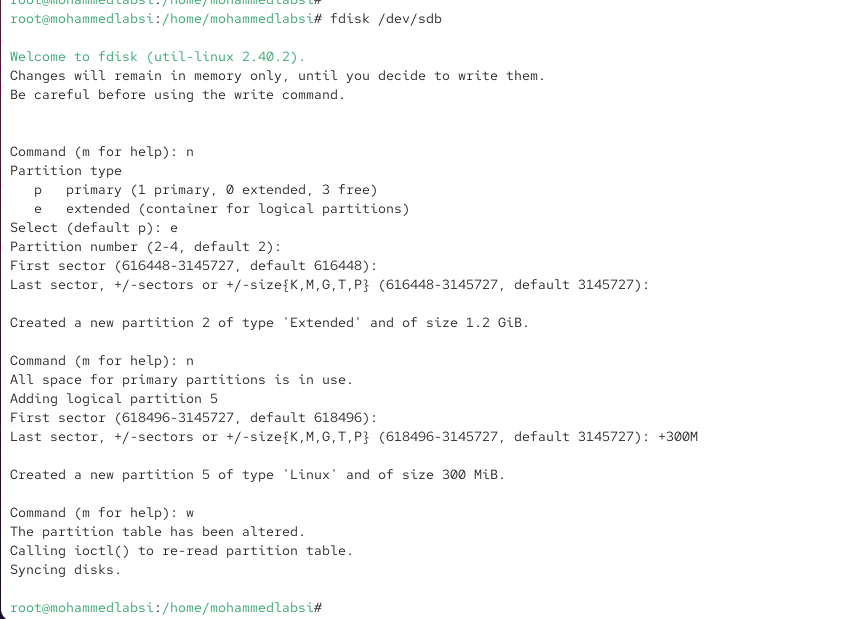{ #fig-005 width=70% }

Для обновления и проверки разметки выполняю:

`partprobe /dev/sdb`

`cat /proc/partitions`

`fdisk --list /dev/sdb`

В результате отображаются три раздела: основной `/dev/sdb1`, расширенный `/dev/sdb2` и логический `/dev/sdb5`.

Логический раздел располагается внутри расширенного раздела и имеет номер `5`, поскольку номера с `1` по `4` предназначены для основных и расширенного разделов MBR (см. рис. [@fig-006]).

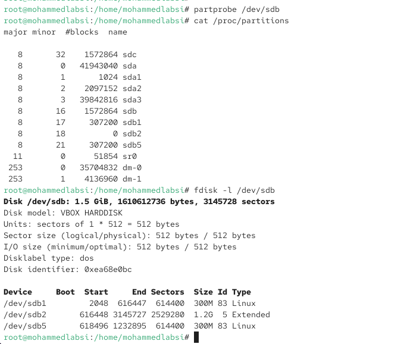{ #fig-006 width=70% }

## Создание раздела подкачки

Для создания раздела подкачки запускаю:

`fdisk /dev/sdb`

Ввожу `n` и создаю логический раздел `/dev/sdb6` размером:

`+300M`

Затем командой `t` выбираю раздел `6` и устанавливаю код типа `82`, соответствующий Linux swap.

Сохраняю изменения командой `w` (см. рис. [@fig-007]).

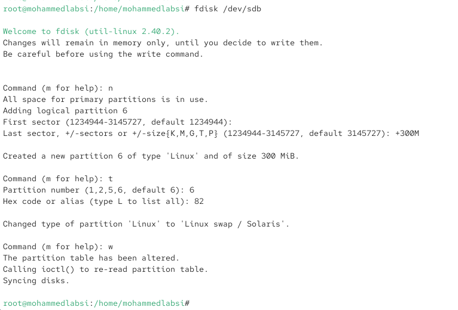{ #fig-007 width=70% }

Обновляю таблицу разделов:

`partprobe /dev/sdb`

Проверяю результат командами:

`cat /proc/partitions`

`fdisk --list /dev/sdb`

В выводе появляется раздел `/dev/sdb6` размером 300 MiB с типом `Linux swap / Solaris` и кодом `82` (см. рис. [@fig-008]).

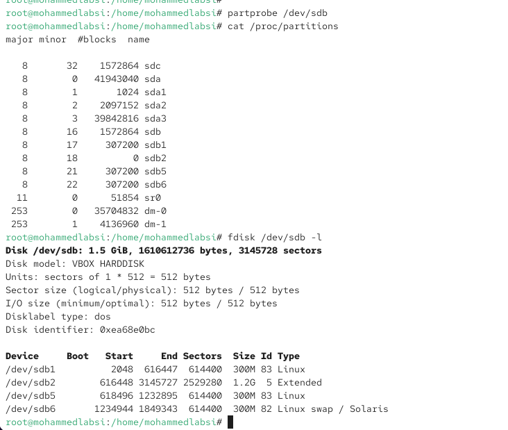{ #fig-008 width=70% }

Для создания области подкачки выполняю:

`mkswap /dev/sdb6`

Активирую её командой:

`swapon /dev/sdb6`

Проверяю состояние памяти:

`free -m`

В результате общий объём доступного пространства подкачки составляет 4339 MiB, из которых 0 MiB используется. Новый раздел подкачки успешно создан и активирован (см. рис. [@fig-009]).

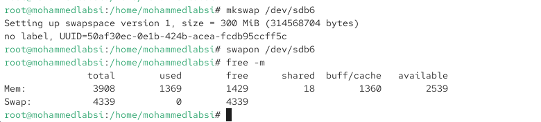{ #fig-009 width=70% }

## Создание разделов GPT с помощью gdisk

Для работы со вторым дополнительным диском выполняю:

`gdisk -l /dev/sdc`

В результате получаю информацию о диске размером 1,5 GiB. Таблицы разделов MBR и GPT отсутствуют, поэтому диск доступен для создания новой разметки GPT (см. рис. [@fig-010]).

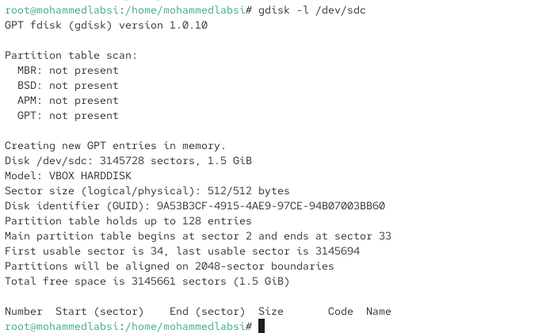{ #fig-010 width=70% }

Запускаю интерактивную утилиту:

`gdisk /dev/sdc`

Ввожу `n`, принимаю номер раздела `1` и начальный сектор по умолчанию.

Задаю размер:

`+300M`

Для типа раздела оставляю код `8300`, соответствующий Linux filesystem.

Командой `p` проверяю разметку, затем ввожу `w` и подтверждаю сохранение символом `Y`.

В результате создаётся раздел `/dev/sdc1` размером 300 MiB (см. рис. [@fig-011]).

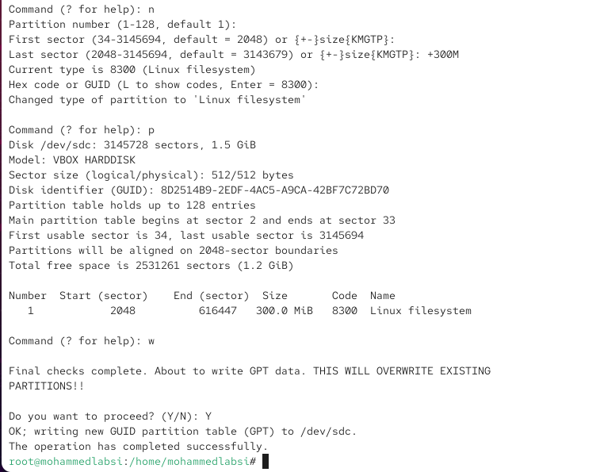{ #fig-011 width=70% }

Для обновления таблицы разделов выполняю:

`partprobe /dev/sdc`

Затем проверяю список блочных устройств:

`cat /proc/partitions`

В выводе появляется раздел `/dev/sdc1` размером 307200 блоков по 1024 байта, что соответствует 300 MiB (см. рис. [@fig-012]).

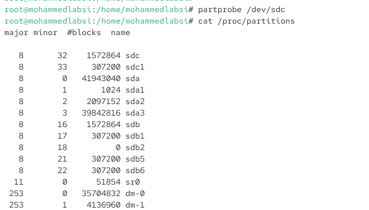{ #fig-012 width=70% }

Для подробной проверки выполняю:

`gdisk -l /dev/sdc`

В результате программа обнаруживает корректную таблицу GPT с защитной MBR. Раздел `/dev/sdc1` имеет размер 300 MiB и код типа `8300`, что подтверждает успешное создание GPT-разметки (см. рис. [@fig-013]).

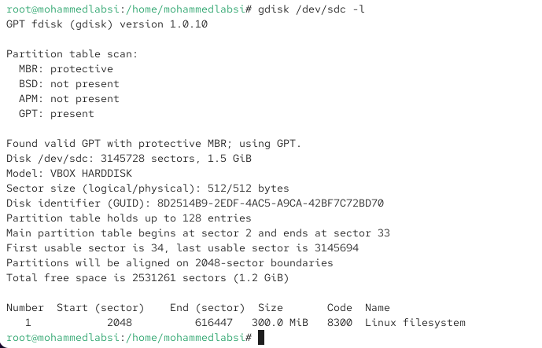{ #fig-013 width=70% }

## Форматирование файловой системы XFS

Для создания файловой системы XFS на разделе `/dev/sdb1` выполняю:

`mkfs.xfs /dev/sdb1`

В результате создаётся журналируемая файловая система XFS с размером блока 4096 байт.

Для установки метки выполняю:

`xfs_admin -L xfsdisk /dev/sdb1`

Утилита подтверждает установку метки `xfsdisk`. Раздел подготовлен для хранения данных (см. рис. [@fig-014]).

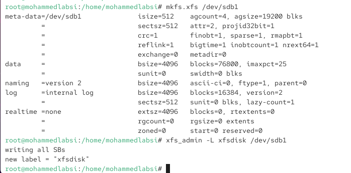{ #fig-014 width=70% }

## Форматирование файловой системы EXT4

Для форматирования логического раздела выполняю:

`mkfs.ext4 /dev/sdb5`

В результате создаётся файловая система EXT4 с журналированием.

Устанавливаю метку:

`tune2fs -L ext4disk /dev/sdb5`

Затем задаю параметры монтирования:

`tune2fs -o acl,user_xattr /dev/sdb5`

Параметр `acl` обеспечивает поддержку списков контроля доступа, а `user_xattr` — расширенных пользовательских атрибутов.

Файловая система EXT4 успешно создана и настроена (см. рис. [@fig-015]).

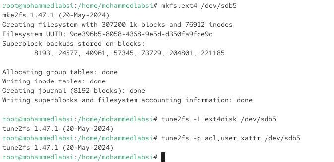{ #fig-015 width=70% }

## Ручное монтирование файловых систем

Создаю каталог для монтирования:

`mkdir -p /mnt/tmp`

Подключаю раздел EXT4:

`mount /dev/sdb5 /mnt/tmp`

Проверяю результат командой:

`mount`

В выводе присутствует запись `/dev/sdb5 on /mnt/tmp type ext4`, подтверждающая успешное монтирование с возможностью чтения и записи (см. рис. [@fig-016]).

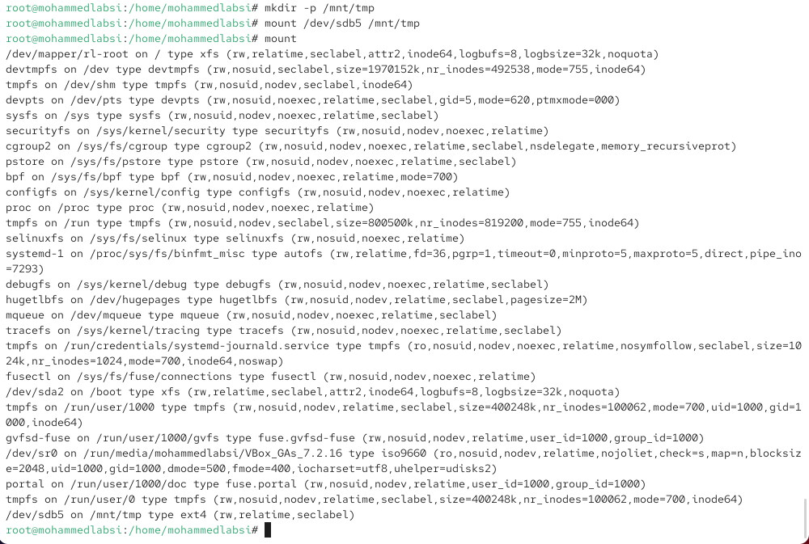{ #fig-016 width=70% }

Для отключения раздела выполняю:

`umount /dev/sdb5`

Повторно проверяю список подключённых файловых систем:

`mount`

Запись о `/dev/sdb5` больше не отображается. Следовательно, файловая система успешно отмонтирована (см. рис. [@fig-017]).

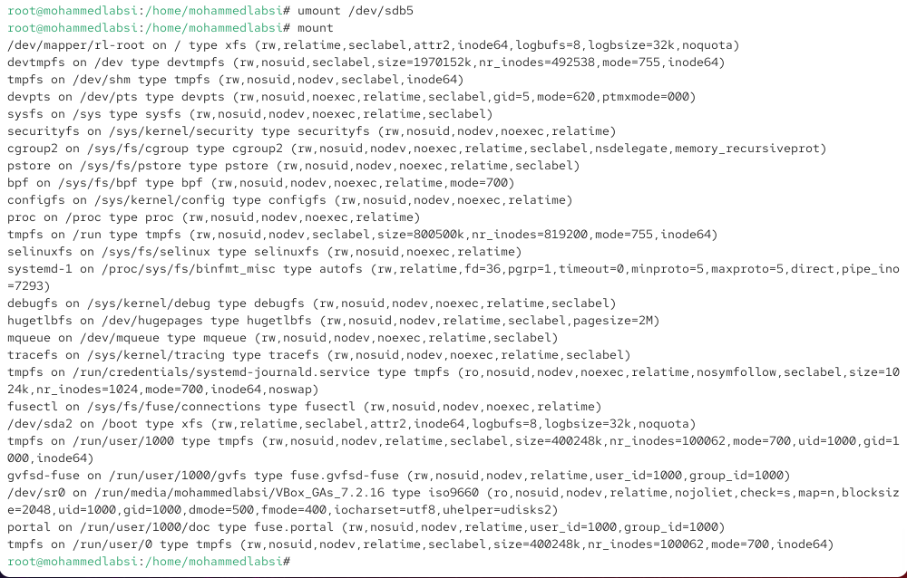{ #fig-017 width=70% }

## Монтирование разделов с помощью /etc/fstab

Для автоматического монтирования XFS создаю каталог:

`mkdir -p /mnt/data`

Просматриваю идентификаторы файловых систем:

`blkid`

Для получения UUID нужного раздела выполняю:

`blkid /dev/sdb1`

В результате определяю UUID раздела XFS с меткой `xfsdisk`. Использование UUID позволяет корректно находить файловую систему при изменении имён дисковых устройств (см. рис. [@fig-018]).

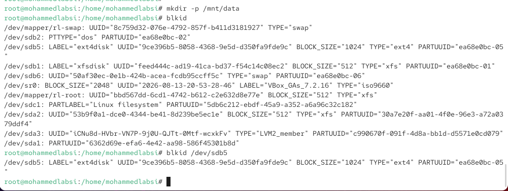{ #fig-018 width=70% }

Открываю конфигурационный файл:

`nano /etc/fstab`

Добавляю запись:

`UUID=feed444c-ad19-41ca-bd37-f54c14c08ec2 /mnt/data xfs defaults 0 0`

Здесь указываются UUID файловой системы, точка монтирования `/mnt/data`, тип `xfs` и стандартные параметры.

Сохраняю изменения. Теперь раздел будет подключаться автоматически при загрузке системы (см. рис. [@fig-019]).

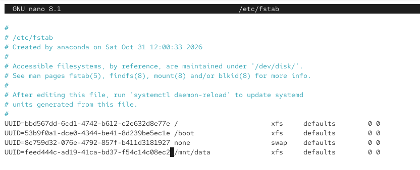{ #fig-019 width=70% }

Для проверки конфигурации выполняю:

`mount -a`

Команда выполняет монтирование согласно настройкам `/etc/fstab`.

Затем проверяю результат:

`df -h`

В выводе отображается раздел `/dev/sdb1`, смонтированный в `/mnt/data`, с доступным пространством 217 MiB.

Это подтверждает корректное подключение файловой системы XFS (см. рис. [@fig-020]).

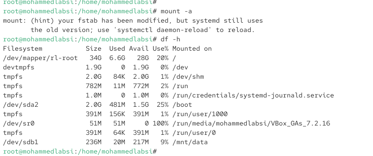{ #fig-020 width=70% }

## Выполнение самостоятельной работы

Для самостоятельной работы создаю дополнительные разделы на диске `/dev/sdc` с таблицей GPT.

Запускаю:

`gdisk /dev/sdc`

Командой `n` создаю раздел `/dev/sdc2` размером 300 MiB с кодом типа `8300` — Linux filesystem.

Затем создаю раздел `/dev/sdc3` размером 300 MiB и устанавливаю код `8200` — Linux swap.

Сохраняю изменения командой `w` и подтверждаю запись символом `Y`.

В результате на диске GPT созданы дополнительные разделы для файловой системы и пространства подкачки. Их фактический размер составляет 300 MiB вместо указанных в задании 100 MiB (см. рис. [@fig-021]).

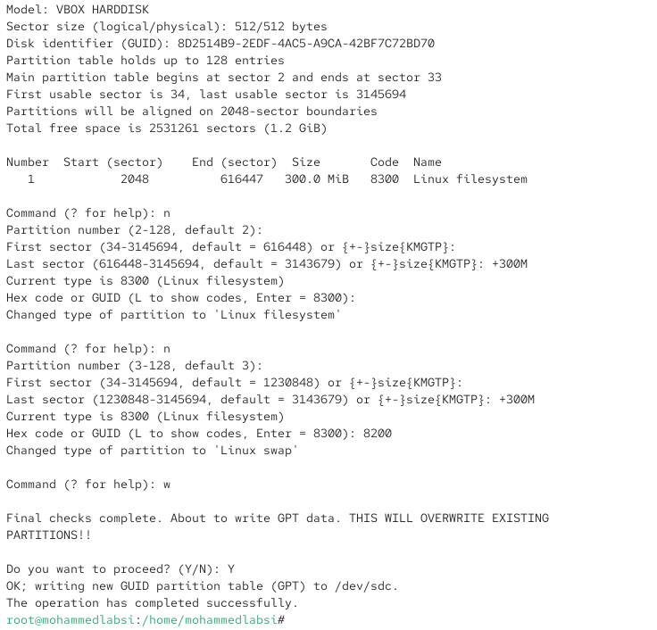{ #fig-021 width=70% }

Для создания файловой системы EXT4 выполняю:

`mkfs.ext4 /dev/sdc2`

Устанавливаю метку:

`tune2fs -L ext4disk2 /dev/sdc2`

Задаю параметры:

`tune2fs -o acl,user_xattr /dev/sdc2`

Для инициализации пространства подкачки выполняю:

`mkswap /dev/sdc3`

В результате раздел `/dev/sdc2` отформатирован в EXT4, а `/dev/sdc3` подготовлен к использованию в качестве области подкачки (см. рис. [@fig-022]).

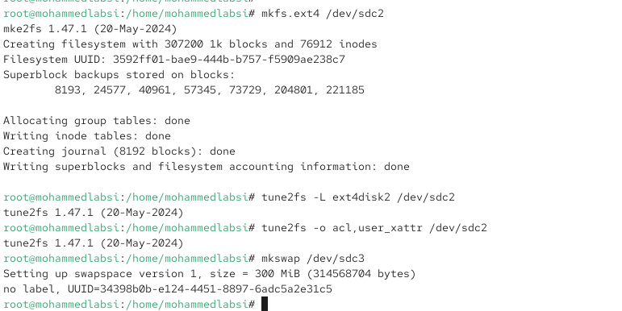{ #fig-022 width=70% }

Для настройки автоматического подключения открываю:

`nano /etc/fstab`

Добавляю запись для EXT4:

`UUID=3592ff01-bae9-444b-b757-f5909ae238c7 /mnt/data-ext ext4 defaults 1 2`

Для пространства подкачки добавляю:

`UUID=34398b0b-e124-4451-8897-6adc5a2e31c5 none swap defaults 0 0`

Первая запись обеспечивает автоматическое монтирование EXT4 в `/mnt/data-ext`, вторая — подключение дополнительной области подкачки (см. рис. [@fig-023]).

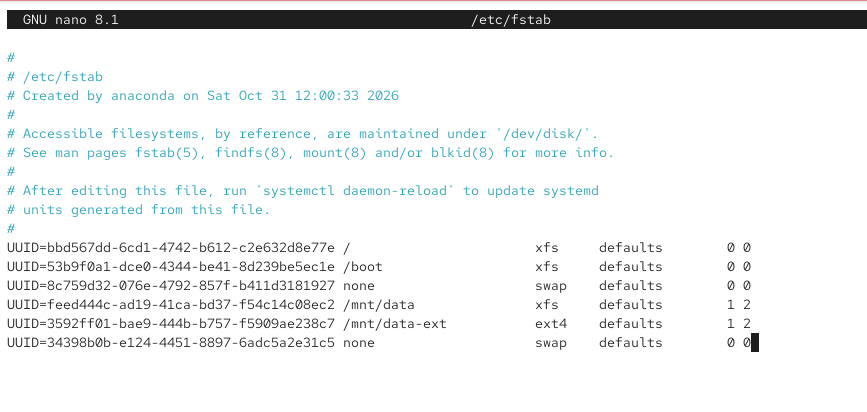{ #fig-023 width=70% }

После повторного входа в систему получаю права администратора:

`sudo -i`

Проверяю подключённые файловые системы:

`mount | grep mnt`

В результате отображаются XFS в `/mnt/data` и EXT4 в `/mnt/data-ext`.

Для проверки дискового пространства выполняю:

`df -h`

В выводе отображаются обе файловые системы: XFS размером 236 MiB и EXT4 размером 272 MiB.

Дополнительно проверяю пространство подкачки:

`free -m`

Общий объём Swap составляет 4339 MiB, использование — 0 MiB.

Проверка подтверждает корректное монтирование файловых систем и наличие активного пространства подкачки (см. рис. [@fig-024]).

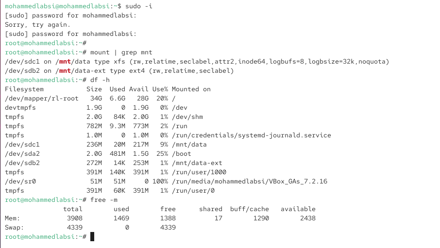{ #fig-024 width=70% }

## Контрольные вопросы

1. **Какой инструмент используется для создания разделов GUID?**

   Для создания разделов с таблицей GUID Partition Table (GPT) используется утилита:

   `gdisk`

   Она позволяет создавать, удалять и изменять разделы GPT, а также управлять их типами и размерами.

   Для запуска утилиты используется команда:

   `gdisk /dev/sdc`

   Для просмотра существующих разделов:

   `gdisk -l /dev/sdc`

2. **Какой инструмент применяется для создания разделов MBR?**

   Для создания разделов с таблицей Master Boot Record (MBR) используется утилита:

   `fdisk`

   Она позволяет создавать основные, расширенные и логические разделы, изменять их типы и сохранять таблицу разделов.

   Для запуска утилиты используется команда:

   `fdisk /dev/sdb`

   Для просмотра таблицы разделов:

   `fdisk -l /dev/sdb`

3. **Какой файл используется для автоматического монтирования разделов во время загрузки?**

   Для автоматического монтирования файловых систем при загрузке Linux используется файл:

   `/etc/fstab`

   В нём указываются устройства или их UUID, точки монтирования, типы файловых систем и параметры подключения.

   Для редактирования файла используется команда:

   `nano /etc/fstab`

   Пример записи:

   `UUID=feed444c-ad19-41ca-bd37-f54c14c08ec2 /mnt/data xfs defaults 0 0`

   Данная запись обеспечивает автоматическое монтирование файловой системы XFS в каталог `/mnt/data`.

4. **Какой вариант монтирования целесообразно выбрать, если необходимо, чтобы файловая система не была автоматически примонтирована во время загрузки?**

   Для отключения автоматического монтирования используется параметр:

   `noauto`

   Он указывается в файле `/etc/fstab` вместо параметра `auto` или `defaults`.

   Пример записи:

   `/dev/sdb5 /mnt/tmp ext4 noauto 0 0`

   В результате файловая система не будет автоматически монтироваться при загрузке операционной системы.

   Для её ручного подключения используется команда:

   `mount /mnt/tmp`

5. **Какая команда позволяет форматировать раздел с типом 82 с соответствующей файловой системой?**

   Раздел с кодом типа `82` в таблице MBR предназначен для пространства подкачки Linux (Linux swap).

   Для его инициализации используется команда:

   `mkswap /dev/sdb6`

   Она создаёт необходимые структуры области подкачки.

   Для активации раздела выполняется команда:

   `swapon /dev/sdb6`

   Проверить общий объём доступного пространства подкачки можно командой:

   `free -m`

6. **Вы только что добавили несколько разделов для автоматического монтирования при загрузке. Как можно безопасно проверить, будет ли это работать без реальной перезагрузки?**

   Для проверки корректности записей файла `/etc/fstab` используется команда:

   `mount -a`

   Она выполняет монтирование файловых систем, указанных в `/etc/fstab`, за исключением записей с параметром `noauto` и уже смонтированных разделов.

   Перед монтированием можно проверить конфигурацию командой:

   `findmnt --verify`

   Для просмотра результата используется:

   `df -h`

   Если разделы успешно подключены к указанным каталогам, конфигурация монтирования работает корректно.

   Для отдельной проверки активации пространства подкачки применяется команда:

   `swapon -a`

7. **Какая файловая система создаётся, если вы используете команду mkfs без какой-либо спецификации файловой системы?**

   При использовании команды `mkfs` без указания типа файловой системы по умолчанию в стандартной реализации util-linux создаётся файловая система:

   `ext2`

   Например:

   `mkfs /dev/sdb5`

   Для явного указания типа файловой системы используется параметр `-t`.

   Пример создания EXT4:

   `mkfs -t ext4 /dev/sdb5`

   Рекомендуется всегда указывать нужный тип файловой системы, чтобы избежать случайного форматирования в другом формате.

8. **Как форматировать раздел EXT4?**

   Для создания файловой системы EXT4 используется команда:

   `mkfs.ext4 /dev/sdb5`

   Она создаёт структуры файловой системы, включая суперблоки, таблицы inode и журнал.

   Для установки метки файловой системы можно использовать команду:

   `tune2fs -L ext4disk /dev/sdb5`

   Для настройки поддержки списков контроля доступа и расширенных атрибутов используется:

   `tune2fs -o acl,user_xattr /dev/sdb5`

   После выполнения форматирования раздел готов к монтированию и хранению данных.

9. **Как найти UUID для всех устройств на компьютере?**

   Для просмотра UUID блочных устройств используется команда:

   `blkid`

   Она отображает информацию о файловых системах, включая их уникальные идентификаторы, метки и типы.

   Для просмотра UUID конкретного раздела используется команда:

   `blkid /dev/sdb1`

   Дополнительно можно воспользоваться командой:

   `lsblk -f`

   Она отображает файловые системы, UUID и точки монтирования в удобном табличном виде.

   UUID используется для надёжной идентификации файловых систем, в частности при настройке автоматического монтирования через `/etc/fstab`.

# Заключение

В ходе лабораторной работы изучены способы создания и управления разделами MBR и GPT с помощью утилит `fdisk` и `gdisk`.

Созданы основные, расширенный и логические разделы, выполнено форматирование файловых систем XFS и EXT4, настроена область подкачки.

Освоены операции ручного монтирования и автоматического подключения файловых систем через `/etc/fstab` с использованием UUID.

Итоговая проверка подтвердила успешное монтирование разделов и доступность пространства подкачки.

# Список литературы

1. [Linux man-pages. fdisk(8) — руководство по использованию утилиты fdisk для создания и управления разделами MBR, изменения типов разделов и просмотра таблиц разделов](https://man7.org/linux/man-pages/man8/fdisk.8.html).

2. [GPT fdisk. gdisk Documentation — документация по созданию и редактированию разделов GPT, управлению GUID, типами разделов и сохранению таблиц разделов](https://www.rodsbooks.com/gdisk/gdisk.html).

3. [Red Hat. Managing File Systems — официальное руководство по созданию, форматированию и администрированию файловых систем XFS и EXT4 в Linux](https://docs.redhat.com/en/documentation/red_hat_enterprise_linux/9/html-single/managing_file_systems/index).

4. [Linux man-pages. mount(8) — руководство по ручному монтированию файловых систем, настройке параметров подключения и проверке смонтированных разделов](https://man7.org/linux/man-pages/man8/mount.8.html).

5. [Linux man-pages. fstab(5) — описание конфигурационного файла /etc/fstab, использования UUID и настройки автоматического монтирования файловых систем при загрузке Linux](https://man7.org/linux/man-pages/man5/fstab.5.html).

6. [Linux man-pages. mkswap(8) — руководство по созданию и инициализации пространства подкачки Linux swap, настройке разделов подкачки и их подготовке к использованию](https://man7.org/linux/man-pages/man8/mkswap.8.html).
